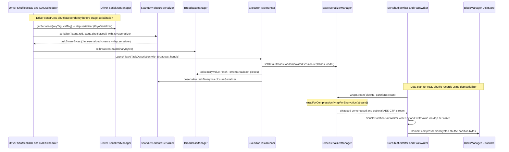

# SerializerManager: data serialization, Kryo codecs, and stream wrapping

[component index](README.md)

`SerializerManager` is **not** a network service, does **not** serialize Spark task closures (which always use the separate `SparkEnv.closureSerializer`), and does **not** serialize Catalyst SQL `UnsafeRow` shuffles via Kryo auto-pick. It is a per-JVM codec coordinator inside both the [driver](spark-driver.md) and each [executor](executor.md) [`SparkEnv`](spark-env.md) that selects data serializers (`JavaSerializer` or `KryoSerializer`) for RDD shuffles, serialized [RDD cache](rdd-cache.md) blocks, and [broadcast](broadcast-manager.md) payloads, and composes stream compression (LZ4/zstd), optional AES-CTR I/O encryption, and plaintext checksumming. It applies to Scala, Java, and PySpark JVMs alike (while PySpark worker sockets separately frame Python pickle or Arrow batches across the JVM-Python boundary).

## Flow at a glance

1. **Per-JVM split in `SparkEnv`**: `SparkEnv.create` builds `SerializerManager` around the configured data serializer (`spark.serializer`), a separate internal `KryoSerializer`, a lazy `CompressionCodec`, and optional `ioEncryptionKey` -- completely separate from `SparkEnv.closureSerializer` (always `JavaSerializer`).
2. **Closure vs data boundary**: `DAGScheduler` serializes `(stage.rdd, stage.shuffleDep)` directly through `SparkEnv.closureSerializer` and broadcasts `taskBinaryBytes` via `BroadcastManager` (`LaunchTask` sends only the compact `Broadcast` handle). Executors bind their user `ClassLoader` onto `SerializerManager` before running tasks.
3. **Data serializer selection**: For RDD shuffles, `ShuffledRDD` asks `SerializerManager.getSerializer` (auto-picking Kryo via `canUseKryo` only for primitives, primitive arrays, and `String`), whereas SQL `ShuffleExchangeExec` explicitly instantiates `UnsafeRowSerializer`.
4. **Stream wrapping**: `SortShuffleWriter` passes `dep.serializer` into `ExternalSorter` and `ShufflePartitionPairsWriter`, which wraps the output stream with `SerializerManager.wrapStream` (compress plaintext first, encrypt ciphertext second) and writes key/value records.

> **Key distinction:** `SparkEnv.closureSerializer` is **always** `JavaSerializer`, regardless of `spark.serializer`. Configuring `KryoSerializer` accelerates RDD data, shuffle, and broadcast payload serialization through `SerializerManager`, never driver-to-executor task closure serialization.

> **Interactive explorer:** [Open in Spark Visualizer](https://nuthanreddy.github.io/spark-visualizer/#component=serializer-manager) to step through commands, wire payloads, language modes, category filters, and fault simulations on the live cluster canvas.

## Three distinct serialization paths in Spark

Confusion around serialization bugs almost always stems from conflating three separate code paths inside a Spark JVM:

| Path | Serializer used | Governed by `SerializerManager`? | Where configured and invoked |
|---|---|---|---|
| **Task closures (`taskBinary`)** | Always [`JavaSerializer`][env-ser] (`SparkEnv.closureSerializer`) | **No** (except `BroadcastManager` wrapping the resulting `Array[Byte]` broadcast pieces) | [`DAGScheduler.scala:3391-3411`][dag-closure] serializes `(stage.rdd, stage.shuffleDep)` or `(stage.rdd, stage.func)` after `SparkClosureCleaner` and broadcasts it via `sc.broadcast(taskBinaryBytes)`. [`ShuffleMapTask.runTask`][smt-decode] reads `taskBinary.value` and decodes with `SparkEnv.get.closureSerializer`. |
| **RDD shuffle, cache, and broadcast data** | `spark.serializer` (`JavaSerializer` default or [`KryoSerializer`][kryo-setup]), with `canUseKryo` fast path | **Yes** | [`SerializerManager.getSerializer`][sm-class] selects `kryoSerializer` if `canUseKryo` matches primitives, primitive arrays, or `String` only (`SerializerManager.scala:85-107`), else `defaultSerializer`. [`ShuffledRDD`][shuffled-rdd] -> [`SortShuffleWriter`][sort-writer] -> [`ShufflePartitionPairsWriter`][pairs-writer] streams via `writeKey`/`writeValue`. |
| **Catalyst SQL `ShuffleExchangeExec`** | Dedicated [`UnsafeRowSerializer`][sql-shuffle-ser] (`ShuffleExchangeExec.scala:220`) | Uses `SerializerManager.wrapStream` for compression/encryption, **not** Kryo/Java object ser/de | SQL exchanges explicitly pass `UnsafeRowSerializer` on `ShuffleDependency`, copying raw 8-byte-aligned Tungsten `UnsafeRow` bytes without generic Java/Kryo object reflection. |

### `canUseKryo` and `KryoSerializer` guards

- **`canUseKryo` scope ([`SerializerManager.scala:85-107`][sm-class]):** `canUseKryo(ct)` checks only `primitiveAndPrimitiveArrayClassTags` (`Boolean`, `Byte`, `Char`, `Double`, `Float`, `Int`, `Long`, `Null`, `Short`, and their wrapped array `ClassTag`s) plus `String`. It does **not** match `UnsafeRow` or user case classes.
- **Kryo pooling and class registration ([`KryoSerializer.scala:63-148`][kryo-setup]):** `KryoSerializer` maintains a soft-referenced `KryoPool` (`spark.kryo.pool=true` default). Setting `spark.kryo.registrationRequired=true` configures `kryo.setRegistrationRequired(true)`, causing Kryo 4.0.3 to throw `IllegalArgumentException("Class is not registered")` if any data class was omitted from `spark.kryo.classesToRegister` or a custom `KryoRegistrator`.
- **Bounded single-object buffer ([`KryoSerializer.scala:448-461`][kryo-overflow]):** `KryoSerializerInstance.serialize()` allocates a `KryoOutput(bufferSize, math.max(bufferSize, maxBufferSize))` bounded by `spark.kryoserializer.buffer.max` (`64m` default, must be `< 2048m`). When a single object -- such as an oversized `zeroValue` serialized on the driver in [`PairRDDFunctions.aggregateByKey`][pair-agg] -- overflows that buffer, `KryoSerializerInstance.serialize()` catches `KryoException` starting with `"Buffer overflow"` and throws `SparkException(errorClass = "KRYO_BUFFER_OVERFLOW")`.

## Closure dispatch vs executor data-stream pipeline

1. **Lazy compression codec and `ClassLoader` propagation.** `SerializerManager` declares `compressionCodec` as a `private lazy val` ([`SerializerManager.scala:78-80`][sm-class]) so user-defined codecs packaged in `--jars` are not instantiated before [`Executor.updateDependencies`][exec-cl] updates the URL classloader and calls `env.serializerManager.setDefaultClassLoader(...)` (`Executor.scala:412`), propagating it to the internal `kryoSerializer`.
2. **Stream layer ordering (`wrapStream`).** [`SerializerManager.wrapStream`][sm-wrap] calls `wrapForCompression(blockId, wrapForEncryption(out))`. Plaintext serialized bytes enter the compression codec first (`LZ4` default, gated per `BlockId` type by `spark.shuffle.compress`, `spark.rdd.compress`, `spark.broadcast.compress`, and `spark.shuffle.spill.compress`), and compressed bytes flow into `CryptoStreamUtils` AES-CTR encryption when `spark.io.encryption.enabled=true` provides `SecurityManager.ioEncryptionKey`. When block checksums are enabled, `wrapForChecksum` sits inside `wrapForCompression` above encryption so replicas produce identical plaintext fingerprints despite random IVs.
3. **Shuffle write path.** [`SortShuffleWriter.write`][sort-writer] hands `dep.serializer` to `ExternalSorter`; when emitting partitioned output, [`ShufflePartitionPairsWriter.open`][pairs-writer] wraps the partition stream via `serializerManager.wrapStream(blockId, ...)` and calls `serializerInstance.serializeStream(wrappedStream)` followed by `objOut.writeKey(key)` and `objOut.writeValue(value)`.

## Inputs, outputs, and state

| Boundary | Contract |
|---|---|
| Inputs | `SparkConf` serializer and codec flags (`spark.serializer`, `spark.kryo.registrationRequired`, `spark.kryo.classesToRegister`, `spark.kryo.registrator`, `spark.kryoserializer.buffer`, `spark.kryoserializer.buffer.max`, `spark.io.compression.codec`, `spark.shuffle.compress`, `spark.rdd.compress`, `spark.broadcast.compress`, `spark.shuffle.spill.compress`), optional `SecurityManager.ioEncryptionKey`, user `ClassLoader`, and `BlockId` / `ClassTag` arguments. |
| Owned state | Configured `defaultSerializer`, internal `kryoSerializer` (with soft-referenced `KryoPool`), lazy `CompressionCodec`, boolean per-block-type compression flags, and `encryptionKey: Option[Array[Byte]]`. |
| Outputs | Selected `Serializer` / `SerializerInstance` objects, compression/encryption/checksum wrapped `InputStream` and `OutputStream` pipelines for `ShuffleWriter`, `ShuffleReader`, `BlockManager`, and `TorrentBroadcast`, plus `KRYO_BUFFER_OVERFLOW` or Kryo registration errors on invalid data payloads. |

## Failure clues and diagnosis

- **`TaskNotSerializableException` / `NotSerializableException` on a driver lambda despite `spark.serializer=KryoSerializer`:** Expected, because task closures always use `SparkEnv.closureSerializer` (`JavaSerializer`, [`SparkEnv.scala:730-738`][env-ser]), never Kryo. Read the `SerializationDebugger` chain to locate the non-serializable outer reference captured by the closure.
- **`IllegalArgumentException: Class is not registered` on executor shuffle/cache write:** Raised by Kryo 4.0.3 when `spark.kryo.registrationRequired=true` hits an unregistered class on the `SerializerManager` data path. Register the missing class via `spark.kryo.classesToRegister` or a `KryoRegistrator`, or disable strict registration while profiling.
- **`SparkException` with error class `KRYO_BUFFER_OVERFLOW` citing `spark.kryoserializer.buffer.max`:** Caught at [`KryoSerializer.scala:448-461`][kryo-overflow] when a single serialized object exceeds the bounded buffer (default `64m`, e.g., a large collection passed as `zeroValue` to `aggregateByKey`). Raise `spark.kryoserializer.buffer.max` (strictly `< 2048m`) or replace large inline state with a broadcast variable or partitioned RDD.
- **`ClassNotFoundException` when loading a custom `CompressionCodec` or `KryoRegistrator`:** Indicates the JAR was not present on the executor `MutableURLClassLoader` before `SerializerManager` initialized the codec or `Kryo` pool. Ship the JAR via `--jars` or `sc.addJar` so `Executor.updateDependencies` updates the classloader.
- **High CPU in `JavaSerializer` despite DataFrame API usage:** DataFrame shuffles use `UnsafeRowSerializer` automatically, so heavy `JavaSerializer` frames indicate either an RDD fallback (`df.rdd`), an unregistered custom Scala object cached with `MEMORY_ONLY_SER`, or large closure objects serialized on the driver.

[env-ser]: https://github.com/apache/spark/blob/dada2a6db5d73b152d6ba16e4fe21406f86abfe3/core/src/main/scala/org/apache/spark/SparkEnv.scala#L730-L738
[sm-class]: https://github.com/apache/spark/blob/dada2a6db5d73b152d6ba16e4fe21406f86abfe3/core/src/main/scala/org/apache/spark/serializer/SerializerManager.scala#L37-L110
[sm-wrap]: https://github.com/apache/spark/blob/dada2a6db5d73b152d6ba16e4fe21406f86abfe3/core/src/main/scala/org/apache/spark/serializer/SerializerManager.scala#L111-L185
[kryo-setup]: https://github.com/apache/spark/blob/dada2a6db5d73b152d6ba16e4fe21406f86abfe3/core/src/main/scala/org/apache/spark/serializer/KryoSerializer.scala#L63-L148
[kryo-overflow]: https://github.com/apache/spark/blob/dada2a6db5d73b152d6ba16e4fe21406f86abfe3/core/src/main/scala/org/apache/spark/serializer/KryoSerializer.scala#L448-L465
[dag-closure]: https://github.com/apache/spark/blob/dada2a6db5d73b152d6ba16e4fe21406f86abfe3/core/src/main/scala/org/apache/spark/scheduler/DAGScheduler.scala#L3391-L3415
[smt-decode]: https://github.com/apache/spark/blob/dada2a6db5d73b152d6ba16e4fe21406f86abfe3/core/src/main/scala/org/apache/spark/scheduler/ShuffleMapTask.scala#L83-L98
[shuffled-rdd]: https://github.com/apache/spark/blob/dada2a6db5d73b152d6ba16e4fe21406f86abfe3/core/src/main/scala/org/apache/spark/rdd/ShuffledRDD.scala#L81-L91
[sort-writer]: https://github.com/apache/spark/blob/dada2a6db5d73b152d6ba16e4fe21406f86abfe3/core/src/main/scala/org/apache/spark/shuffle/sort/SortShuffleWriter.scala#L65-L90
[pairs-writer]: https://github.com/apache/spark/blob/dada2a6db5d73b152d6ba16e4fe21406f86abfe3/core/src/main/scala/org/apache/spark/shuffle/ShufflePartitionPairsWriter.scala#L55-L82
[sql-shuffle-ser]: https://github.com/apache/spark/blob/dada2a6db5d73b152d6ba16e4fe21406f86abfe3/sql/core/src/main/scala/org/apache/spark/sql/execution/exchange/ShuffleExchangeExec.scala#L218-L225
[pair-agg]: https://github.com/apache/spark/blob/dada2a6db5d73b152d6ba16e4fe21406f86abfe3/core/src/main/scala/org/apache/spark/rdd/PairRDDFunctions.scala#L155-L162
[exec-cl]: https://github.com/apache/spark/blob/dada2a6db5d73b152d6ba16e4fe21406f86abfe3/core/src/main/scala/org/apache/spark/executor/Executor.scala#L408-L414
