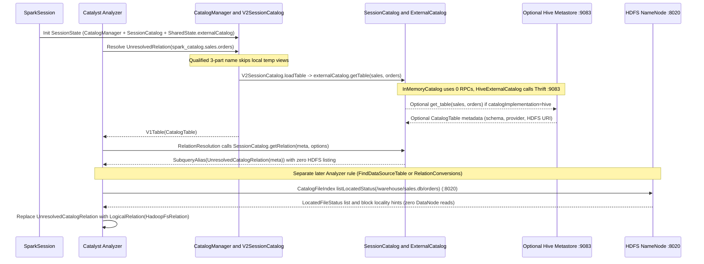

# SessionCatalog and CatalogManager: V1/V2 table and function resolution

[component index](README.md)

`SessionCatalog` and `CatalogManager` are **not** a Hive Metastore server, do **not** require a Hive Thrift daemon (`:9083`) to run Spark SQL, and do **not** list HDFS data files when resolving a V1 catalog table. Inside the [driver JVM](spark-driver.md), every [`SparkSession`](spark-session.md) owns a per-session `CatalogManager` and V1 `SessionCatalog` (local temp views, current database/namespace, and `FunctionRegistry`) backed by `SharedState.externalCatalog` -- which defaults to `InMemoryCatalog` with **zero external metastore RPCs** unless `enableHiveSupport()` configures `HiveExternalCatalog`. PySpark, Scala, and Java SQL/DataFrame queries all pass through this exact driver-side Catalyst Analyzer metadata layer.

## Flow at a glance

1. **Session vs shared scope**: `SparkSession.sessionState` binds per-session `CatalogManager` and `SessionCatalog` (local `tempViews`, `currentNamespace`, UDF `FunctionRegistry`), sharing `SharedState.externalCatalog` (`InMemoryCatalog` by default, or `HiveExternalCatalog` on Thrift `:9083` when Hive is enabled) and `GlobalTempViewManager`.
2. **Qualified 3-part routing**: A qualified 3-part identifier such as `spark_catalog.sales.orders` **skips local temp views** and routes straight to `CatalogManager.catalog("spark_catalog")` (`V2SessionCatalog`). Only unqualified 1-part names check session `tempViews` first, and `global_temp.<name>` resolves global temp views.
3. **Catalog metadata load without file listing**: `V2SessionCatalog.loadTable` returns `V1Table(catalogTable)` from `externalCatalog.getTable`; `RelationResolution` then calls `SessionCatalog.getRelation(meta)` (not `lookupRelation`), producing `SubqueryAlias(..., UnresolvedCatalogRelation(meta))` without listing HDFS.
4. **Decoupled HDFS file listing**: In a later Catalyst Analyzer rule (`FindDataSourceTable` or Hive `RelationConversions`), Spark replaces `UnresolvedCatalogRelation` with `LogicalRelation(HadoopFsRelation(...))`, issuing [HDFS NameNode](hdfs-namenode.md) (`:8020`) `listLocatedStatus` metadata RPCs (zero DataNode reads) to build `InMemoryFileIndex`/`CatalogFileIndex`.

> **Key distinction:** Default `InMemoryCatalog` resolves databases, tables, and temp views purely inside the driver JVM with zero external metastore RPCs (`HiveExternalCatalog` `:9083` is opt-in via `enableHiveSupport()`), and V1 catalog lookup (`V2SessionCatalog.loadTable` -> `SessionCatalog.getRelation`) returns `UnresolvedCatalogRelation` metadata only -- HDFS file listing happens later in `FindDataSourceTable` / `RelationConversions`.

> **Interactive explorer:** [Open in Spark Visualizer](https://nuthanreddy.github.io/spark-visualizer/#component=session-catalog) to step through commands, wire payloads, language modes, category filters, and fault simulations on the live cluster canvas.

## Identifier resolution rules and catalog backends

`SharedState.externalCatalogClassName` ([`SharedState.scala:221-228`][shared-state]) selects the persistent V1 backing store from `spark.sql.catalogImplementation` (`"in-memory"` default -> `InMemoryCatalog`; `"hive"` -> `HiveExternalCatalog`). On top of it, [`CatalogManager`][cat-mgr] routes multi-part names across V2 catalog plugins (`spark.sql.catalog.<name>`) and the built-in `"spark_catalog"` (`V2SessionCatalog`).

| Identifier form | Resolution path in Catalyst Analyzer | Local temp-view check? | Output logical node |
|---|---|---|---|
| Unqualified 1-part (`orders`) | Checks session `SessionCatalog.tempViews` first; on miss, resolves against `CatalogManager.currentCatalog` + `currentNamespace`. | **Yes** | Temp view `SubqueryAlias(plan)` if found, else persistent catalog node |
| Global temp (`global_temp.orders`) | Matches `spark.sql.globalTempDatabase` (`global_temp`) in `GlobalTempViewManager` ([`SessionCatalog.lookupRelation`][sc-lookup]). | Global temp only | `SubqueryAlias(table, "global_temp", plan)` |
| Qualified 3-part on `spark_catalog` (`spark_catalog.sales.orders`) | Bypasses local temp views -> `CatalogManager.catalog("spark_catalog")` -> [`V2SessionCatalog.loadTable`][v2sc-load] -> `V1Table` -> [`RelationResolution.createRelation`][rel-res] calls `v1SessionCatalog.getRelation(v1Table, options)`. | **No** (3-part skips local temp views) | `SubqueryAlias(Seq("spark_catalog", "sales", "orders"), UnresolvedCatalogRelation(metadata, options))` |
| Qualified custom V2 catalog (`iceberg.sales.orders`) | `CatalogManager.catalog("iceberg")` loads `TableCatalog` plugin -> `loadTable(ident)` -> `Table`. | **No** | `DataSourceV2Relation` (no `UnresolvedCatalogRelation` / `FindDataSourceTable` pass) |

### Why `RelationResolution` calls `SessionCatalog.getRelation` (not `lookupRelation`)

In [`RelationResolution.scala:428-459`][rel-res], once `V2SessionCatalog.loadTable(ident)` returns `V1Table(v1Table)` (already fetched from `externalCatalog.getTable("sales", "orders")`), `createDataSourceV1Scan` invokes [`v1SessionCatalog.getRelation(v1Table, options)`][sc-lookup] (`SessionCatalog.scala:1124-1145`) rather than re-running `lookupRelation`. `getRelation` builds the 3-part qualifier (`spark_catalog`, db, table) and wraps the `CatalogTable` metadata in `SubqueryAlias(multiParts, UnresolvedCatalogRelation(metadata, options))` (or expands views / metric views). Separating this step from [`FindDataSourceTable`][find-ds] (`DataSourceStrategy.scala:240-375`) and Hive [`RelationConversions`][hive-conv] (`HiveStrategies.scala:212-250`) keeps catalog metadata lookup cleanly decoupled from HDFS directory listing and partition pruning.

## Qualified 3-part resolution and decoupled HDFS file-index flow

1. **Optional Hive Metastore client ([`HiveExternalCatalog.scala:60-95`][hive-cat]).** When `spark.sql.catalogImplementation=hive`, `HiveExternalCatalog` lazily initializes `HiveClient` (`HiveUtils.newClientForMetadata`) and synchronizes metadata calls through `withClient`, wrapping Thrift/Hive exceptions in `AnalysisException`. When `in-memory` is active (the default), `InMemoryCatalog` serves `getTable` from an in-JVM map with zero network calls.
2. **Table creation validation ([`SessionCatalog.createTable`][sc-create]).** On DDL writes, `SessionCatalog.createTable` (`SessionCatalog.scala:569-610`) requires external tables to specify a location URI, qualifies relative paths against the warehouse directory, checks that managed table locations are non-existent or empty (`validateTableLocation`), and persists metadata to `externalCatalog.createTable`.
3. **HDFS metadata listing during relation conversion.** Only after `SessionCatalog.getRelation` produces `UnresolvedCatalogRelation` does `FindDataSourceTable` (or `RelationConversions` for convertible Hive Parquet/ORC tables) construct `InMemoryFileIndex` / `CatalogFileIndex` and query NameNode `:8020` for file statuses and block locations, replacing `UnresolvedCatalogRelation` with a typed `LogicalRelation(HadoopFsRelation)` ready for the Catalyst Optimizer ([`sql-planner.md`](sql-planner.md)).

## Inputs, outputs, and state

| Boundary | Contract |
|---|---|
| Inputs | `UnresolvedRelation`, `UnresolvedTable`, and `UnresolvedFunction` AST nodes from Catalyst parser/DataFrame API; `spark.sql.catalogImplementation` (`in-memory` default or `hive`), `spark.sql.warehouse.dir`, `spark.sql.catalog.<name>` V2 plugin configs, `spark.sql.defaultCatalog`, and `spark.sql.globalTempDatabase`. |
| Owned state | Per-session `CatalogManager` (`currentCatalog`, `currentNamespace`, lazy `catalogs` plugin cache); per-session `SessionCatalog` (`tempViews`, `currentDb`, `functionRegistry`); shared `SharedState.externalCatalog` (`InMemoryCatalog` or `HiveExternalCatalog` Thrift client) and `GlobalTempViewManager`. |
| Outputs | `SubqueryAlias(UnresolvedCatalogRelation)` from `SessionCatalog.getRelation` (later converted into `LogicalRelation(HadoopFsRelation)`), `DataSourceV2Relation` for V2 catalogs, temp-view `LogicalPlan`s, resolved `Expression` builders from `FunctionRegistry`, and optional Hive Thrift `:9083` RPCs. |

## Failure clues and diagnosis

- **`TABLE_OR_VIEW_NOT_FOUND` when querying an existing Hive table:** The session was built without `.enableHiveSupport()`, leaving `spark.sql.catalogImplementation=in-memory` (`InMemoryCatalog`, 0 Thrift RPCs). Enable Hive support and confirm `hive-site.xml` is on the driver classpath.
- **Query ignores a local temp view created with `df.createOrReplaceTempView("orders")`:** Inspect the SQL table reference. A qualified 3-part name like `spark_catalog.sales.orders` (or 2-part `sales.orders`) bypasses local `tempViews` and goes directly to the persistent catalog; reference unqualified `orders` to hit the local temp view.
- **`FileNotFoundException` or missing newly added partitions on a V1 table after external writes:** `InMemoryFileIndex` / catalog metadata caches file listings created during `FindDataSourceTable`. Run `REFRESH TABLE spark_catalog.sales.orders` (or `MSCK REPAIR TABLE` for Hive-partitioned tables) to invalidate cached file statuses and sync partitions.
- **Slow query analysis before any Spark job/stage starts:** Check whether `HiveExternalCatalog` Thrift `:9083` metadata calls (large partition counts) or `FindDataSourceTable` NameNode `:8020` `listStatus` scans across thousands of directories are stalling Catalyst analysis on the driver.
- **Managed `CREATE TABLE` fails with non-empty location error:** [`SessionCatalog.validateTableLocation`][sc-create] rejects creating a managed table over an existing non-empty directory; use `EXTERNAL` (with explicit `LOCATION`) or clear the target directory first.

[shared-state]: https://github.com/apache/spark/blob/dada2a6db5d73b152d6ba16e4fe21406f86abfe3/sql/core/src/main/scala/org/apache/spark/sql/internal/SharedState.scala#L221-L229
[cat-mgr]: https://github.com/apache/spark/blob/dada2a6db5d73b152d6ba16e4fe21406f86abfe3/sql/catalyst/src/main/scala/org/apache/spark/sql/connector/catalog/CatalogManager.scala#L130-L170
[v2sc-load]: https://github.com/apache/spark/blob/dada2a6db5d73b152d6ba16e4fe21406f86abfe3/sql/core/src/main/scala/org/apache/spark/sql/execution/datasources/v2/V2SessionCatalog.scala#L89-L126
[rel-res]: https://github.com/apache/spark/blob/dada2a6db5d73b152d6ba16e4fe21406f86abfe3/sql/catalyst/src/main/scala/org/apache/spark/sql/catalyst/analysis/RelationResolution.scala#L428-L459
[sc-create]: https://github.com/apache/spark/blob/dada2a6db5d73b152d6ba16e4fe21406f86abfe3/sql/catalyst/src/main/scala/org/apache/spark/sql/catalyst/catalog/SessionCatalog.scala#L569-L610
[sc-lookup]: https://github.com/apache/spark/blob/dada2a6db5d73b152d6ba16e4fe21406f86abfe3/sql/catalyst/src/main/scala/org/apache/spark/sql/catalyst/catalog/SessionCatalog.scala#L1107-L1145
[hive-cat]: https://github.com/apache/spark/blob/dada2a6db5d73b152d6ba16e4fe21406f86abfe3/sql/hive/src/main/scala/org/apache/spark/sql/hive/HiveExternalCatalog.scala#L60-L95
[find-ds]: https://github.com/apache/spark/blob/dada2a6db5d73b152d6ba16e4fe21406f86abfe3/sql/core/src/main/scala/org/apache/spark/sql/execution/datasources/DataSourceStrategy.scala#L240-L375
[hive-conv]: https://github.com/apache/spark/blob/dada2a6db5d73b152d6ba16e4fe21406f86abfe3/sql/hive/src/main/scala/org/apache/spark/sql/hive/HiveStrategies.scala#L212-L250
