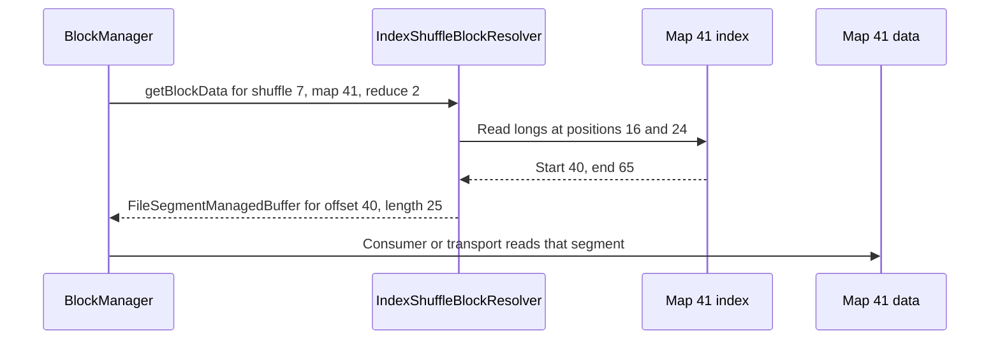

# Shuffle block resolver: from a block ID to a byte range

[component index](README.md) | [Shuffle writer](shuffle-writer.md) | [Shuffle reader](shuffle-reader.md)

`IndexShuffleBlockResolver` implements the default sort-shuffle file format on the executor. On write, it commits the index and data for **one map output**. On read, it answers “which bytes in this map's file belong to reducer `r`?” It does not decide which map attempt won, discover a remote host, deserialize rows, or open a listening port.

## Flow at a glance

1. **Block manager**: Requests reducer 2's block from shuffle 7, map attempt 41.
2. **Block resolver**: Reads offsets 40 and 65 from attempt 41's index.
3. **File segment**: Points the caller to 25 bytes starting at offset 40 in the data file.

> **Key distinction:** The tracker reports an estimated size for this block. The on-disk index, not that estimate, supplies its exact start and end.

> **Interactive explorer:** [Open in Spark Visualizer](https://nuthanreddy.github.io/spark-visualizer/#component=shuffle-block-resolver) to step through commands, wire payloads, category filters, and fault simulations on the live cluster canvas.

## The disk layout, with one worked lookup

Suppose input map partition **3** of shuffle **7** ran as task attempt **41**. Its exact stored lengths, in reduce ID order, are `[40, 0, 25]` bytes. The logical block `shuffle_7_41_2` is **not** a filename:

| File | Contents for this example |
| --- | --- |
| `shuffle_7_41_0.data` | 65 bytes. Reducer 0 occupies `[0, 40)`, reducer 1 is empty, and reducer 2 occupies `[40, 65)`. |
| `shuffle_7_41_0.index` | Four big-endian 64-bit offsets: `[0, 40, 40, 65]`. The final offset is the end of the data. For `R` reducers the index is `8 * (R + 1)` bytes. |
| Optional checksum sidecar | A checksum per reduce block when supplied, for corruption diagnosis; not needed to locate the bytes. Its [name includes the algorithm][checksum]. |

The `_0` in both permanent filenames is a [placeholder reduce ID][names], not an assertion that the file contains only reducer 0. The physical `mapId` is 41, not array slot 3 (these can coincide under the old fetch protocol). The resolver asks `DiskBlockManager` for each filename; the [hash-based placement][hash] means the index and data need not be in the same subdirectory. For host-local reads it can [resolve using explicit executor directories][dirs].

## Commit before publish

1. `SortShuffleManager` [creates a resolver][create] for serving blocks and tracks map IDs it wrote per shuffle. The default `LocalDiskShuffleExecutorComponents` [creates its own resolver for the disk writers][write-resolver]. These are separate objects in this revision; they agree on a **file format and directory mapping**, not an in-memory map of every block's offsets.
2. A [local disk output writer][commit-input] supplies `(shuffleId, mapId, exact partition lengths, optional checksums, temporary data file)` to `writeMetadataFileAndCommit`. Inside a synchronized section, the resolver [checks an existing index/data pair][check]. If usable for that same file identity, it copies the existing lengths back to the caller and discards the duplicate temporary output. This is not the driver's selection between different attempt IDs.
3. Otherwise it prefix-sums lengths starting at zero, writes the index through a temporary file, and renames staged data into place if present. Index/data commit errors propagate; writing the optional checksum after a successful data/index commit is best effort. The [commit code][commit] serializes competing writers on the resolver; it is **not** one filesystem transaction across files. A completely empty map can commit a zero-offset index without a data file. Only after commit does the writer return a status to advertise.

On a [local or executor-served fetch][block-manager], `getBlockData` uses the requested reduce ID and its successor (or the two endpoints of a `ShuffleBlockBatchId`). It [seeks to `8 * start` and `8 * end`][read], closes the index channel, and returns a file-segment descriptor. Length is `endOffset - startOffset`; the compressed estimate from `MapStatus` is **not** an input. When the optional [external shuffle service](external-shuffle-service.md) serves a remote request, **its Java resolver** reads the same format; it need not call the executor or keep that JVM alive.

## Removal, failures, and diagnosis

`SortShuffleManager.unregisterShuffle` [iterates its recorded map IDs][cleanup] and asks `removeDataByMap` to [delete data, index, and configured checksum files][delete]. Manager shutdown also calls [`resolver.stop()`][stop], which is a no-op here; do not equate it with removing each shuffle. The resolver neither retries a lost file on another node nor recomputes a partition. Read or transfer failure is reported by the [reader](shuffle-reader.md); the driver decides what to rerun.

**Diagnostic:** Given an error for `shuffle_7_41_2`, use the producing executor's local directories and search for the two `_0` filenames, not `_2.data` or a file named after map index 3. For this example the index should be **32 bytes**, its last offset **65**, and its two entries for reducer 2 **40 and 65**. A missing index prevents lookup even if data still exists. Equal offsets denote an empty partition, not a missing file. Preserve live files when inspecting them.

[names]: https://github.com/apache/spark/blob/dada2a6db5d73b152d6ba16e4fe21406f86abfe3/core/src/main/scala/org/apache/spark/shuffle/IndexShuffleBlockResolver.scala#L46-L57
[hash]: https://github.com/apache/spark/blob/dada2a6db5d73b152d6ba16e4fe21406f86abfe3/core/src/main/scala/org/apache/spark/storage/DiskBlockManager.scala#L92-L128
[dirs]: https://github.com/apache/spark/blob/dada2a6db5d73b152d6ba16e4fe21406f86abfe3/core/src/main/scala/org/apache/spark/shuffle/IndexShuffleBlockResolver.scala#L126-L155
[checksum]: https://github.com/apache/spark/blob/dada2a6db5d73b152d6ba16e4fe21406f86abfe3/core/src/main/scala/org/apache/spark/shuffle/IndexShuffleBlockResolver.scala#L602-L613
[create]: https://github.com/apache/spark/blob/dada2a6db5d73b152d6ba16e4fe21406f86abfe3/core/src/main/scala/org/apache/spark/shuffle/sort/SortShuffleManager.scala#L73-L86
[write-resolver]: https://github.com/apache/spark/blob/dada2a6db5d73b152d6ba16e4fe21406f86abfe3/core/src/main/java/org/apache/spark/shuffle/sort/io/LocalDiskShuffleExecutorComponents.java#L55-L88
[commit-input]: https://github.com/apache/spark/blob/dada2a6db5d73b152d6ba16e4fe21406f86abfe3/core/src/main/java/org/apache/spark/shuffle/sort/io/LocalDiskShuffleMapOutputWriter.java#L101-L129
[check]: https://github.com/apache/spark/blob/dada2a6db5d73b152d6ba16e4fe21406f86abfe3/core/src/main/scala/org/apache/spark/shuffle/IndexShuffleBlockResolver.scala#L213-L251
[commit]: https://github.com/apache/spark/blob/dada2a6db5d73b152d6ba16e4fe21406f86abfe3/core/src/main/scala/org/apache/spark/shuffle/IndexShuffleBlockResolver.scala#L391-L461
[block-manager]: https://github.com/apache/spark/blob/dada2a6db5d73b152d6ba16e4fe21406f86abfe3/core/src/main/scala/org/apache/spark/storage/BlockManager.scala#L883-L905
[read]: https://github.com/apache/spark/blob/dada2a6db5d73b152d6ba16e4fe21406f86abfe3/core/src/main/scala/org/apache/spark/shuffle/IndexShuffleBlockResolver.scala#L615-L658
[cleanup]: https://github.com/apache/spark/blob/dada2a6db5d73b152d6ba16e4fe21406f86abfe3/core/src/main/scala/org/apache/spark/shuffle/sort/SortShuffleManager.scala#L179-L194
[delete]: https://github.com/apache/spark/blob/dada2a6db5d73b152d6ba16e4fe21406f86abfe3/core/src/main/scala/org/apache/spark/shuffle/IndexShuffleBlockResolver.scala#L187-L207
[stop]: https://github.com/apache/spark/blob/dada2a6db5d73b152d6ba16e4fe21406f86abfe3/core/src/main/scala/org/apache/spark/shuffle/IndexShuffleBlockResolver.scala#L668-L675
