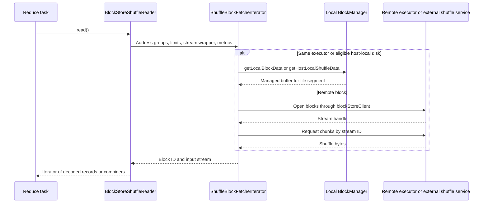

# Shuffle reader: from block locations to records

[component index](README.md) | [Tracker worker](map-output-tracker-worker.md) | [Block resolver](shuffle-block-resolver.md)

`BlockStoreShuffleReader` runs in the consuming executor JVM. A task asks for **reduce partitions across map outputs**, not all of a particular executor's files. The reader turns the block list into an interruptible iterator of key/value pairs or combiners. Neither the driver nor the YARN ResourceManager relays these bytes.

## Flow at a glance

1. **Shuffle manager**: Gives the reader block IDs and addresses for reduce partition 2.
2. **Block fetcher**: Reads local blocks from disk or requests remote blocks from their servers.
3. **Shuffle reader**: Decodes the bytes and yields records to the reduce task.

> **Key distinction:** Reducer 2 needs only its slice from each map output. For attempt 41 that's `shuffle_7_41_2`, not the whole data file.

> **Interactive explorer:** [Open in Spark Visualizer](https://nuthanreddy.github.io/spark-visualizer/#component=shuffle-reader) to step through commands, wire payloads, category filters, and fault simulations on the live cluster canvas.

## Who creates it, and what it receives

For the RDD API, [`ShuffledRDD.compute`][rdd] passes `[split.index, split.index + 1)` and a task metrics reporter to `getReader`. That [overload][range] requests all map indices. SQL's [`ShuffledRowRDD.compute`][sql] can instead request several adjacent reducers, or just a range of map indices for one reducer; it consumes the value of each returned pair as an `InternalRow`.

For an ordinary blocking shuffle, [`SortShuffleManager.getReader`][manager] first calls the tracker worker's `getMapSizesByExecutorId`. It then creates a reader with the dependency's handle, task context, metrics, and an iterator grouped by serving address. A tuple for shuffle 7 might be `(ShuffleBlockId(7, 41, 2), estimatedBytes, 3)`: read reducer **2** of physical map output **41**; **3** is the upstream logical map index for failure reporting. Obtaining this tuple transfers **metadata**, not the requested block.

## How `read()` obtains bytes

1. The [fetch iterator initializes][init] by separating local, host-local and remote work. A block on this executor uses `getLocalBlockData`. Another executor on this host can use a direct disk read when host-local reading is enabled and directory information can be obtained. A [directory lookup][host-local] is metadata I/O; the block bytes then come from local disk. Other blocks go to `BlockStoreClient.fetchBlocks(host, port, execId, blockIds, listener, ...)`.
2. Remote fetch is asynchronous. The iterator randomizes queued requests, tracks estimated bytes and requests in flight plus blocks per address, and [defers requests when limits are reached][limits]. A first request may exceed the byte budget so a single large block can make progress. Above the [fetch-to-memory threshold][send], the client streams a request to temporary disk rather than buffering it all in memory. A successful callback retains the buffer and enqueues it; the task thread [takes the next result][take]. Arrival order is not a key ordering.
3. The [reader][read] wraps streams for configured compression/encryption, uses the dependency serializer's `asKeyValueIterator`, and counts records. If there is key ordering, an external sorter sorts and may also aggregate. Without ordering, it merges **combiners** (partial aggregate values) when the map side already combined, combines **values** when only the reduce side aggregates, or passes the records through if there is no aggregator. Fetching several reducers does not automatically enable batch fetch: [serializer, codec, protocol and encryption checks][batch] still apply.

## Lifetime, retry, and diagnosis

There is no reader daemon or explicit `stop` call for the task to manage. Iterator exhaustion [runs the completion callback][complete]; the fetcher also registers a task-completion listener, covering cancellation and failure. [Cleanup][cleanup] marks the fetcher inactive, releases buffers, and deletes its registered download files. The producer's committed files are not reader scratch files.

The transport can [retry outstanding blocks after eligible I/O failures][retry] without rerunning a map task. If a block still fails, the iterator [throws a fetch failure with address, shuffle ID, map ID, map index and reduce ID][failure]. The [driver can then resubmit stages][resubmit] and recompute missing outputs, subject to its retry policy. Failure to obtain the initial location list is a different path: see the [tracker worker](map-output-tracker-worker.md).

**Diagnostic:** Start with the reducer's `Getting ... non-empty blocks` [log breakdown][locality] and its shuffle-read metrics. A task with mostly host-local blocks is not primarily reading over the network. High fetch wait alongside high remote bytes points to the producing host or transfer path; high spill after records arrive points instead to reduce-side aggregation or ordering. A failed address using the configured shuffle-service port points to the [NodeManager auxiliary service](external-shuffle-service.md), not the driver RPC endpoint.

[rdd]: https://github.com/apache/spark/blob/dada2a6db5d73b152d6ba16e4fe21406f86abfe3/core/src/main/scala/org/apache/spark/rdd/ShuffledRDD.scala#L105-L112
[range]: https://github.com/apache/spark/blob/dada2a6db5d73b152d6ba16e4fe21406f86abfe3/core/src/main/scala/org/apache/spark/shuffle/ShuffleManager.scala#L66-L89
[sql]: https://github.com/apache/spark/blob/dada2a6db5d73b152d6ba16e4fe21406f86abfe3/sql/core/src/main/scala/org/apache/spark/sql/execution/ShuffledRowRDD.scala#L210-L254
[manager]: https://github.com/apache/spark/blob/dada2a6db5d73b152d6ba16e4fe21406f86abfe3/core/src/main/scala/org/apache/spark/shuffle/sort/SortShuffleManager.scala#L120-L142
[init]: https://github.com/apache/spark/blob/dada2a6db5d73b152d6ba16e4fe21406f86abfe3/core/src/main/scala/org/apache/spark/storage/ShuffleBlockFetcherIterator.scala#L711-L744
[host-local]: https://github.com/apache/spark/blob/dada2a6db5d73b152d6ba16e4fe21406f86abfe3/core/src/main/scala/org/apache/spark/storage/ShuffleBlockFetcherIterator.scala#L612-L675
[limits]: https://github.com/apache/spark/blob/dada2a6db5d73b152d6ba16e4fe21406f86abfe3/core/src/main/scala/org/apache/spark/storage/ShuffleBlockFetcherIterator.scala#L1192-L1248
[send]: https://github.com/apache/spark/blob/dada2a6db5d73b152d6ba16e4fe21406f86abfe3/core/src/main/scala/org/apache/spark/storage/ShuffleBlockFetcherIterator.scala#L375-L385
[take]: https://github.com/apache/spark/blob/dada2a6db5d73b152d6ba16e4fe21406f86abfe3/core/src/main/scala/org/apache/spark/storage/ShuffleBlockFetcherIterator.scala#L808-L844
[read]: https://github.com/apache/spark/blob/dada2a6db5d73b152d6ba16e4fe21406f86abfe3/core/src/main/scala/org/apache/spark/shuffle/BlockStoreShuffleReader.scala#L72-L157
[batch]: https://github.com/apache/spark/blob/dada2a6db5d73b152d6ba16e4fe21406f86abfe3/core/src/main/scala/org/apache/spark/shuffle/BlockStoreShuffleReader.scala#L46-L68
[complete]: https://github.com/apache/spark/blob/dada2a6db5d73b152d6ba16e4fe21406f86abfe3/core/src/main/scala/org/apache/spark/storage/ShuffleBlockFetcherIterator.scala#L1177-L1180
[cleanup]: https://github.com/apache/spark/blob/dada2a6db5d73b152d6ba16e4fe21406f86abfe3/core/src/main/scala/org/apache/spark/storage/ShuffleBlockFetcherIterator.scala#L234-L261
[retry]: https://github.com/apache/spark/blob/dada2a6db5d73b152d6ba16e4fe21406f86abfe3/common/network-shuffle/src/main/java/org/apache/spark/network/shuffle/RetryingBlockTransferor.java#L205-L256
[failure]: https://github.com/apache/spark/blob/dada2a6db5d73b152d6ba16e4fe21406f86abfe3/core/src/main/scala/org/apache/spark/storage/ShuffleBlockFetcherIterator.scala#L1250-L1263
[resubmit]: https://github.com/apache/spark/blob/dada2a6db5d73b152d6ba16e4fe21406f86abfe3/core/src/main/scala/org/apache/spark/scheduler/DAGScheduler.scala#L4281-L4317
[locality]: https://github.com/apache/spark/blob/dada2a6db5d73b152d6ba16e4fe21406f86abfe3/core/src/main/scala/org/apache/spark/storage/ShuffleBlockFetcherIterator.scala#L422-L471
