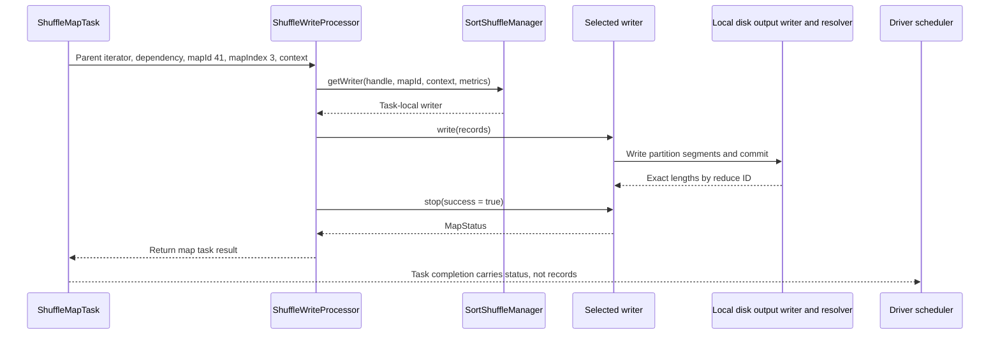

# Shuffle writer: one map attempt, many reduce partitions

[component index](README.md) | [Shuffle block resolver](shuffle-block-resolver.md) | [MapOutputTrackerMaster](map-output-tracker-master.md)

A shuffle writer runs inside the **map task's executor JVM**. It consumes one input partition, groups its records by destination reduce partition, and commits files that later tasks can pull. It returns a `MapStatus` to the task, not a stream of rows to the driver. The sort-shuffle manager does **not** imply that every writer sorts keys.

## Flow at a glance

1. **Partitioner**: Picks a reduce partition for each record from map partition 3.
2. **Shuffle writer**: Commits attempt 41's output to local disk in reduce-partition order.
3. **Map task**: Reports the serving address and block size estimates to the driver.

> **Key distinction:** The 25 bytes for reducer 2 are together on disk. This layout groups records by partition; it does not require sorting by key.

Show the animated flow

## How Spark chooses the writer

On the driver, [`ShuffleDependency` registers with its shuffle manager][handle] and holds the resulting handle. `SortShuffleManager` tests the following cases **in order**. On the executor, [`getWriter(handle, mapId, context, metrics)`][factory] constructs the corresponding writer for this attempt.

| Handle / executor writer | Selection rule | What happens to records |
| --- | --- | --- |
| `BypassMergeSortShuffleHandle` / `BypassMergeSortShuffleWriter` | No map-side combine and number of reduce partitions **at most** `spark.shuffle.sort.bypassMergeThreshold` (default 200). | Dispatch by `partitioner.getPartition(key)` to per-partition temporary writers; copy their segments into the final output in partition order. No key sort. Empty input commits zero lengths without opening all those writers. |
| `SerializedShuffleHandle` / `UnsafeShuffleWriter` | Bypass did not apply, the serializer supports relocation, no map-side combine, and at most `2^24` reduce partitions. | Serialize each pair once into the sorter with its partition ID; sort record pointers by partition and spill as needed. One suitable spill can become the output directly; multiple spills are merged by partition. |
| `BaseShuffleHandle` / `SortShuffleWriter` | Otherwise. | `ExternalSorter` buffers objects and can spill. With map-side combine it uses the dependency's aggregator, partitioner and optional key ordering. Without combine it passes no key ordering: the map only needs records grouped by partition. |

See the [selection order][select], [bypass predicate][bypass-rule], [threshold default][threshold], and [serialized-mode restrictions][unsafe-rule]. The three implementations differ in scratch space and CPU cost, but expose the same block and status contract.

## One attempt, from records to a published location

1. [`ShuffleMapTask.runTask`][task] obtains the parent RDD iterator for **one input partition**. It passes both `partitionId` (the logical map index) and `mapId` (normally `context.taskAttemptId()`, or `partitionId` under the old fetch protocol). A replacement for map index 3 can therefore produce file ID 58 instead of 41.
2. The [write processor][processor] obtains a writer and metrics reporter. The selected writer consumes `(key, value)` pairs; the **partitioner**, not the input partition index, chooses a reduce ID for each record. For a DataFrame's [SQL shuffle exchange][sql], the key already holds the computed destination partition ID and a passthrough partitioner preserves it. Intermediate state belongs to this attempt: [temporary partition writers][bypass], [serialized pages and spills][unsafe], or an [object sorter][sort].
3. With default local disk storage the merged output holds each reduce partition's serialized bytes contiguously. The [disk writer][commit] commits the exact length vector and optional checksums through the resolver; the [single-spill writer][single] reaches the same commit path. For shuffle 7, attempt 41, lengths `[40, 0, 25]` mean reducer 2 has 25 bytes and reducer 1 has no block to fetch.
4. The writer creates `MapStatus(blockManager.shuffleServerId, partitionLengths, mapId, ...)`. The [status encoding][status] preserves emptiness but can approximate sizes. An optional aggregate row checksum in the status compares **attempts**; per-block checksums on disk diagnose **corrupted bytes**. The [scheduler registers the result][report] under logical input slot 3. The shuffle bytes remain on the producing node, even if the advertised port belongs to its external shuffle service.

## Failure and diagnosis

On a write exception the processor [calls `stop(false)` if it obtained a writer and rethrows][failure]; it does not return a successful status for that attempt. Each implementation owns its scratch cleanup: for example, `SortShuffleWriter.stop` stops its sorter, and the bypass writer [aborts its output on write failure][abort]. A still-needed failed map task can be [requeued by `TaskSetManager` within its failure limit][retry]. Stopping a **successful** writer does not delete the committed files: reducers may not have started yet.

**Diagnostic:** For a slow producer, compare map-task [shuffle bytes/records written and write time][metrics] with [memory and disk bytes spilled][spill]. Large spill with modest final output points to sorter or merge work worth investigating; a bypass writer uses temporary partition files instead. For a commit failure, start with the map attempt and its local-disk exception. A downstream reduce fetch timeout describes a different operation.

[handle]: https://github.com/apache/spark/blob/dada2a6db5d73b152d6ba16e4fe21406f86abfe3/core/src/main/scala/org/apache/spark/Dependency.scala#L129-L141
[select]: https://github.com/apache/spark/blob/dada2a6db5d73b152d6ba16e4fe21406f86abfe3/core/src/main/scala/org/apache/spark/shuffle/sort/SortShuffleManager.scala#L91-L111
[factory]: https://github.com/apache/spark/blob/dada2a6db5d73b152d6ba16e4fe21406f86abfe3/core/src/main/scala/org/apache/spark/shuffle/sort/SortShuffleManager.scala#L146-L177
[bypass-rule]: https://github.com/apache/spark/blob/dada2a6db5d73b152d6ba16e4fe21406f86abfe3/core/src/main/scala/org/apache/spark/shuffle/sort/SortShuffleWriter.scala#L118-L127
[threshold]: https://github.com/apache/spark/blob/dada2a6db5d73b152d6ba16e4fe21406f86abfe3/core/src/main/scala/org/apache/spark/internal/config/package.scala#L1863-L1869
[unsafe-rule]: https://github.com/apache/spark/blob/dada2a6db5d73b152d6ba16e4fe21406f86abfe3/core/src/main/scala/org/apache/spark/shuffle/sort/SortShuffleManager.scala#L224-L245
[task]: https://github.com/apache/spark/blob/dada2a6db5d73b152d6ba16e4fe21406f86abfe3/core/src/main/scala/org/apache/spark/scheduler/ShuffleMapTask.scala#L82-L113
[processor]: https://github.com/apache/spark/blob/dada2a6db5d73b152d6ba16e4fe21406f86abfe3/core/src/main/scala/org/apache/spark/shuffle/ShuffleWriteProcessor.scala#L30-L61
[sql]: https://github.com/apache/spark/blob/dada2a6db5d73b152d6ba16e4fe21406f86abfe3/sql/core/src/main/scala/org/apache/spark/sql/execution/exchange/ShuffleExchangeExec.scala#L567-L586
[bypass]: https://github.com/apache/spark/blob/dada2a6db5d73b152d6ba16e4fe21406f86abfe3/core/src/main/java/org/apache/spark/shuffle/sort/BypassMergeSortShuffleWriter.java#L148-L201
[abort]: https://github.com/apache/spark/blob/dada2a6db5d73b152d6ba16e4fe21406f86abfe3/core/src/main/java/org/apache/spark/shuffle/sort/BypassMergeSortShuffleWriter.java#L197-L211
[unsafe]: https://github.com/apache/spark/blob/dada2a6db5d73b152d6ba16e4fe21406f86abfe3/core/src/main/java/org/apache/spark/shuffle/sort/UnsafeShuffleWriter.java#L233-L310
[sort]: https://github.com/apache/spark/blob/dada2a6db5d73b152d6ba16e4fe21406f86abfe3/core/src/main/scala/org/apache/spark/shuffle/sort/SortShuffleWriter.scala#L64-L111
[commit]: https://github.com/apache/spark/blob/dada2a6db5d73b152d6ba16e4fe21406f86abfe3/core/src/main/java/org/apache/spark/shuffle/sort/io/LocalDiskShuffleMapOutputWriter.java#L83-L122
[single]: https://github.com/apache/spark/blob/dada2a6db5d73b152d6ba16e4fe21406f86abfe3/core/src/main/java/org/apache/spark/shuffle/sort/io/LocalDiskSingleSpillMapOutputWriter.java#L45-L56
[status]: https://github.com/apache/spark/blob/dada2a6db5d73b152d6ba16e4fe21406f86abfe3/core/src/main/scala/org/apache/spark/scheduler/MapStatus.scala#L49-L91
[report]: https://github.com/apache/spark/blob/dada2a6db5d73b152d6ba16e4fe21406f86abfe3/core/src/main/scala/org/apache/spark/scheduler/DAGScheduler.scala#L4094-L4116
[failure]: https://github.com/apache/spark/blob/dada2a6db5d73b152d6ba16e4fe21406f86abfe3/core/src/main/scala/org/apache/spark/shuffle/ShuffleWriteProcessor.scala#L117-L129
[retry]: https://github.com/apache/spark/blob/dada2a6db5d73b152d6ba16e4fe21406f86abfe3/core/src/main/scala/org/apache/spark/scheduler/TaskSetManager.scala#L1139-L1163
[metrics]: https://github.com/apache/spark/blob/dada2a6db5d73b152d6ba16e4fe21406f86abfe3/core/src/main/scala/org/apache/spark/executor/ShuffleWriteMetrics.scala#L35-L49
[spill]: https://github.com/apache/spark/blob/dada2a6db5d73b152d6ba16e4fe21406f86abfe3/core/src/main/scala/org/apache/spark/util/collection/ExternalSorter.scala#L768-L785
