# SparkContext: the application and job-submission boundary

[component index](README.md)

`sc = spark.sparkContext` refers to the application, not a SQL namespace or an executor.
In classic PySpark, Python `SparkContext` holds `_jsc`, a [Py4J](py4j-gateway.md) handle
to [`JavaSparkContext`][java], which wraps the Scala `SparkContext`. The Scala object
owns the scheduler backend, task and DAG schedulers, listener bus, and driver [SparkEnv](spark-env.md).
[One active context per driver JVM][singleton] is the normal invariant; multiple
[SparkSessions](spark-session.md) can share it. The JVM is the YARN AM in cluster mode
and the submit-side JVM in client mode. No context is shipped to executors or
[exposed to a remote Spark Connect client][py-guards].

## Flow at a glance

1. **RDD action**: Calls runJob with a function and selected partitions.
2. **SparkContext**: Cleans the closure and hands the job to the DAG scheduler.
3. **Result handler**: Receives one result per requested partition.

> **Watch for:** Read `sc.defaultParallelism` on the driver and capture the integer in a task function, not `sc`.

> **Interactive explorer:** [Open in Spark Visualizer](https://nuthanreddy.github.io/spark-visualizer/#component=spark-context) to step through commands, wire payloads, category filters, and fault simulations on the live cluster canvas.

## Construction: from `SparkConf` to a usable application

1. **Acquire a context.** The session builder or user calls Python [`getOrCreate(conf)`][py-reuse].
   Under a lock it returns the current context or constructs one. The constructor
   [attaches to the gateway][py-init], combines `SparkConf` with direct options,
   [checks `spark.master` and `spark.app.name`][py-conf], and calls `JavaSparkContext(jconf)`.
   That Java constructor creates the Scala context. Explicitly constructing a second
   Python context is rejected rather than starting a second application.
2. **Build driver services.** The JVM [marks the context as under construction][guard],
   [clones and validates its configuration][validate], and sets its driver host/port.
   It wires the status listener **before** creating the environment, so early events are
   captured, then [publishes `SparkEnv` and binds the optional UI][env-ui]. It registers
   the [heartbeat endpoint before scheduler construction][wiring] because an executor
   looks it up during startup.
3. **Start scheduling.** With master `yarn`, the external cluster manager [chooses a
   scheduler/backend pair by deploy mode][yarn]. The context constructs `DAGScheduler`,
   starts the task scheduler, obtains application/attempt IDs, and [initializes the driver
   block manager with the application ID][start]. [Client mode][client-start] submits
   the YARN application during backend start; [cluster mode][cluster-start] signals the
   existing AM in `postStartHook`. The JVM [publishes the active context][publish] after
   successful construction; an [initialization exception triggers cleanup][post].

## Job interface: what an action hands off

| Caller and input | What `SparkContext` does | Observable output |
|---|---|---|
| Core action calls `runJob(rdd: RDD[T], func: (TaskContext, Iterator[T]) => U, partitions: Seq[Int], resultHandler: (Int, U) => Unit)` | Reject a stopped context, capture the call site, clean the closure, and pass these plus the submitting thread's local properties to `DAGScheduler.runJob` | Per-result callbacks; this overload returns `Unit` when complete. The overload without a handler builds an `Array[U]` sized to the requested partitions. A failed job can throw to the caller. |
| Python `sc.stop()`, including through `spark.stop()` | Stop the Java/Scala context; JVM uses an atomic guard, posts application end, stops the schedulers and environment, and clears its active reference. Python clears `_jsc` and the active Python context. | `None` in Python. Old RDDs/session handles do not become valid against a future context. Orderly JVM exit also has a shutdown hook. |

`SparkContext` is the entry to the job; the [`runJob` handoff][job] delegates stage
boundaries to the [DAGScheduler](dag-scheduler.md). For shutdown, compare the [JVM stop
guard][stop], [service and active-reference cleanup][clear], and [Python stop][py-stop].

## Diagnostic: a task function captures `sc`

`sc.parallelize([1]).map(lambda _: sc.defaultParallelism).collect()` captures the live
application context in a Python task closure. The driver [serializes that closure][pickle]
before running it; [`SparkContext.__getnewargs__`][no-pickle] deliberately raises
`CONTEXT_ONLY_VALID_ON_DRIVER` (often seen inside a serialization error). Read
`sc.defaultParallelism` **on the driver** first and capture the resulting integer instead.
This is not a shortage of executor cores or a failed YARN registration.

[py-guards]: https://github.com/apache/spark/blob/dada2a6db5d73b152d6ba16e4fe21406f86abfe3/python/pyspark/core/context.py#L184-L204
[java]: https://github.com/apache/spark/blob/dada2a6db5d73b152d6ba16e4fe21406f86abfe3/core/src/main/scala/org/apache/spark/api/java/JavaSparkContext.scala#L48-L60
[singleton]: https://github.com/apache/spark/blob/dada2a6db5d73b152d6ba16e4fe21406f86abfe3/core/src/main/scala/org/apache/spark/SparkContext.scala#L3416-L3438
[py-reuse]: https://github.com/apache/spark/blob/dada2a6db5d73b152d6ba16e4fe21406f86abfe3/python/pyspark/core/context.py#L517-L543
[py-conf]: https://github.com/apache/spark/blob/dada2a6db5d73b152d6ba16e4fe21406f86abfe3/python/pyspark/core/context.py#L239-L302
[py-init]: https://github.com/apache/spark/blob/dada2a6db5d73b152d6ba16e4fe21406f86abfe3/python/pyspark/core/context.py#L442-L488
[guard]: https://github.com/apache/spark/blob/dada2a6db5d73b152d6ba16e4fe21406f86abfe3/core/src/main/scala/org/apache/spark/SparkContext.scala#L88-L109
[validate]: https://github.com/apache/spark/blob/dada2a6db5d73b152d6ba16e4fe21406f86abfe3/core/src/main/scala/org/apache/spark/SparkContext.scala#L432-L450
[env-ui]: https://github.com/apache/spark/blob/dada2a6db5d73b152d6ba16e4fe21406f86abfe3/core/src/main/scala/org/apache/spark/SparkContext.scala#L503-L573
[wiring]: https://github.com/apache/spark/blob/dada2a6db5d73b152d6ba16e4fe21406f86abfe3/core/src/main/scala/org/apache/spark/SparkContext.scala#L633-L655
[yarn]: https://github.com/apache/spark/blob/dada2a6db5d73b152d6ba16e4fe21406f86abfe3/resource-managers/yarn/src/main/scala/org/apache/spark/scheduler/cluster/YarnClusterManager.scala#L26-L56
[start]: https://github.com/apache/spark/blob/dada2a6db5d73b152d6ba16e4fe21406f86abfe3/core/src/main/scala/org/apache/spark/SparkContext.scala#L676-L704
[client-start]: https://github.com/apache/spark/blob/dada2a6db5d73b152d6ba16e4fe21406f86abfe3/resource-managers/yarn/src/main/scala/org/apache/spark/scheduler/cluster/YarnClientSchedulerBackend.scala#L49-L73
[cluster-start]: https://github.com/apache/spark/blob/dada2a6db5d73b152d6ba16e4fe21406f86abfe3/resource-managers/yarn/src/main/scala/org/apache/spark/scheduler/cluster/YarnClusterScheduler.scala#L27-L36
[post]: https://github.com/apache/spark/blob/dada2a6db5d73b152d6ba16e4fe21406f86abfe3/core/src/main/scala/org/apache/spark/SparkContext.scala#L757-L800
[publish]: https://github.com/apache/spark/blob/dada2a6db5d73b152d6ba16e4fe21406f86abfe3/core/src/main/scala/org/apache/spark/SparkContext.scala#L3336-L3341
[job]: https://github.com/apache/spark/blob/dada2a6db5d73b152d6ba16e4fe21406f86abfe3/core/src/main/scala/org/apache/spark/SparkContext.scala#L2784-L2831
[stop]: https://github.com/apache/spark/blob/dada2a6db5d73b152d6ba16e4fe21406f86abfe3/core/src/main/scala/org/apache/spark/SparkContext.scala#L2621-L2672
[clear]: https://github.com/apache/spark/blob/dada2a6db5d73b152d6ba16e4fe21406f86abfe3/core/src/main/scala/org/apache/spark/SparkContext.scala#L2714-L2731
[py-stop]: https://github.com/apache/spark/blob/dada2a6db5d73b152d6ba16e4fe21406f86abfe3/python/pyspark/core/context.py#L694-L717
[pickle]: https://github.com/apache/spark/blob/dada2a6db5d73b152d6ba16e4fe21406f86abfe3/python/pyspark/core/rdd.py#L5106-L5136
[no-pickle]: https://github.com/apache/spark/blob/dada2a6db5d73b152d6ba16e4fe21406f86abfe3/python/pyspark/core/context.py#L490-L495
