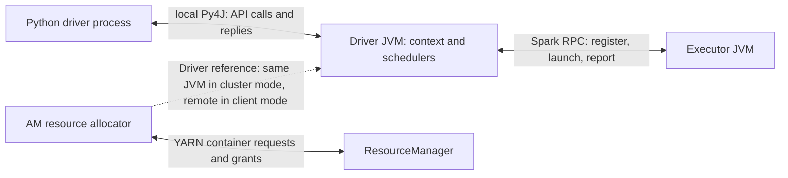

# Spark driver JVM: where application decisions are made

[component index](README.md)

In a classic PySpark application, `orders.py` runs in a [Python process](python-driver.md).
The **driver JVM** holds the live [SparkContext](spark-context.md), SQL plans, schedulers,
and executor registrations. "Driver" names a process role, not a class to instantiate.
The JVM schedules Spark tasks; YARN grants containers, and executors run the tasks.
This is not a Spark Connect client/server deployment.

## Flow at a glance

1. **Executor**: Registers with the driver and signals it is ready.
2. **Driver JVM**: Sends a task to the executor over Spark RPC.
3. **Driver backend**: Frees the task's cores on its final status update.

> **Key distinction:** YARN grants the container; the driver decides which tasks its executor runs.

Show the animated flow

## Placement: which process must stay alive?

| YARN deploy mode | JVM that owns the driver | How the AM finds it |
|---|---|---|
| Cluster | The AM JVM in the AM container. A thread in that JVM invokes `deploy.PythonRunner.main`; the script is a child **process** in the same container. The submit client is not the driver. | No network discovery is needed to obtain the context: the cluster scheduler hands the AM the actual `SparkContext` object. The AM uses its bound RPC address. |
| Client | The submit-side JVM on the client host. Its Python child also stays there. The AM in YARN is a separate JVM that launches executors, not a backup driver. | The driver backend passes `host:port` as an AM argument. The AM resolves the driver's `YarnScheduler` endpoint through Spark RPC. |

Follow the launch from SparkSubmit ([client][submit-client], [cluster][submit-cluster])
to [the AM user thread][user-thread], or follow the client-mode address from the
[submitting backend][client-submit] to the [separate AM][client-am].

## From startup to shutdown

1. **Publish the driver.** The [JVM launcher][launcher] starts the local
   [Py4J gateway](py4j-gateway.md) and the Python child. When the script requests a
   context, its JVM constructor installs the driver's [SparkEnv](spark-env.md) and
   [initializes the schedulers][context-init]. A running Python interpreter alone does
   not imply a ready driver.
2. **Coordinate with YARN.** In cluster mode [the scheduler hook][hook] calls
   `sparkContextInitialized(sc)`, which [completes a promise and waits][handoff].
   The [AM thread][am-start] obtains `sc.env.rpcEnv`, reads the actual host and port,
   registers with the ResourceManager, creates the allocator, and resumes the waiting
   call. In PySpark the `PythonRunner` thread is waiting for its child; the context
   constructor runs on the JVM side of the Py4J call. In client mode the already-listening
   driver instead submits and waits for the YARN application to run.
3. **Accept executors and dispatch work.** An executor sends
   `RegisterExecutor(id, executorRef, host, cores, ..., resourceProfileId)`. On
   [acceptance][register] the driver records the endpoint and resources and replies `true`;
   `LaunchedExecutor(id)` makes those cores available for offers. A distributed action
   drives the JVM schedulers. The [driver backend](driver-scheduler-backend.md)
   [encodes each chosen `TaskDescription` into `LaunchTask`][dispatch]. An incoming
   [`StatusUpdate`][status] goes to the task scheduler; a terminal update releases that
   task's resources. Neither message goes through Python or the ResourceManager.
4. **Finish two lifetimes.** `spark.stop()` [stops the context][stop]; it does not exit
   the Python script. The runner [waits for the child exit and closes its gateway][child-exit].
   In cluster mode the AM user thread translates a normal return or a `SparkUserAppException`
   into a finish request. Before AM registration, [`finish`][finish] records a
   context-initialization failure instead of preserving a user exit code.

## Diagnostic: no executor logs yet

If a cluster-mode script blocks **before** `getOrCreate()`, the AM can report
[`Timed out waiting for SparkContext.`][am-start] It started the user application but
has not reached allocator creation. Read the AM container's Python output and JVM logs,
not executor logs. [`spark.yarn.am.waitTime`][am-wait] bounds that wait; increasing it
only helps if the pre-context work will finish.

If the JVM itself dies, its in-memory context and scheduler state are lost. A
[YARN retry][attempts], when granted in cluster mode, starts a fresh AM/driver and
reruns the script; it does not resume the previous Python stack. A managed client-mode AM
[handles driver disconnect by finishing][disconnect], not by recreating the client driver.

[submit-client]: https://github.com/apache/spark/blob/dada2a6db5d73b152d6ba16e4fe21406f86abfe3/core/src/main/scala/org/apache/spark/deploy/SparkSubmit.scala#L568-L578
[submit-cluster]: https://github.com/apache/spark/blob/dada2a6db5d73b152d6ba16e4fe21406f86abfe3/core/src/main/scala/org/apache/spark/deploy/SparkSubmit.scala#L824-L842
[user-thread]: https://github.com/apache/spark/blob/dada2a6db5d73b152d6ba16e4fe21406f86abfe3/resource-managers/yarn/src/main/scala/org/apache/spark/deploy/yarn/ApplicationMaster.scala#L741-L799
[client-submit]: https://github.com/apache/spark/blob/dada2a6db5d73b152d6ba16e4fe21406f86abfe3/resource-managers/yarn/src/main/scala/org/apache/spark/scheduler/cluster/YarnClientSchedulerBackend.scala#L45-L73
[client-am]: https://github.com/apache/spark/blob/dada2a6db5d73b152d6ba16e4fe21406f86abfe3/resource-managers/yarn/src/main/scala/org/apache/spark/deploy/yarn/ApplicationMaster.scala#L564-L584
[launcher]: https://github.com/apache/spark/blob/dada2a6db5d73b152d6ba16e4fe21406f86abfe3/core/src/main/scala/org/apache/spark/deploy/PythonRunner.scala#L54-L85
[context-init]: https://github.com/apache/spark/blob/dada2a6db5d73b152d6ba16e4fe21406f86abfe3/core/src/main/scala/org/apache/spark/SparkContext.scala#L633-L682
[hook]: https://github.com/apache/spark/blob/dada2a6db5d73b152d6ba16e4fe21406f86abfe3/resource-managers/yarn/src/main/scala/org/apache/spark/scheduler/cluster/YarnClusterScheduler.scala#L27-L36
[handoff]: https://github.com/apache/spark/blob/dada2a6db5d73b152d6ba16e4fe21406f86abfe3/resource-managers/yarn/src/main/scala/org/apache/spark/deploy/yarn/ApplicationMaster.scala#L405-L419
[am-start]: https://github.com/apache/spark/blob/dada2a6db5d73b152d6ba16e4fe21406f86abfe3/resource-managers/yarn/src/main/scala/org/apache/spark/deploy/yarn/ApplicationMaster.scala#L496-L539
[register]: https://github.com/apache/spark/blob/dada2a6db5d73b152d6ba16e4fe21406f86abfe3/core/src/main/scala/org/apache/spark/scheduler/cluster/CoarseGrainedSchedulerBackend.scala#L247-L348
[dispatch]: https://github.com/apache/spark/blob/dada2a6db5d73b152d6ba16e4fe21406f86abfe3/core/src/main/scala/org/apache/spark/scheduler/cluster/CoarseGrainedSchedulerBackend.scala#L439-L485
[status]: https://github.com/apache/spark/blob/dada2a6db5d73b152d6ba16e4fe21406f86abfe3/core/src/main/scala/org/apache/spark/scheduler/cluster/CoarseGrainedSchedulerBackend.scala#L178-L196
[stop]: https://github.com/apache/spark/blob/dada2a6db5d73b152d6ba16e4fe21406f86abfe3/core/src/main/scala/org/apache/spark/SparkContext.scala#L2621-L2661
[child-exit]: https://github.com/apache/spark/blob/dada2a6db5d73b152d6ba16e4fe21406f86abfe3/core/src/main/scala/org/apache/spark/deploy/PythonRunner.scala#L119-L131
[finish]: https://github.com/apache/spark/blob/dada2a6db5d73b152d6ba16e4fe21406f86abfe3/resource-managers/yarn/src/main/scala/org/apache/spark/deploy/yarn/ApplicationMaster.scala#L377-L393
[am-wait]: https://github.com/apache/spark/blob/dada2a6db5d73b152d6ba16e4fe21406f86abfe3/resource-managers/yarn/src/main/scala/org/apache/spark/deploy/yarn/config/package.scala#L249-L260
[attempts]: https://github.com/apache/spark/blob/dada2a6db5d73b152d6ba16e4fe21406f86abfe3/resource-managers/yarn/src/main/scala/org/apache/spark/deploy/yarn/ApplicationMaster.scala#L225-L255
[disconnect]: https://github.com/apache/spark/blob/dada2a6db5d73b152d6ba16e4fe21406f86abfe3/resource-managers/yarn/src/main/scala/org/apache/spark/deploy/yarn/ApplicationMaster.scala#L878-L897
