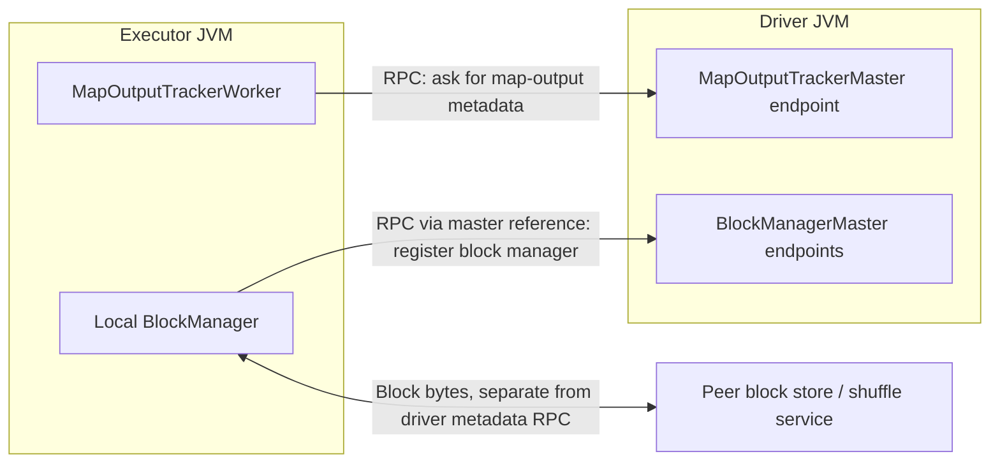

# SparkEnv: services local to one Spark JVM

[component index](README.md)

`SparkEnv` answers **"which RPC, storage, serialization, shuffle, and memory services
should code in this JVM use?"** A classic PySpark YARN application with three executor
JVMs has four [environments][fields] once initialized: one in the [driver JVM](spark-driver.md)
and one built independently in each executor. [`SparkEnv.get`][accessor] accesses the
local one. Neither the Python driver nor Python workers get their own `SparkEnv`.
It is not an OS environment-variable map, a [SQL session](spark-session.md), or the
[SparkContext](spark-context.md) that starts the application.

## Flow at a glance

1. **Driver SparkEnv**: Registers the endpoint for shuffle map locations.
2. **Executor tracker**: Gets shuffle locations from the driver on a cache miss.
3. **Shuffle reader**: Reads the needed blocks from those locations.

> **Watch for:** If the executor cannot reach the tracker, check the advertised driver host and RPC port, not the Py4J port.

Show the animated flow

## Who creates it, and with what?

| Caller | Factory input | Result and placement |
|---|---|---|
| Driver [`SparkContext.createSparkEnv`][driver-call] | `SparkConf`, `isLocal`, `LiveListenerBus`, usable driver cores; bind address, advertised host and requested port from configuration | `createDriverEnv` returns a `SparkEnv` with executor ID `driver`; the context [installs it with `SparkEnv.set`][install]. In cluster mode it lives in the AM JVM, in client mode on the submit host. |
| [`CoarseGrainedExecutorBackend`][executor-call] | Driver-derived `SparkConf`, executor ID, bind address, advertised hostname, assigned cores, optional I/O encryption key, `isLocal=false` | `createExecutorEnv` returns and publishes that executor's environment. A [temporary `driverPropsFetcher` RPC client][bootstrap] retrieves application configuration and shuts down **before** the environment is built. |

Compare the [two factory signatures][factories]. The [client-mode AM][am] has an RPC
environment for talking to the driver, not a second **driver** `SparkEnv`.

## Assembly, use, and shutdown

1. **Establish identity and transport.** The [common factory][factory] branches on
   executor ID. The driver requires a listener bus. Both sides construct a `SecurityManager`
   and an [`RpcEnv`](rpc-env.md); the driver writes the **actual bound port** back to
   `spark.driver.port`. The factory creates the configured data serializer,
   `SerializerManager`, and a separate `JavaSerializer` for closures. These are JVM
   serializers, not the Python pickler.
2. **Register here or look up there.** [`registerOrLookupEndpoint(name, creator)`][tracker]
   returns an `RpcEndpointRef`. On the driver it evaluates `creator` and registers the
   endpoint. On an executor it [resolves that name at the advertised driver address][lookup].
   Thus `MapOutputTrackerMaster` owns shuffle metadata, while a `MapOutputTrackerWorker`
   can request it. [Block-manager master endpoints][blocks] use the same pattern; each
   process still has its **own** `BlockManager` and block transfer service.
   [`OutputCommitCoordinator`][coordinator] also gets a reference to a driver endpoint.
3. **Finish initialization at the right time.** Constructing a `BlockManager` does not
   register it yet. The driver [initializes shuffle and memory managers][driver-managers]
   before scheduling, then [registers the block manager][driver-block] once it has an
   application ID. On an executor the factory initializes its memory manager; executor
   startup [initializes the block manager][executor-block] and later [loads shuffle managers
   with the executor user classpath][executor-shuffle].
4. **Tear down once.** [Driver context stop][driver-stop] and [non-local executor
   stop][executor-stop] each close their own environment. A [synchronized flag][stop]
   prevents duplicate teardown; worker factories and trackers, shuffle/broadcast/block
   services, metrics, and the commit coordinator stop before RPC shutdown and termination.
   A clean driver context stop also clears the JVM's `SparkEnv` reference.

## Diagnostic: loopback works, cluster RPC does not

Suppose a client-mode driver advertises `spark.driver.host=localhost`. Its Python process
can use the local [Py4J gateway](py4j-gateway.md) and the JVM may successfully bind a port.
But `localhost` in an AM on **another** node denotes that node, not the submit host.
The AM will look for the driver there; executor bootstrap, if reached, also needs the
real driver address. Compare `spark.driver.bindAddress` (local interface) with
`spark.driver.host` (advertised peer address) and the **bound** RPC port.
Supply an address reachable from the YARN nodes, not the Py4J port or the UI port.

[fields]: https://github.com/apache/spark/blob/dada2a6db5d73b152d6ba16e4fe21406f86abfe3/core/src/main/scala/org/apache/spark/SparkEnv.scala#L60-L87
[accessor]: https://github.com/apache/spark/blob/dada2a6db5d73b152d6ba16e4fe21406f86abfe3/core/src/main/scala/org/apache/spark/SparkEnv.scala#L613-L622
[driver-call]: https://github.com/apache/spark/blob/dada2a6db5d73b152d6ba16e4fe21406f86abfe3/core/src/main/scala/org/apache/spark/SparkContext.scala#L307-L313
[install]: https://github.com/apache/spark/blob/dada2a6db5d73b152d6ba16e4fe21406f86abfe3/core/src/main/scala/org/apache/spark/SparkContext.scala#L534-L545
[factories]: https://github.com/apache/spark/blob/dada2a6db5d73b152d6ba16e4fe21406f86abfe3/core/src/main/scala/org/apache/spark/SparkEnv.scala#L627-L683
[bootstrap]: https://github.com/apache/spark/blob/dada2a6db5d73b152d6ba16e4fe21406f86abfe3/core/src/main/scala/org/apache/spark/executor/CoarseGrainedExecutorBackend.scala#L439-L470
[executor-call]: https://github.com/apache/spark/blob/dada2a6db5d73b152d6ba16e4fe21406f86abfe3/core/src/main/scala/org/apache/spark/executor/CoarseGrainedExecutorBackend.scala#L511-L515
[am]: https://github.com/apache/spark/blob/dada2a6db5d73b152d6ba16e4fe21406f86abfe3/resource-managers/yarn/src/main/scala/org/apache/spark/deploy/yarn/ApplicationMaster.scala#L564-L584
[factory]: https://github.com/apache/spark/blob/dada2a6db5d73b152d6ba16e4fe21406f86abfe3/core/src/main/scala/org/apache/spark/SparkEnv.scala#L699-L745
[tracker]: https://github.com/apache/spark/blob/dada2a6db5d73b152d6ba16e4fe21406f86abfe3/core/src/main/scala/org/apache/spark/SparkEnv.scala#L736-L759
[lookup]: https://github.com/apache/spark/blob/dada2a6db5d73b152d6ba16e4fe21406f86abfe3/core/src/main/scala/org/apache/spark/util/RpcUtils.scala#L27-L35
[blocks]: https://github.com/apache/spark/blob/dada2a6db5d73b152d6ba16e4fe21406f86abfe3/core/src/main/scala/org/apache/spark/SparkEnv.scala#L781-L824
[coordinator]: https://github.com/apache/spark/blob/dada2a6db5d73b152d6ba16e4fe21406f86abfe3/core/src/main/scala/org/apache/spark/SparkEnv.scala#L840-L861
[driver-managers]: https://github.com/apache/spark/blob/dada2a6db5d73b152d6ba16e4fe21406f86abfe3/core/src/main/scala/org/apache/spark/SparkContext.scala#L633-L653
[driver-block]: https://github.com/apache/spark/blob/dada2a6db5d73b152d6ba16e4fe21406f86abfe3/core/src/main/scala/org/apache/spark/SparkContext.scala#L678-L703
[executor-block]: https://github.com/apache/spark/blob/dada2a6db5d73b152d6ba16e4fe21406f86abfe3/core/src/main/scala/org/apache/spark/executor/Executor.scala#L335-L341
[executor-shuffle]: https://github.com/apache/spark/blob/dada2a6db5d73b152d6ba16e4fe21406f86abfe3/core/src/main/scala/org/apache/spark/executor/Executor.scala#L520-L535
[stop]: https://github.com/apache/spark/blob/dada2a6db5d73b152d6ba16e4fe21406f86abfe3/core/src/main/scala/org/apache/spark/SparkEnv.scala#L283-L324
[driver-stop]: https://github.com/apache/spark/blob/dada2a6db5d73b152d6ba16e4fe21406f86abfe3/core/src/main/scala/org/apache/spark/SparkContext.scala#L2714-L2729
[executor-stop]: https://github.com/apache/spark/blob/dada2a6db5d73b152d6ba16e4fe21406f86abfe3/core/src/main/scala/org/apache/spark/executor/Executor.scala#L678-L688
