# SparkSession: SQL state and the query entry point

[component index](README.md)

`spark` in a classic PySpark script is a Python `SparkSession` with a [Py4J](py4j-gateway.md)
handle, `_jsparkSession`, to [`org.apache.spark.sql.classic.SparkSession`][binding].
It answers **"under which SQL settings, catalog, and functions should this query run?"**
The [SparkContext](spark-context.md) owns the application and scheduling; [SparkEnv](spark-env.md)
holds services in each JVM. Creating another session need not create either of those.
Both session objects stay on the driver side: in the AM container in YARN cluster mode,
or on the submit host in client mode. This is not a Connect session.

## Flow at a glance

1. **First session**: Registers a local temporary view named paid_orders.
2. **Sibling session**: Shares the SparkContext, not the local views.
3. **Name lookup**: Cannot resolve that local view in the sibling session.

> **Watch for:** Stopping either session stops their shared SparkContext, even though their local views are separate.



> **Interactive explorer:** [Open in Spark Visualizer](https://nuthanreddy.github.io/spark-visualizer/#component=spark-session) to step through commands, wire payloads, category filters, and fault simulations on the live cluster canvas.

## Creation and state ownership

1. The Python builder collects key/value options. If no live session exists,
   [classic `getOrCreate()`][builder] converts the options to a `SparkConf`, asks
   `SparkContext.getOrCreate(conf)` for a context, then constructs a session wrapper.
   If a Python session is already live, it returns that session after [applying modifiable
   settings][modifiable]. It does not restart the context to change its master or driver memory.
2. The [wrapper][binding] reuses a non-stopped default JVM session when available, otherwise
   constructs one from `self._jsc.sc()` and the options. When installing the first live
   Python session it sets the JVM default and active sessions. The JVM distinguishes
   [a thread's active session from the process-wide default][active].
3. [`newSession()`][new-py] returns another wrapper with the same `SparkContext` and a
   new JVM session. Its [constructor][new-jvm] receives `Some(sharedState)` but **no
   parent `SessionState`**. The division below makes both isolation and reuse possible.

| State | What lives there | What a sibling session sees |
|---|---|---|
| [`SessionState`][services] and [session `SQLConf`][states] | Runtime settings, local temporary views, registered UDFs, parser/analyzer/optimizer/planner | Independent settings and local namespace; a local view is not automatically visible |
| `SharedState` | [SQL table cache][shared-cache], [external catalog and global temporary view manager][shared-catalog] | Same cache and shared catalog infrastructure; a global temp view can be addressed through its global-temp database |
| `SparkContext` | One application ID, executor pool, schedulers | Same running Spark application, not a second YARN allocation |

## One call: SQL text to a result

For `df = spark.sql("SELECT * FROM orders WHERE amount > :floor", {"floor": 10})`,
[Python][sql-py] converts named values to Java literal columns and calls `_jsparkSession.sql`.
The [JVM parser][sql-jvm] works with this session active, converting the SQL and
named parameters to a `LogicalPlan`. [`Dataset.ofRows`][dataset] binds it to a
`QueryExecution`. The output is a Python DataFrame backed by a JVM `Dataset[Row]`,
**not** the matching rows. Analysis may already reject the query at this point.

For a `SELECT`, an action such as `df.count()` drives execution.
[`QueryExecution`][plan] uses the [SQL planner](sql-planner.md) to turn the optimized
logical plan into a prepared physical `SparkPlan`. The [count action][count] returns a
JVM `Long` and then a Python `int`. Distributed work goes through Spark Core, not from
the session directly to YARN. Do not generalize `SELECT` laziness to all `spark.sql`
calls: [DDL/DML commands can execute eagerly][commands].

## Diagnostic: a view disappears but executors are still running

```python
spark.range(1).createOrReplaceTempView("only_in_this_session")
other = spark.newSession()
other.table("only_in_this_session").collect()
```

Assuming no persistent table of that name, the last line fails to resolve the view. Use
the creating session, or create a global temp view and qualify its name; asking for
more executors cannot change name resolution. Conversely, [`other.stop()`][stop] is
**not** session-local cleanup: it stops the shared context and clears session references,
so the first session can no longer submit work either.

[binding]: https://github.com/apache/spark/blob/dada2a6db5d73b152d6ba16e4fe21406f86abfe3/python/pyspark/sql/session.py#L665-L719
[builder]: https://github.com/apache/spark/blob/dada2a6db5d73b152d6ba16e4fe21406f86abfe3/python/pyspark/sql/session.py#L575-L588
[modifiable]: https://github.com/apache/spark/blob/dada2a6db5d73b152d6ba16e4fe21406f86abfe3/sql/core/src/main/scala/org/apache/spark/sql/classic/SparkSession.scala#L1106-L1142
[active]: https://github.com/apache/spark/blob/dada2a6db5d73b152d6ba16e4fe21406f86abfe3/sql/core/src/main/scala/org/apache/spark/sql/classic/SparkSession.scala#L1021-L1047
[new-py]: https://github.com/apache/spark/blob/dada2a6db5d73b152d6ba16e4fe21406f86abfe3/python/pyspark/sql/session.py#L737-L757
[new-jvm]: https://github.com/apache/spark/blob/dada2a6db5d73b152d6ba16e4fe21406f86abfe3/sql/core/src/main/scala/org/apache/spark/sql/classic/SparkSession.scala#L263-L272
[states]: https://github.com/apache/spark/blob/dada2a6db5d73b152d6ba16e4fe21406f86abfe3/sql/core/src/main/scala/org/apache/spark/sql/classic/SparkSession.scala#L175-L214
[services]: https://github.com/apache/spark/blob/dada2a6db5d73b152d6ba16e4fe21406f86abfe3/sql/core/src/main/scala/org/apache/spark/sql/internal/SessionState.scala#L71-L103
[shared-cache]: https://github.com/apache/spark/blob/dada2a6db5d73b152d6ba16e4fe21406f86abfe3/sql/core/src/main/scala/org/apache/spark/sql/internal/SharedState.scala#L94-L100
[shared-catalog]: https://github.com/apache/spark/blob/dada2a6db5d73b152d6ba16e4fe21406f86abfe3/sql/core/src/main/scala/org/apache/spark/sql/internal/SharedState.scala#L148-L191
[sql-py]: https://github.com/apache/spark/blob/dada2a6db5d73b152d6ba16e4fe21406f86abfe3/python/pyspark/sql/session.py#L1920-L1941
[sql-jvm]: https://github.com/apache/spark/blob/dada2a6db5d73b152d6ba16e4fe21406f86abfe3/sql/core/src/main/scala/org/apache/spark/sql/classic/SparkSession.scala#L587-L625
[dataset]: https://github.com/apache/spark/blob/dada2a6db5d73b152d6ba16e4fe21406f86abfe3/sql/core/src/main/scala/org/apache/spark/sql/classic/Dataset.scala#L129-L140
[plan]: https://github.com/apache/spark/blob/dada2a6db5d73b152d6ba16e4fe21406f86abfe3/sql/core/src/main/scala/org/apache/spark/sql/execution/QueryExecution.scala#L343-L406
[count]: https://github.com/apache/spark/blob/dada2a6db5d73b152d6ba16e4fe21406f86abfe3/sql/core/src/main/scala/org/apache/spark/sql/classic/Dataset.scala#L1639-L1643
[commands]: https://github.com/apache/spark/blob/dada2a6db5d73b152d6ba16e4fe21406f86abfe3/sql/core/src/main/scala/org/apache/spark/sql/classic/SparkSession.scala#L571-L580
[stop]: https://github.com/apache/spark/blob/dada2a6db5d73b152d6ba16e4fe21406f86abfe3/python/pyspark/sql/session.py#L2171-L2181
