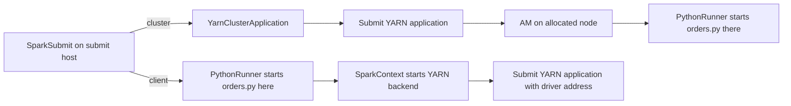

# `spark-submit`: choosing where the PySpark driver starts

[Component index](README.md) · [Next: YARN submission client](yarn-client.md)

For a classic PySpark batch script, `spark-submit` decides **which JVM entry point runs first and what arguments it gets**. It runs on the submit host. In cluster mode that JVM submits the application; in client mode it also hosts the JVM side of the driver. `spark-submit` does not choose a worker, launch a YARN container, or assign a task.

## Flow at a glance

1. **Submit wrapper**: Passes the command line to SparkSubmit.
2. **SparkSubmit**: Selects PythonRunner for a client-mode Python script.
3. **PythonRunner**: Starts the Python driver on the submit host.

> **Key distinction:** In cluster mode the submit JVM runs the YARN submission client instead. The AM starts Python later.

<details>
<summary>Show the animated flow</summary>



</details>

## From command line to JVM call

| Boundary | Input and output |
|---|---|
| Caller to launcher | The [`bin/spark-submit` wrapper][wrapper] passes the argument vector to `spark-class` for `org.apache.spark.deploy.SparkSubmit`. [`doSubmit`][entry] parses it and dispatches the `SUBMIT` action. `--master yarn` selects a **cluster manager**, not a [ResourceManager](resource-manager.md) hostname. `--deploy-mode` selects the driver's placement; its default is `client`. |
| Parser to environment preparation | `SparkSubmitArguments` owns the primary resource URI, `isPython`, application arguments, and Spark properties for this invocation. The first non-option resource ends Spark option parsing: `--executor-memory 4g` **after** `orders.py` is an argument to the script. `--conf` values take precedence over properties-file entries; explicit options such as `--executor-memory` are filled from properties or environment only if missing. [Parsing and defaults][defaults] · [argument boundary][boundary] |
| Environment preparation to dispatcher | `prepareSubmitEnvironment` returns `(childArgs, childClasspath, sparkConf, childMainClass)`. For YARN it maps `--num-executors` to `spark.executor.instances`, `--py-files` to `spark.yarn.dist.pyFiles`, and marks Python submissions with `spark.yarn.isPython=true`. These are inputs for later components, **not** requests already sent to YARN. [Mode selection][mode] · [option mapping][mapping] · [Python dispatch][cluster] |
| Dispatcher to selected class | `runMain` installs the classpath and invokes `SparkApplication.start` or wraps a static `main` with `JavaMainApplication`. Thus **child main class** means a call inside the submit JVM, not a second JVM. `PythonRunner`, when invoked, really does create a Python subprocess. [Dispatcher][dispatch] · [static-main adapter][adapter] · [Python process][python] |

## Trace one command in both modes

Suppose `orders.py` accepts a processing date:

```shell
spark-submit --master yarn --deploy-mode cluster --num-executors 3 --conf spark.dynamicAllocation.enabled=false --py-files rules.zip orders.py 2026-04-30
```

1. The submit JVM recognizes the `.py` primary resource; `2026-04-30` is application data. It resolves file references. A remote URI whose scheme Hadoop cannot handle, or which `spark.yarn.dist.forceDownloadSchemes` selects, can be downloaded to the **submit host** first. That is neither upload to shared storage nor localization into a container. [Download decision][download]
2. **Cluster:** the first class is `YarnClusterApplication`. Its arguments include `--primary-py-file <orders.py URI> --class org.apache.spark.deploy.PythonRunner --arg 2026-04-30`. The wrapper constructs the [YARN client](yarn-client.md); no user Python process is needed on the submit host. The selected node later starts the [ApplicationMaster](application-master.md), which invokes `PythonRunner` with the localized script. [Cluster argument construction][cluster] · [wrapper handoff][handoff]
3. **Client, changing only `--deploy-mode`:** the first class is `PythonRunner` itself. It receives the local script path, local Python dependencies, then the date; it starts a Py4J gateway and the Python process on the submit host. When the script initializes its classic Spark context, `YarnClientSchedulerBackend.start` submits the YARN application with `--arg <driverHost>:<driverPort>`. Here the driver exists **before** the AM. [Client arguments][client-args] · [Python gateway and process][python] · [backend submission][client-backend]



## Interpreting exit and failure

If the options are invalid, `HADOOP_CONF_DIR` and `YARN_CONF_DIR` are both missing, or Spark cannot load its YARN classes, look at the **submit process**, not executor logs. `--verbose` shows the selected main class, arguments, classpath, and redacted Spark configuration. It can distinguish the wrong deploy mode from a later failure to stage or run the script. [Validation][validate] · [YARN class check][mode] · [verbose output][dispatch]

In ordinary cluster submission the client monitors the application. With `spark.yarn.submit.waitAppCompletion=false` and no connected launcher backend, it checks one report and can exit before the job finishes; a zero shell exit is then **not** proof of successful output. In client mode the submit host must remain alive: `PythonRunner` waits for Python, propagates its nonzero exit, and shuts down the gateway. YARN cannot restart that external driver. [Cluster wait policy][wait] · [Python exit handling][python]

[wrapper]: https://github.com/apache/spark/blob/dada2a6db5d73b152d6ba16e4fe21406f86abfe3/bin/spark-submit#L20-L27
[entry]: https://github.com/apache/spark/blob/dada2a6db5d73b152d6ba16e4fe21406f86abfe3/core/src/main/scala/org/apache/spark/deploy/SparkSubmit.scala#L70-L104
[defaults]: https://github.com/apache/spark/blob/dada2a6db5d73b152d6ba16e4fe21406f86abfe3/core/src/main/scala/org/apache/spark/deploy/SparkSubmitArguments.scala#L93-L218
[boundary]: https://github.com/apache/spark/blob/dada2a6db5d73b152d6ba16e4fe21406f86abfe3/core/src/main/scala/org/apache/spark/deploy/SparkSubmitArguments.scala#L505-L529
[mode]: https://github.com/apache/spark/blob/dada2a6db5d73b152d6ba16e4fe21406f86abfe3/core/src/main/scala/org/apache/spark/deploy/SparkSubmit.scala#L243-L285
[mapping]: https://github.com/apache/spark/blob/dada2a6db5d73b152d6ba16e4fe21406f86abfe3/core/src/main/scala/org/apache/spark/deploy/SparkSubmit.scala#L690-L707
[dispatch]: https://github.com/apache/spark/blob/dada2a6db5d73b152d6ba16e4fe21406f86abfe3/core/src/main/scala/org/apache/spark/deploy/SparkSubmit.scala#L971-L1049
[adapter]: https://github.com/apache/spark/blob/dada2a6db5d73b152d6ba16e4fe21406f86abfe3/core/src/main/scala/org/apache/spark/deploy/SparkApplication.scala#L33-L53
[download]: https://github.com/apache/spark/blob/dada2a6db5d73b152d6ba16e4fe21406f86abfe3/core/src/main/scala/org/apache/spark/deploy/SparkSubmit.scala#L498-L540
[cluster]: https://github.com/apache/spark/blob/dada2a6db5d73b152d6ba16e4fe21406f86abfe3/core/src/main/scala/org/apache/spark/deploy/SparkSubmit.scala#L813-L843
[handoff]: https://github.com/apache/spark/blob/dada2a6db5d73b152d6ba16e4fe21406f86abfe3/resource-managers/yarn/src/main/scala/org/apache/spark/deploy/yarn/Client.scala#L1829-L1841
[client-args]: https://github.com/apache/spark/blob/dada2a6db5d73b152d6ba16e4fe21406f86abfe3/core/src/main/scala/org/apache/spark/deploy/SparkSubmit.scala#L569-L588
[python]: https://github.com/apache/spark/blob/dada2a6db5d73b152d6ba16e4fe21406f86abfe3/core/src/main/scala/org/apache/spark/deploy/PythonRunner.scala#L42-L132
[client-backend]: https://github.com/apache/spark/blob/dada2a6db5d73b152d6ba16e4fe21406f86abfe3/resource-managers/yarn/src/main/scala/org/apache/spark/scheduler/cluster/YarnClientSchedulerBackend.scala#L49-L73
[validate]: https://github.com/apache/spark/blob/dada2a6db5d73b152d6ba16e4fe21406f86abfe3/core/src/main/scala/org/apache/spark/deploy/SparkSubmitArguments.scala#L278-L321
[wait]: https://github.com/apache/spark/blob/dada2a6db5d73b152d6ba16e4fe21406f86abfe3/resource-managers/yarn/src/main/scala/org/apache/spark/deploy/yarn/Client.scala#L1386-L1412
