# Live Spark UI: reading the driver's status store

[component index](README.md)

A browser asking how many tasks finished in stage `3` does **not** poll its executors or replay the event log. The live `SparkUI` serves the status that the **driver JVM** has already assembled. On YARN, that is the AM JVM in cluster mode and the submitting client's driver JVM in client mode. The YARN application tracking link can lead to this UI; the ResourceManager does not compute its stage metrics.

## Flow at a glance

1. **Status queue**: Delivers task events to the status listener in the driver.
2. **Status listener**: The listener writes task-attempt records and updates stage counts in the driver's store.
3. **Stages page**: The UI reads the selected stage attempt from the store and displays its task rows.

> **Watch for:** Two task IDs for one partition can mean a failed first attempt and a successful retry.

> **Interactive explorer:** [Open in Spark Visualizer](https://nuthanreddy.github.io/spark-visualizer/#component=spark-ui) to step through commands, wire payloads, category filters, and fault simulations on the live cluster canvas.

## Startup, request path and shutdown

`SparkContext` [creates the live `AppStatusStore` and registers its listener][start] before constructing `SparkEnv`, even if `spark.ui.enabled=false`. If the UI is enabled, it constructs `SparkUI` with `Some(sc)` and the store, and binds Jetty **before** starting the scheduler. The [initial HTTP handler][handlers] reports that Spark is starting. Later the context sets the app ID and [attaches the real handlers][ready]. Jobs, Stages, Storage, Environment, Executors and the REST API are mounted on the same server. The [configured port][port] defaults to `4040`; use the actual URL, not an assumed port. In cluster mode the AM [registers the driver's UI URL with YARN][yarn].

| Boundary | Data and contract |
|---|---|
| Producers to status listener | The [listener bus](listener-bus.md) `appStatus` queue delivers job/stage/task lifecycles, executor changes, block updates and metrics from [heartbeats](heartbeat-receiver.md). The listener owns [live maps][entities] keyed by job ID, `(stageId, attemptId)`, task attempt ID, executor ID and RDD ID. |
| Listener to store | `AppStatusListener` updates those entities, then writes queryable records to an `ElementTrackingStore` over a KV store. [`createLiveStore`][store] selects memory by default or an optional local store under `spark.ui.store.path`. An update to an active entity [can be throttled][throttle]; final task state is written directly. |
| Request to response | A stage page [looks up the requested stage **attempt**][stage-page] through `AppStatusStore`; the [versioned REST resource][rest] queries the same store and returns structured data. Rendering a status page does not schedule a task. An explicit live action is different: a [job-cancel request][cancel] checks configuration, permissions and job state before calling `SparkContext.cancelJob`. |
| SQL execution to jobs | For a DataFrame query, [`SharedState` registers `SQLAppStatusListener`][sql], creates `SQLAppStatusStore` over the same underlying store and attaches the SQL tab. The SQL listener [correlates a job via its SQL execution ID][sql-job]. A SQL execution ID, Spark job ID and stage attempt ID are different keys. |

`SparkContext.stop()` [stops the UI server][ui-stop] and later [closes the status store][store-stop]. Disabling or losing that HTTP server is not the same as disabling scheduler events. After the driver goes away, the [History Server](history-server.md), if available, serves a **different** store rebuilt from persisted records, not the driver's address or its heap.

## Worked example: a failed task in a successful stage

In stage `3`, attempt `0`, partition `5` first runs as task ID `83`. On [task start][task-start], the listener creates a `LiveTask` keyed by `83`, increments the stage's active count and updates the executor's task counts. A heartbeat can update in-flight metrics [by delta][heartbeat]. On [task end][task-end], it removes `83` from the live map, writes its final row and failure reason, and updates failed/active counts. If task ID `84` retries partition `5` successfully, the listener records another attempt and marks the partition index complete. The Stages tab can therefore show a failed attempt **and** a successful stage. `GET /api/v1/applications/<appId>/stages/3/0` addresses the stage attempt, not either task ID.

**What a blank or stale row means:** the status queue may be behind or have dropped an event; periodic updates are intentionally coalesced. [Retention limits][retention] can evict older jobs, stages and task details. Check the attempt ID, queue metrics and retention before inferring that work never ran. Spark task metrics describe attempts; they are not YARN node-health samples, raw Python output or a record of every row processed.

[start]: https://github.com/apache/spark/blob/dada2a6db5d73b152d6ba16e4fe21406f86abfe3/core/src/main/scala/org/apache/spark/SparkContext.scala#L534-L571
[ready]: https://github.com/apache/spark/blob/dada2a6db5d73b152d6ba16e4fe21406f86abfe3/core/src/main/scala/org/apache/spark/SparkContext.scala#L695-L755
[handlers]: https://github.com/apache/spark/blob/dada2a6db5d73b152d6ba16e4fe21406f86abfe3/core/src/main/scala/org/apache/spark/ui/SparkUI.scala#L66-L128
[port]: https://github.com/apache/spark/blob/dada2a6db5d73b152d6ba16e4fe21406f86abfe3/core/src/main/scala/org/apache/spark/internal/config/UI.scala#L39-L49
[yarn]: https://github.com/apache/spark/blob/dada2a6db5d73b152d6ba16e4fe21406f86abfe3/resource-managers/yarn/src/main/scala/org/apache/spark/deploy/yarn/ApplicationMaster.scala#L496-L513
[entities]: https://github.com/apache/spark/blob/dada2a6db5d73b152d6ba16e4fe21406f86abfe3/core/src/main/scala/org/apache/spark/status/AppStatusListener.scala#L48-L110
[store]: https://github.com/apache/spark/blob/dada2a6db5d73b152d6ba16e4fe21406f86abfe3/core/src/main/scala/org/apache/spark/status/AppStatusStore.scala#L857-L880
[throttle]: https://github.com/apache/spark/blob/dada2a6db5d73b152d6ba16e4fe21406f86abfe3/core/src/main/scala/org/apache/spark/status/AppStatusListener.scala#L1264-L1280
[stage-page]: https://github.com/apache/spark/blob/dada2a6db5d73b152d6ba16e4fe21406f86abfe3/core/src/main/scala/org/apache/spark/ui/jobs/StagePage.scala#L99-L119
[rest]: https://github.com/apache/spark/blob/dada2a6db5d73b152d6ba16e4fe21406f86abfe3/core/src/main/scala/org/apache/spark/status/api/v1/StagesResource.scala#L83-L107
[cancel]: https://github.com/apache/spark/blob/dada2a6db5d73b152d6ba16e4fe21406f86abfe3/core/src/main/scala/org/apache/spark/ui/jobs/JobsTab.scala#L56-L69
[sql]: https://github.com/apache/spark/blob/dada2a6db5d73b152d6ba16e4fe21406f86abfe3/sql/core/src/main/scala/org/apache/spark/sql/internal/SharedState.scala#L118-L129
[sql-job]: https://github.com/apache/spark/blob/dada2a6db5d73b152d6ba16e4fe21406f86abfe3/sql/core/src/main/scala/org/apache/spark/sql/execution/ui/SQLAppStatusListener.scala#L78-L97
[ui-stop]: https://github.com/apache/spark/blob/dada2a6db5d73b152d6ba16e4fe21406f86abfe3/core/src/main/scala/org/apache/spark/SparkContext.scala#L2638-L2654
[store-stop]: https://github.com/apache/spark/blob/dada2a6db5d73b152d6ba16e4fe21406f86abfe3/core/src/main/scala/org/apache/spark/SparkContext.scala#L2713-L2722
[task-start]: https://github.com/apache/spark/blob/dada2a6db5d73b152d6ba16e4fe21406f86abfe3/core/src/main/scala/org/apache/spark/status/AppStatusListener.scala#L619-L659
[task-end]: https://github.com/apache/spark/blob/dada2a6db5d73b152d6ba16e4fe21406f86abfe3/core/src/main/scala/org/apache/spark/status/AppStatusListener.scala#L669-L734
[heartbeat]: https://github.com/apache/spark/blob/dada2a6db5d73b152d6ba16e4fe21406f86abfe3/core/src/main/scala/org/apache/spark/status/AppStatusListener.scala#L970-L1012
[retention]: https://github.com/apache/spark/blob/dada2a6db5d73b152d6ba16e4fe21406f86abfe3/core/src/main/scala/org/apache/spark/internal/config/Status.scala#L29-L60
