# Spark SQL physical planner: choosing the operators

[component index](README.md) | [Adaptive Query Execution](adaptive-query-execution.md)

The planner answers **how should this logical query run?** It returns a tree of
`SparkPlan` operators, not rows, Spark stages, or YARN container requests. In classic
PySpark it runs in the **driver JVM**: in the ApplicationMaster container in YARN
cluster mode, or on the submit host in client mode. `SessionState` supplies the
`SparkPlanner`; each `QueryExecution` keeps its own plans. An action needs the plan,
but `explain` can ask for it before the data is processed.

## Flow at a glance

1. **Logical join**: The planner receives an optimized left join of orders and regions.
2. **Build side**: The planner picks a hash join that broadcasts the small right side, regions.
3. **Prepared plan**: A preparation rule adds the exchange that will broadcast regions.

> **Key distinction:** The SQL planner chooses operators; the core schedulers later form stages and launch tasks.

> **Interactive explorer:** [Open in Spark Visualizer](https://nuthanreddy.github.io/spark-visualizer/#component=sql-planner) to step through commands, wire payloads, category filters, and fault simulations on the live cluster canvas.

## What crosses each interface

| Handoff | Input, output, and owner |
|---|---|
| Analyzer and optimizer to planner | `analyzer.executeAndCheck` resolves names and types. The optimizer rewrites the resolved logical tree. `QueryExecution` keeps `analyzed`, `optimizedPlan`, and the later physical plans separately; it passes a clone of the optimized tree to `createSparkPlan`. |
| `SparkPlanner` to `QueryExecution.sparkPlan` | Ordered strategies receive logical nodes and return zero or more physical candidates. `QueryPlanner.plan` recursively fills `PlanLater` children; `SparkStrategies.plan` links the physical node to its logical origin. `createSparkPlan` takes the **first** result of `planner.plan(ReturnAnswer(plan))`, not the cheapest of every possible tree. |
| `sparkPlan` to `executedPlan` | `prepareForExecution` applies rules to a clone of the selected plan. `EnsureRequirements` compares child partitioning and ordering against parent requirements, inserting exchanges or local sorts where needed. If AQE wraps the tree, it runs its own stage preparation. `executedPlan` means *prepared for execution*, not *already run*. |
| Physical operators to the core scheduler | For the row path, `SparkPlan.execute()` supplies an `RDD[InternalRow]`. A distributed action submits work over RDD dependencies. The [DAGScheduler](dag-scheduler.md) forms scheduler stages at shuffle dependencies and submits `TaskSet`s to the task scheduler. Several SQL operators can run in one task; a SQL operator is not a scheduler stage. |

The [analysis][analysis], [query-local plan state][state], [strategy list][strategies],
[placeholder expansion][placeholders], [logical links][logical-link], and
[first-candidate selection][first] are separate pieces of this handoff.

## Trace: why the regions table is built on the right

1. Suppose `orders o LEFT JOIN regions r ON o.region_id = r.id AND o.amount >= r.minimum`
   has integral equality keys, no hints, a large `orders`, and a **6 MiB estimated**
   right side after filtering. `ExtractEquiJoinKeys` extracts `region_id` and `id`;
   the amount comparison remains a condition on matching pairs.
2. `JoinSelection` tests whether the keys support binary-stable hashing and whether
   the join type permits that build side. A left outer hash join can build the
   **right**, not the preserved left. The automatic size test is
   `0 <= sizeInBytes <= autoBroadcastJoinThreshold`; at a 10 MiB threshold, 6 MiB
   qualifies. A broadcast hint can bypass the estimate test, not the join-type or
   key restrictions. If broadcast is ineligible, the strategy tries alternatives;
   for example, a sort-merge join needs orderable keys.
3. The selected `BroadcastHashJoinExec(BuildRight)` asks for a hashed broadcast on
   `regions` and no particular distribution on `orders`. During preparation an
   unsatisfied build-side requirement becomes a [broadcast exchange](broadcast-exchange.md).
   At this point the planner has **not** collected `regions` or probed an order.
4. At execution the [join](broadcast-hash-join.md) consumes the relation. If AQE is
   active, distinguish this initial choice from the final SQL plan: runtime
   statistics may justify a different choice before the remaining work runs.

## When the plan surprises you

Use `df.explain("extended")` to see where a logical operation became a physical one,
`df.explain("cost")` to inspect the **estimates**, and `df.explain("formatted")`
to find the join, build side, and exchanges. An unresolved column is an analysis
failure; increasing executor retries will not fix it. A stale size estimate can
produce a perfectly valid plan that later times out or exhausts driver memory
building the broadcast. For that case, compare the estimate with the exchange's
runtime `data size` in the SQL UI for the actual action.

**Implementation:** [join strategies and fallback order][join-selection] ·
[build-side eligibility][eligibility] · [size and join-type checks][size-check] ·
[distribution enforcement][distribution] · [RDD execution][rdd] ·
[scheduler handoff][scheduler] · [EXPLAIN modes][explain].

[analysis]: https://github.com/apache/spark/blob/dada2a6db5d73b152d6ba16e4fe21406f86abfe3/sql/core/src/main/scala/org/apache/spark/sql/execution/QueryExecution.scala#L219-L239
[state]: https://github.com/apache/spark/blob/dada2a6db5d73b152d6ba16e4fe21406f86abfe3/sql/core/src/main/scala/org/apache/spark/sql/execution/QueryExecution.scala#L343-L405
[strategies]: https://github.com/apache/spark/blob/dada2a6db5d73b152d6ba16e4fe21406f86abfe3/sql/core/src/main/scala/org/apache/spark/sql/execution/SparkPlanner.scala#L33-L79
[placeholders]: https://github.com/apache/spark/blob/dada2a6db5d73b152d6ba16e4fe21406f86abfe3/sql/catalyst/src/main/scala/org/apache/spark/sql/catalyst/planning/QueryPlanner.scala#L56-L95
[logical-link]: https://github.com/apache/spark/blob/dada2a6db5d73b152d6ba16e4fe21406f86abfe3/sql/core/src/main/scala/org/apache/spark/sql/execution/SparkStrategies.scala#L77-L89
[first]: https://github.com/apache/spark/blob/dada2a6db5d73b152d6ba16e4fe21406f86abfe3/sql/core/src/main/scala/org/apache/spark/sql/execution/QueryExecution.scala#L898-L930
[join-selection]: https://github.com/apache/spark/blob/dada2a6db5d73b152d6ba16e4fe21406f86abfe3/sql/core/src/main/scala/org/apache/spark/sql/execution/SparkStrategies.scala#L244-L359
[eligibility]: https://github.com/apache/spark/blob/dada2a6db5d73b152d6ba16e4fe21406f86abfe3/sql/catalyst/src/main/scala/org/apache/spark/sql/catalyst/optimizer/joins.scala#L292-L315
[size-check]: https://github.com/apache/spark/blob/dada2a6db5d73b152d6ba16e4fe21406f86abfe3/sql/catalyst/src/main/scala/org/apache/spark/sql/catalyst/optimizer/joins.scala#L436-L465
[distribution]: https://github.com/apache/spark/blob/dada2a6db5d73b152d6ba16e4fe21406f86abfe3/sql/core/src/main/scala/org/apache/spark/sql/execution/exchange/EnsureRequirements.scala#L179-L195
[rdd]: https://github.com/apache/spark/blob/dada2a6db5d73b152d6ba16e4fe21406f86abfe3/sql/core/src/main/scala/org/apache/spark/sql/execution/SparkPlan.scala#L186-L202
[scheduler]: https://github.com/apache/spark/blob/dada2a6db5d73b152d6ba16e4fe21406f86abfe3/core/src/main/scala/org/apache/spark/scheduler/DAGScheduler.scala#L59-L82
[explain]: https://github.com/apache/spark/blob/dada2a6db5d73b152d6ba16e4fe21406f86abfe3/sql/core/src/main/scala/org/apache/spark/sql/execution/QueryExecution.scala#L553-L571
