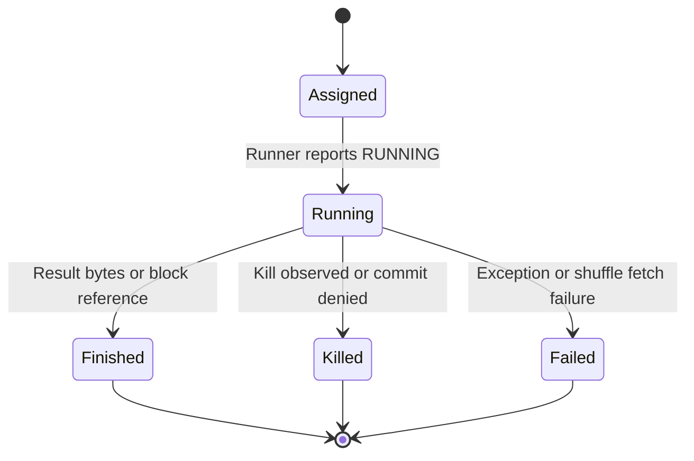

# Task attempt: one partition on one executor thread

[component index](README.md) | [Lifecycle guide](../pyspark-on-yarn.md)

A logical task says **which stage partition to compute**. An attempt is one scheduled execution of it. Its `TaskInfo` lives on the driver; its `TaskRunner`, deserialized `Task` and thread-local `TaskContext` live in the [executor JVM](executor.md). A retry or speculative copy gets a new attempt ID (TID), not a new partition or necessarily a new container. This page follows an ordinary, non-barrier batch stage.

## Flow at a glance

1. **Scheduler**: Launch a speculative copy of a slow partition task.
2. **Winning attempt**: Deliver the first result the driver accepts.
3. **Task set manager**: Ask the executor to kill the other copy.

> **Watch for:** The copies have different attempt IDs. A late result from the losing copy is treated as killed, not as a second success.

> **Interactive explorer:** [Open in Spark Visualizer](https://nuthanreddy.github.io/spark-visualizer/#component=task-attempt) to step through commands, wire payloads, category filters, and fault simulations on the live cluster canvas.

## From offer to result

1. **Assign.** The driver's `TaskSetManager` picks a task index for an executor, allocates a SparkContext-unique TID and takes the next attempt number for that index (first is `0`). `TaskDescription` carries both the index **in the task set** and the RDD partition ID, as well as the TID, attempt number, executor ID, artifacts, properties, CPU/resource assignments and serialized `Task`. [Assignment][assign] / [Envelope][description]
2. **Start a runner.** The [backend](executor-backend.md) decodes **the description**, not user code. `Executor.launchTask` records a runner and submits it to the worker pool. The runner selects its class loader, creates a per-attempt `TaskMemoryManager`, names the thread and reports `RUNNING` **before** fetching dependencies and deserializing the task. A running attempt may therefore still be loading a jar. [Runner startup][start]
3. **Enter the task.** The runner applies versioned credentials and dependencies, deserializes the `Task`, attaches properties and memory manager, checks for a pending kill, and updates the executor's [map-output tracker](map-output-tracker-worker.md) epoch. `Task.run` registers the TID with the block manager and installs a `TaskContextImpl` with stage/stage-attempt/partition IDs, attempt number, metrics, CPUs and resources. It runs the task under failure and completion listeners. [Preparation][start] / [Context][context] / [Listeners][listeners]
4. **Compute.** `ResultTask.runTask` decodes the broadcast RDD and function and calls the function on this partition's iterator. `ShuffleMapTask.runTask` decodes the RDD and shuffle dependency, writes the iterator through the [shuffle writer](shuffle-writer.md) and returns `MapStatus` **metadata**, not the shuffle blocks. Only a Python execution path needs a [Python worker][python]; the surrounding attempt and its scheduler identity remain JVM-side. [Result task][result] / [Shuffle map task][map]
5. **Clean up and report.** `Task.run` releases unroll memory and unsets thread-local context. The runner releases remaining block locks and cleans up managed allocations. On normal return it checks for a late kill, serializes the value, collects accumulators/metric peaks, and chooses the [direct, indirect or oversized-result path](task-result-getter.md). It marks itself finished, clears interrupt status, notifies waiters and sends `FINISHED`. Its outer `finally` removes the TID from `runningTasks`, updates the metrics poller if tracking started, and releases any isolated session reference. [Cleanup around execution][memory] / [Result report][report] / [Runner teardown][teardown]

## Cancellation, failure and ownership

These are the usual **runner reports**, not a promise that every attempt delivers one. A killed JVM cannot send its final update. Conversely, `FINISHED` says the executor prepared a result, not that the driver accepted it.

- **Cancellation:** `killTask` records a kill mark even if launch has not yet installed the runner. Once running, the runner retains the reason; the task marks its context interrupted and may interrupt the thread if requested and safe. Uninterruptible sections can defer it. `TaskKilled` and a denied commit are reported as `KILLED`, not ordinary application exceptions. [Kill handling][kill] / [Reason mapping][failures]
- **Failure:** A recorded shuffle fetch failure, even when wrapped by user code and rethrown as a nonfatal error, is reported as `FAILED` with `FetchFailed`. The driver can [invalidate the missing map output][fetch] and reschedule stages. An ordinary thrown exception is normally `FAILED` with `ExceptionFailure`; the live task set, not the runner, applies its retry budget. Fatal errors can reach the executor's uncaught-exception handler. [Failure reports][failures] / [Retry policy][retry]
- **Competing attempts:** The driver tracks success per task index. When one copy succeeds, the task set asks the backend to kill other running copies; a late successful report from a copy already marked as the loser is handled as killed. [Speculation race][winner]

**Diagnostic clue:** Correlate the TID from the driver's `Starting task` line with `Running` or `Exception in ...` in that executor's container log. The same partition with different TIDs is evidence of multiple attempts; the same stage ID with a different stage-attempt number indicates a stage retry. Treat a lost **task-result block** after `FINISHED` differently from a shuffle fetch failure *during* computation.

[assign]: https://github.com/apache/spark/blob/dada2a6db5d73b152d6ba16e4fe21406f86abfe3/core/src/main/scala/org/apache/spark/scheduler/TaskSetManager.scala#L536-L558
[description]: https://github.com/apache/spark/blob/dada2a6db5d73b152d6ba16e4fe21406f86abfe3/core/src/main/scala/org/apache/spark/scheduler/TaskDescription.scala#L33-L78
[start]: https://github.com/apache/spark/blob/dada2a6db5d73b152d6ba16e4fe21406f86abfe3/core/src/main/scala/org/apache/spark/executor/Executor.scala#L815-L895
[context]: https://github.com/apache/spark/blob/dada2a6db5d73b152d6ba16e4fe21406f86abfe3/core/src/main/scala/org/apache/spark/scheduler/Task.scala#L79-L168
[listeners]: https://github.com/apache/spark/blob/dada2a6db5d73b152d6ba16e4fe21406f86abfe3/core/src/main/scala/org/apache/spark/TaskContext.scala#L235-L263
[result]: https://github.com/apache/spark/blob/dada2a6db5d73b152d6ba16e4fe21406f86abfe3/core/src/main/scala/org/apache/spark/scheduler/ResultTask.scala#L78-L94
[map]: https://github.com/apache/spark/blob/dada2a6db5d73b152d6ba16e4fe21406f86abfe3/core/src/main/scala/org/apache/spark/scheduler/ShuffleMapTask.scala#L82-L112
[python]: https://github.com/apache/spark/blob/dada2a6db5d73b152d6ba16e4fe21406f86abfe3/core/src/main/scala/org/apache/spark/api/python/PythonRunner.scala#L763-L806
[memory]: https://github.com/apache/spark/blob/dada2a6db5d73b152d6ba16e4fe21406f86abfe3/core/src/main/scala/org/apache/spark/executor/Executor.scala#L902-L960
[report]: https://github.com/apache/spark/blob/dada2a6db5d73b152d6ba16e4fe21406f86abfe3/core/src/main/scala/org/apache/spark/executor/Executor.scala#L1005-L1054
[teardown]: https://github.com/apache/spark/blob/dada2a6db5d73b152d6ba16e4fe21406f86abfe3/core/src/main/scala/org/apache/spark/executor/Executor.scala#L1135-L1161
[kill]: https://github.com/apache/spark/blob/dada2a6db5d73b152d6ba16e4fe21406f86abfe3/core/src/main/scala/org/apache/spark/scheduler/Task.scala#L227-L248
[failures]: https://github.com/apache/spark/blob/dada2a6db5d73b152d6ba16e4fe21406f86abfe3/core/src/main/scala/org/apache/spark/executor/Executor.scala#L1055-L1147
[fetch]: https://github.com/apache/spark/blob/dada2a6db5d73b152d6ba16e4fe21406f86abfe3/core/src/main/scala/org/apache/spark/scheduler/DAGScheduler.scala#L4234-L4256
[retry]: https://github.com/apache/spark/blob/dada2a6db5d73b152d6ba16e4fe21406f86abfe3/core/src/main/scala/org/apache/spark/scheduler/TaskSetManager.scala#L1139-L1171
[winner]: https://github.com/apache/spark/blob/dada2a6db5d73b152d6ba16e4fe21406f86abfe3/core/src/main/scala/org/apache/spark/scheduler/TaskSetManager.scala#L832-L898
