# TaskResultGetter: when the driver accepts a finished attempt

[component index](README.md) | [Oversized `collect` scenario](../pyspark-on-yarn-scenarios.md#17-collect-exceeds-the-driver-result-limit)

`TaskResultGetter` is a **driver JVM worker pool** owned by `TaskSchedulerImpl`, not an RPC endpoint on the executor. Its inputs are the task set, attempt ID (TID), and serialized terminal payload. Its output is a scheduler callback carrying either a usable `DirectTaskResult` or a `TaskFailedReason`. It does not decide which partition to retry or collect rows into the Python driver.

## Flow at a glance

1. **Executors**: Store two 2 MiB results and send their block references.
2. **Result getter**: Fetch the first block under the 3 MiB limit.
3. **Task set manager**: Abort at 4 MiB without fetching the second block.

> **Key distinction:** For `collect`, the driver counts the sizes of the indirect results, not the sizes of their block references.

> **Interactive explorer:** [Open in Spark Visualizer](https://nuthanreddy.github.io/spark-visualizer/#component=task-result-getter) to step through commands, wire payloads, category filters, and fault simulations on the live cluster canvas.

## What did the executor actually send?

The [task runner](task-attempt.md) serializes the returned value with `env.serializer`. It wraps the value bytes, accumulator updates and metric peaks in a `DirectTaskResult`, then serializes that envelope with the closure serializer. Let **S** be the *serialized envelope* size, **D** the smaller of `spark.task.maxDirectResultSize` and the [byte equivalent][rpc-size] of the MiB-valued `spark.rpc.message.maxSize`, and **M** `spark.driver.maxResultSize`. The executor tests these branches **in order**:

| Condition | What travels in `StatusUpdate(FINISHED)` | Where are the result bytes? |
|---|---|---|
| `M > 0` and `S > M` | `IndirectTaskResult(TaskResultBlockId(tid), S)` | **Dropped**, not stored. The reference conveys the size so the driver can reject it without transferring it. |
| Otherwise `S > D` | `IndirectTaskResult(TaskResultBlockId(tid), S)` | The executor stores the serialized direct envelope in its block manager at `MEMORY_AND_DISK_SER`. |
| Otherwise | The serialized `DirectTaskResult` | Inline in the status message; no task-result block fetch. |

Switching to block storage changes the transport, not the result quota. Equality does not trip either `>` comparison. Size limit `M = 0` disables the max-result-size checks; it does not make driver memory unlimited. [Thresholds][thresholds] / [Executor decision][decision] / [Envelope types][types]

## From status update to scheduler callback

1. The driver's scheduler backend forwards the status to `TaskSchedulerImpl` and releases the executor's charged resources on terminal status. Under its lock the scheduler finds the task set, cleans up running-task tracking and enqueues completion work. The slot can be reused **before** the result becomes available to the driver. [Resource return][release] / [Scheduler handoff][queue]
2. A `task-result-getter` thread decodes the outer envelope. There are four daemon workers by default (`spark.resultGetter.threads`); each holds thread-local serializer instances for the envelope and the value. Blocking fetches and first-time value deserialization are done **outside** the scheduler lock. [Pool and serializers][pool]
3. **Direct:** call `canFetchMoreResults` with the size of the serialized *value buffer*. If accepted, force `value()` now; later calls reuse the cached object. **Indirect:** check the *declared envelope size* first. If accepted, notify the scheduler that the task is getting its result, call `sparkEnv.blockManager.getRemoteBytes(blockId)`, deserialize the direct envelope and value, then ask the [block manager master](block-manager-master.md) to remove the block. Getting-result time is driver bookkeeping, not a second executor task. [Both paths][get] / [Cached value][value]
4. The getter fills the result-size accumulator on the driver: the outer message size for direct results, or the advertised size for indirect results. It calls `scheduler.handleSuccessfulTask` under the scheduler's synchronization; the task set resolves competing attempts and notifies `DAGScheduler`. No result bytes have to be deserialized for the first time under that lock. [Accounting and callback][callback] / [Scheduler synchronization][locked] / [Task-set completion][complete]

## Why `FINISHED` can still fail

| Evidence | Decision and owner |
|---|---|
| `Total size of serialized results ... is bigger than spark.driver.maxResultSize` | `TaskSetManager.canFetchMoreResults` adds each reported size under the scheduler lock. For a **non-shuffle-map task set**, a positive cap exceeded in aggregate aborts the set. The getter reports this attempt as killed and, for an indirect result, requests block removal without fetching. The aggregate guard excludes shuffle-map task sets; the executor's per-result drop above has no such exemption. [Budget check][quota] |
| `TaskResultLost` | The indirect result passed the budget check, but `getRemoteBytes` returned no block (for example, the executor disappeared between reporting and fetching). The getter calls `handleFailedTask` with the executor-reported state `FINISHED` **and** reason `TaskResultLost`. The scheduler can retry an eligible partition; this is not a missing shuffle-map output. [Missing block][get] / [Failure policy][retry] |
| Exception while decoding a result or a failure | A missing result class or other nonfatal error in the success path aborts the task set. For an already `FAILED`/`KILLED` attempt, the getter instead tries to decode the failure reason; even if that fails, it notifies the scheduler in `finally` with `UnknownReason` if necessary. [Failure decoding][fail] |

For example, suppose **D = 1 MiB**, **M = 3 MiB**, and two result-task envelopes are **2 MiB each**. Both attempts can finish and store their individual results. The driver's second size check brings the task set to **4 MiB** and aborts it; increasing only the RPC message limit would not fix it. To distinguish that case from block loss, compare the driver-side budget message with the executor's `bytes result sent via BlockManager` log for the TID.

`TaskSchedulerImpl` [creates the getter][create] and [stops it][stop] with the scheduler. The same pool can asynchronously deliver partition-completion notifications; `stop()` calls `shutdownNow()`. It has no independent YARN lifecycle. [Other work and shutdown][fail]

[thresholds]: https://github.com/apache/spark/blob/dada2a6db5d73b152d6ba16e4fe21406f86abfe3/core/src/main/scala/org/apache/spark/executor/Executor.scala#L413-L421
[rpc-size]: https://github.com/apache/spark/blob/dada2a6db5d73b152d6ba16e4fe21406f86abfe3/core/src/main/scala/org/apache/spark/util/RpcUtils.scala#L55-L67
[decision]: https://github.com/apache/spark/blob/dada2a6db5d73b152d6ba16e4fe21406f86abfe3/core/src/main/scala/org/apache/spark/executor/Executor.scala#L1005-L1052
[types]: https://github.com/apache/spark/blob/dada2a6db5d73b152d6ba16e4fe21406f86abfe3/core/src/main/scala/org/apache/spark/scheduler/TaskResult.scala#L32-L47
[release]: https://github.com/apache/spark/blob/dada2a6db5d73b152d6ba16e4fe21406f86abfe3/core/src/main/scala/org/apache/spark/scheduler/cluster/CoarseGrainedSchedulerBackend.scala#L178-L196
[queue]: https://github.com/apache/spark/blob/dada2a6db5d73b152d6ba16e4fe21406f86abfe3/core/src/main/scala/org/apache/spark/scheduler/TaskSchedulerImpl.scala#L865-L889
[pool]: https://github.com/apache/spark/blob/dada2a6db5d73b152d6ba16e4fe21406f86abfe3/core/src/main/scala/org/apache/spark/scheduler/TaskResultGetter.scala#L33-L57
[get]: https://github.com/apache/spark/blob/dada2a6db5d73b152d6ba16e4fe21406f86abfe3/core/src/main/scala/org/apache/spark/scheduler/TaskResultGetter.scala#L58-L106
[value]: https://github.com/apache/spark/blob/dada2a6db5d73b152d6ba16e4fe21406f86abfe3/core/src/main/scala/org/apache/spark/scheduler/TaskResult.scala#L94-L112
[callback]: https://github.com/apache/spark/blob/dada2a6db5d73b152d6ba16e4fe21406f86abfe3/core/src/main/scala/org/apache/spark/scheduler/TaskResultGetter.scala#L108-L129
[locked]: https://github.com/apache/spark/blob/dada2a6db5d73b152d6ba16e4fe21406f86abfe3/core/src/main/scala/org/apache/spark/scheduler/TaskSchedulerImpl.scala#L956-L978
[complete]: https://github.com/apache/spark/blob/dada2a6db5d73b152d6ba16e4fe21406f86abfe3/core/src/main/scala/org/apache/spark/scheduler/TaskSetManager.scala#L866-L914
[quota]: https://github.com/apache/spark/blob/dada2a6db5d73b152d6ba16e4fe21406f86abfe3/core/src/main/scala/org/apache/spark/scheduler/TaskSetManager.scala#L801-L828
[retry]: https://github.com/apache/spark/blob/dada2a6db5d73b152d6ba16e4fe21406f86abfe3/core/src/main/scala/org/apache/spark/scheduler/TaskSetManager.scala#L1139-L1165
[fail]: https://github.com/apache/spark/blob/dada2a6db5d73b152d6ba16e4fe21406f86abfe3/core/src/main/scala/org/apache/spark/scheduler/TaskResultGetter.scala#L119-L177
[create]: https://github.com/apache/spark/blob/dada2a6db5d73b152d6ba16e4fe21406f86abfe3/core/src/main/scala/org/apache/spark/scheduler/TaskSchedulerImpl.scala#L243-L246
[stop]: https://github.com/apache/spark/blob/dada2a6db5d73b152d6ba16e4fe21406f86abfe3/core/src/main/scala/org/apache/spark/scheduler/TaskSchedulerImpl.scala#L1018-L1031
