# TaskSchedulerImpl: matching ready task sets to executors

[component index](README.md) · Driver JVM · Apache Spark `dada2a6`

## Overview

`TaskSchedulerImpl` answers **which task set gets the next compatible executor
offer?** Its [DAG scheduler](dag-scheduler.md) submits ready stage attempts.
The [driver backend](driver-scheduler-backend.md) supplies executor offers.
A [TaskSetManager](task-set-manager.md) chooses a partition attempt on each
eligible offer. The task scheduler returns descriptions to the backend; it
neither sends `LaunchTask` itself nor obtains containers from YARN.

## Flow at a glance

1. **Driver backend**: Offers two free CPUs on executor 3.
2. **Task scheduler**: Asks eligible task set managers for work in pool order.
3. **First match**: A one-CPU task leaves one CPU for another match in this round.

> **Key distinction:** An offer describes capacity on an existing executor, not a new grant from YARN.

> **Interactive explorer:** [Open in Spark Visualizer](https://nuthanreddy.github.io/spark-visualizer/#component=task-scheduler) to step through commands, wire payloads, category filters, and fault simulations on the live cluster canvas.

## Requirements analysis

Arbitrate across concurrent jobs, respect pool policy, CPU and custom resource
requirements, and let locality delay a launch without consuming a slot. Track
attempts by ID even when a stage is retried. Prevent a slow result fetch from
blocking scheduling on the driver. [Scheduling contract][threading] ·
[resource fit][fit] · [result fetching][getter].

## Component architecture and lifetime

For master `yarn`, `SparkContext` asks `YarnClusterManager` for a scheduler,
backend and initialization. Client mode gets `YarnScheduler` (a
`TaskSchedulerImpl` with rack lookup); cluster mode gets `YarnClusterScheduler`,
which also signals `ApplicationMaster.sparkContextInitialized(sc)` before the
normal readiness wait. `initialize` builds the scheduling pools. `start` starts
the backend and, if enabled, the speculation timer. `postStartHook` waits on
`backend.isReady()`, **not** on a particular stage's inputs. `DAGScheduler.stop`
calls `stop(exitCode)`, which stops the backend, result getter, timers and any
barrier coordinator. [YARN factory][factory] · [YARN scheduler][yarn-scheduler] ·
[cluster hook][cluster-hook] · [initialization][init] · [wait][ready] ·
[shutdown caller][dag-stop] · [shutdown work][stop].

## Data models and concurrency

| Key | Purpose |
|---|---|
| `(stageId, stageAttemptId)` | Identifies a `TaskSetManager`. Replacement makes older managers for that stage zombies: they accept no new work but may still receive results. |
| TID (`Long`) | Allocated by `newTaskId()` for a launch. `taskIdToTaskSetManager`, `taskIdToExecutorId` and `executorIdToRunningTaskIds` route updates and clean up a lost executor. A partition index is not a TID. |
| `WorkerOffer`, `availableCpus(i)`, `availableResources(i)` | A snapshot plus a temporary *per-round* budget. CPU uses exact `BigDecimal` in this revision. The [backend](driver-scheduler-backend.md) owns the persistent free-core and resource-address counters. |

The driver event loop, backend RPC thread, speculation timer and result-getter
workers enter this object from different threads. Scheduling, manager state
transitions and task-set pool removal use the scheduler monitor. `submitTasks`
releases it before calling `reviveOffers`; result deserialization runs on the
result-getter pool before it calls back under the monitor. [Indexes and lock
contract][threading] · [submission][submit] · [attempt routing][book] ·
[completion callbacks][callbacks].

## Design patterns used

**Composite (structural) + Strategy (behavioral).** A `Pool` sorts its children
and recursively collects schedulable manager leaves. FIFO compares priority
(the submitting job ID on this path), then stage ID. FAIR favors a child below
its minimum share; if both are below, it compares running tasks relative to
minimum share, otherwise relative to weight. Ties break by name. Switching
the comparator changes *who gets first choice*,
not the checks for placing a task. Unlike a single global FIFO queue this can
share slots between configured pools, at the cost of sorting and traversal on
an offer round. [Pool traversal][pool] · [comparators][algorithms] ·
[job ID as priority][taskset-creation].

## API/interface definitions

| Input and caller | Output and recipient |
|---|---|
| `DAGScheduler` → `submitTasks(taskSet)` | Creates/registers a manager, adds it to a pool, and asks the backend to revive offers. It does not synchronously return task results. [Submission][submit] |
| `DriverEndpoint` → `resourceOffers(offers, isAllFreeResources)` | `Seq[Seq[TaskDescription]]`, grouped by offered executor in the scheduler's filtered/shuffled order. Each description names its executor; the backend flattens and launches them. [Offer pass][offers] · [return shape][returned] · [backend consumption][launch] |
| `DriverEndpoint` → `statusUpdate(tid, state, bytes)` | `RUNNING` confirms launch; terminal states remove TID routing/running state and enqueue success/failure work in the [TaskResultGetter](task-result-getter.md). The getter calls `handleSuccessfulTask` or `handleFailedTask` with the captured manager. [Status dispatch][status] · [result callbacks][callbacks] |
| `DAGScheduler` → `killAllTaskAttempts(stageId, interruptThread, reason)` | Sends `backend.killTask` for known running TIDs across **all attempts** of that stage and suspends their managers. Completion and cleanup need not be synchronous with the kill. [Cancellation and removal][cancel] |

## Implementation notes: one offer round

1. Suppose executor `3` offers two free CPUs under a compatible profile. The
   scheduler learns the host/executor mapping, filters application-wide
   exclusions, shuffles the remaining offers, and obtains the pool's sorted
   task sets. This offer describes an already-registered executor, not two
   newly granted YARN vcores. [Build round][offers].
2. For a one-CPU task with no custom resource, the scheduler asks the first
   eligible manager for work on `3` at the current locality. On acceptance it
   records the TID and decrements the **round's** CPU budget to one. On
   rejection no assignment is charged. It tries each executor at that locality
   and repeats while it can launch, then considers broader locality levels.
   A profile mismatch, unavailable GPU address or exhausted CPU budget can
   prevent even asking the manager. [Match and debit][match] · [fit][fit] ·
   [round iteration][round].
3. The backend sends the descriptions. A later `FINISHED` status can make the
   executor offer capacity again **before** the partition result is accepted.
   For an indirect result the getter reads a block; if it has disappeared,
   `TaskResultLost` goes through failure handling despite that `FINISHED`
   report. A still-live manager with an unfinished partition can then trigger
   another `reviveOffers`. [Terminal status/offer][finish] · [indirect results][getter] ·
   [retry decision][callbacks].

**Late status and executor loss.** A duplicate/late status for a TID no longer
in the routing map is logged and ignored here. That differs from a useful
older *stage-attempt* success: the DAG scheduler can notify the active manager
by `(stageId, partitionId)` to skip redundant work. On `LossReasonPending` the
scheduler cleans TID routing but preserves the executor-to-host mapping; it
notifies the pool of the loss when a concrete reason is available. That
distinction matters to per-task retry accounting on YARN.
[Unknown TID][status] · [partition notification][callbacks] · [two-phase loss][loss].

## Scalability and performance considerations

Large sets of offers, locality passes and serialization in the manager all
consume time under the scheduling lock. A single-executor offer need not scan
every executor. Barrier sets are different: the scheduler checks the whole
set fits and, on the normal non-legacy path, gives back provisional assignments
instead of launching half a set. **Diagnostic:** if the driver reports that it
skipped a barrier round, compare the *required and available compatible slots*
in that log; a running YARN application or a large total core count does not
satisfy a simultaneous free-slot requirement. [Offer scope][offer-scope] ·
[barrier admission][round] · [provisional rollback][barrier].

[threading]: https://github.com/apache/spark/blob/dada2a6db5d73b152d6ba16e4fe21406f86abfe3/core/src/main/scala/org/apache/spark/scheduler/TaskSchedulerImpl.scala#L52-L148
[fit]: https://github.com/apache/spark/blob/dada2a6db5d73b152d6ba16e4fe21406f86abfe3/core/src/main/scala/org/apache/spark/scheduler/TaskSchedulerImpl.scala#L540-L554
[getter]: https://github.com/apache/spark/blob/dada2a6db5d73b152d6ba16e4fe21406f86abfe3/core/src/main/scala/org/apache/spark/scheduler/TaskResultGetter.scala#L33-L124
[factory]: https://github.com/apache/spark/blob/dada2a6db5d73b152d6ba16e4fe21406f86abfe3/resource-managers/yarn/src/main/scala/org/apache/spark/scheduler/cluster/YarnClusterManager.scala#L26-L56
[yarn-scheduler]: https://github.com/apache/spark/blob/dada2a6db5d73b152d6ba16e4fe21406f86abfe3/resource-managers/yarn/src/main/scala/org/apache/spark/scheduler/cluster/YarnScheduler.scala#L27-L39
[cluster-hook]: https://github.com/apache/spark/blob/dada2a6db5d73b152d6ba16e4fe21406f86abfe3/resource-managers/yarn/src/main/scala/org/apache/spark/scheduler/cluster/YarnClusterScheduler.scala#L27-L35
[init]: https://github.com/apache/spark/blob/dada2a6db5d73b152d6ba16e4fe21406f86abfe3/core/src/main/scala/org/apache/spark/scheduler/TaskSchedulerImpl.scala#L262-L297
[ready]: https://github.com/apache/spark/blob/dada2a6db5d73b152d6ba16e4fe21406f86abfe3/core/src/main/scala/org/apache/spark/scheduler/TaskSchedulerImpl.scala#L1257-L1271
[dag-stop]: https://github.com/apache/spark/blob/dada2a6db5d73b152d6ba16e4fe21406f86abfe3/core/src/main/scala/org/apache/spark/scheduler/DAGScheduler.scala#L5422-L5437
[stop]: https://github.com/apache/spark/blob/dada2a6db5d73b152d6ba16e4fe21406f86abfe3/core/src/main/scala/org/apache/spark/scheduler/TaskSchedulerImpl.scala#L1018-L1040
[submit]: https://github.com/apache/spark/blob/dada2a6db5d73b152d6ba16e4fe21406f86abfe3/core/src/main/scala/org/apache/spark/scheduler/TaskSchedulerImpl.scala#L299-L351
[book]: https://github.com/apache/spark/blob/dada2a6db5d73b152d6ba16e4fe21406f86abfe3/core/src/main/scala/org/apache/spark/scheduler/TaskSchedulerImpl.scala#L525-L532
[callbacks]: https://github.com/apache/spark/blob/dada2a6db5d73b152d6ba16e4fe21406f86abfe3/core/src/main/scala/org/apache/spark/scheduler/TaskSchedulerImpl.scala#L956-L993
[pool]: https://github.com/apache/spark/blob/dada2a6db5d73b152d6ba16e4fe21406f86abfe3/core/src/main/scala/org/apache/spark/scheduler/Pool.scala#L105-L127
[algorithms]: https://github.com/apache/spark/blob/dada2a6db5d73b152d6ba16e4fe21406f86abfe3/core/src/main/scala/org/apache/spark/scheduler/SchedulingAlgorithm.scala#L25-L69
[taskset-creation]: https://github.com/apache/spark/blob/dada2a6db5d73b152d6ba16e4fe21406f86abfe3/core/src/main/scala/org/apache/spark/scheduler/DAGScheduler.scala#L3475-L3490
[offers]: https://github.com/apache/spark/blob/dada2a6db5d73b152d6ba16e4fe21406f86abfe3/core/src/main/scala/org/apache/spark/scheduler/TaskSchedulerImpl.scala#L573-L631
[returned]: https://github.com/apache/spark/blob/dada2a6db5d73b152d6ba16e4fe21406f86abfe3/core/src/main/scala/org/apache/spark/scheduler/TaskSchedulerImpl.scala#L816-L825
[launch]: https://github.com/apache/spark/blob/dada2a6db5d73b152d6ba16e4fe21406f86abfe3/core/src/main/scala/org/apache/spark/scheduler/cluster/CoarseGrainedSchedulerBackend.scala#L457-L486
[status]: https://github.com/apache/spark/blob/dada2a6db5d73b152d6ba16e4fe21406f86abfe3/core/src/main/scala/org/apache/spark/scheduler/TaskSchedulerImpl.scala#L865-L894
[cancel]: https://github.com/apache/spark/blob/dada2a6db5d73b152d6ba16e4fe21406f86abfe3/core/src/main/scala/org/apache/spark/scheduler/TaskSchedulerImpl.scala#L374-L443
[match]: https://github.com/apache/spark/blob/dada2a6db5d73b152d6ba16e4fe21406f86abfe3/core/src/main/scala/org/apache/spark/scheduler/TaskSchedulerImpl.scala#L468-L510
[round]: https://github.com/apache/spark/blob/dada2a6db5d73b152d6ba16e4fe21406f86abfe3/core/src/main/scala/org/apache/spark/scheduler/TaskSchedulerImpl.scala#L632-L687
[finish]: https://github.com/apache/spark/blob/dada2a6db5d73b152d6ba16e4fe21406f86abfe3/core/src/main/scala/org/apache/spark/scheduler/cluster/CoarseGrainedSchedulerBackend.scala#L179-L198
[loss]: https://github.com/apache/spark/blob/dada2a6db5d73b152d6ba16e4fe21406f86abfe3/core/src/main/scala/org/apache/spark/scheduler/TaskSchedulerImpl.scala#L1154-L1189
[offer-scope]: https://github.com/apache/spark/blob/dada2a6db5d73b152d6ba16e4fe21406f86abfe3/core/src/main/scala/org/apache/spark/scheduler/cluster/CoarseGrainedSchedulerBackend.scala#L402-L455
[barrier]: https://github.com/apache/spark/blob/dada2a6db5d73b152d6ba16e4fe21406f86abfe3/core/src/main/scala/org/apache/spark/scheduler/TaskSchedulerImpl.scala#L738-L803
