# TaskSetManager: choosing and retrying a partition attempt

[component index](README.md) · Driver JVM · Apache Spark `dada2a6`

## Overview

A `TaskSetManager` manages **one submitted stage attempt**, not a whole job.
Given an offer for a particular host and executor, it decides which of *its*
partitions to launch, whether that launch is a retry or speculative copy, and
when to stop issuing work. The [task scheduler](task-scheduler.md) has already
chosen which manager to ask and checked that the resources fit. The manager
does not decide stage readiness, debit an executor's free cores, or allocate a
YARN container.

## Flow at a glance

1. **Attempt 0**: Hits an exception while running partition 7.
2. **Task set manager**: Counts one failure and queues partition 7 again because retries remain.
3. **Attempt 1**: Starts with a new task ID on the next compatible offer.

> **Key distinction:** The task attempt changes; the partition and stage attempt stay the same.

Show the animated flow

## Requirements analysis

Prefer data-local work without waiting forever, bound repeatable failures of a
single partition, and avoid counting two successful attempts as two completed
partitions. A failed shuffle read is a different problem: repeatedly launching
the same reader cannot recreate its missing input. [Class contract][contract] ·
[locality clock][clock] · [failure handling][failed].

## Component architecture and lifetime

`TaskSchedulerImpl.submitTasks` constructs the manager, indexes it by
`(stageId, stageAttemptId)` and adds it to a scheduling pool. The manager
initializes the pending lists and stamps its tasks with the current map-output
tracker epoch. It has **no scheduler thread or independent `stop()`**. Its
mutable state is designed to be accessed under `TaskSchedulerImpl`'s monitor.
A superseding stage attempt, suspension, abort or completion can mark it
`isZombie`: no more launches, but existing attempts can still report.
`maybeFinishTaskSet` checks `isZombie && runningTasks == 0` before asking the
scheduler to remove it from the stage index and pool. [Creation][create] ·
[state and initialization][indexes] · [drain condition][drain] · [removal][remove].

## Data models

| Identity or index | Why it is separate |
|---|---|
| `TaskSet.id = stageId.stageAttemptId` | The stage and its attempted execution. `tasks(index).partitionId` is the RDD partition; an array containing *only missing partitions* can have `index = 0` for partition `7`. `partitionToIndex` translates notifications back. |
| TID and [task attempt](task-attempt.md) number | `sched.newTaskId()` is unique per launch in this scheduler; `taskAttempts(index).size` gives the next zero-based attempt number **within this manager**. `TaskInfo` holds both, the executor, host, locality, time and speculative flag. |
| `successful(index)`, `copiesRunning(index)`, `numFailures(index)` | Eligibility, copy and retry accounting are per index. `runningTasksSet` tracks outstanding TIDs and `tasksSuccessful` counts indices, not attempts. There is a deliberate fetch-failure exception to the meaning of `successful`. |
| Pending and history indexes | Regular and speculative work have separate locality lists. `taskInfos` indexes by TID; `executorIdToTaskIds` indexes all attempts placed there, including finished ones that may have produced shuffle data. |

[TaskSet shape][taskset] · [partition and failure state][contract] · [indexes][indexes] ·
[attempt creation][prepare].

## Design patterns used

**Composite leaf (structural).** Like a `Pool`, the manager is a `Schedulable`,
but its sorted queue contains only itself. Parent pools can order leaves and
propagate running counts without knowing about partitions. Inside the leaf,
`isZombie`, per-index flags and running TIDs implement a guarded lifecycle
rather than a hierarchy of state classes. Immediately deleting a cancelled
leaf would lose the history needed to interpret a late attempt.
[Leaf operations][leaf] · [pool traversal][pool] · [zombie lifetime][indexes].

## API/interface definitions

| Caller and input | Manager decision/output |
|---|---|
| `TaskSchedulerImpl.resourceOfferSingleTaskSet` → `resourceOffer(execId, host, maxLocality, taskCpus, assignments)` | Returns `(Option[TaskDescription], delaySchedulingReject, dequeuedIndex)`. An ordinary acceptance calls `prepareLaunchingTask`; a barrier acceptance reserves a candidate until the scheduler can place the entire set. [Offer contract][offer] |
| `TaskResultGetter` through `TaskSchedulerImpl` → `handleSuccessfulTask(tid, directResult)` / `handleFailedTask(tid, state, reason)` | Updates `TaskInfo` and partition accounting, informs `DAGScheduler.taskEnded`, and may enqueue a retry, kill a sibling, or abort. A result callback is not an executor RPC into this object. [Callbacks][callbacks] · [DAG notification][notify] |
| Task scheduler → `suspend()`; manager or result getter → `abort(message, exception)` | Both stop new attempts. `abort` additionally reports `dagScheduler.taskSetFailed`; `suspend` deliberately does not refail a stage the DAG scheduler is already cancelling. [Abort vs. suspend][abort] |

## Implementation notes: partition 7 gets a second attempt

1. Suppose index `0` represents partition `7`, with a preference for host A.
   A compatible CPU offer on host B may be refused during the node-local wait.
   `resourceOffer` combines the caller's maximum locality with the manager's
   clock; it tries ordinary work before speculative work, consulting executor,
   host, no-preference, rack, and all-task lists as allowed. It skips a
   locality level that no longer has pending work instead of waiting for it.
   [Queue selection][dequeue] · [offer][offer] · [clock][clock].
2. A permitted offer selects index `0`. The manager obtains a new TID, records
   attempt `0`, serializes the task, posts `taskStarted` and returns a
   description containing partition `7`, executor ID, CPU/resource assignments
   and serialized task. The [backend](driver-scheduler-backend.md) sends it.
   [Bookkeeping, serialization and description][prepare].
3. Suppose the task reports an ordinary `ExceptionFailure`. The manager marks
   that TID finished, decrements the copy count, notifies the DAG scheduler,
   charges one failure if the reason counts, and requeues the index if the
   limit has not been reached. On another offer it launches attempt `1` with
   a **different TID, same stage attempt and partition**. At the configured
   `spark.task.maxFailures` limit it aborts the set; the limit counts failures,
   not extra retries after the initial attempt. [Failure debit][failed] ·
   [threshold and requeue][budget].

| Race or failure | Outcome |
|---|---|
| Speculation | In the usual path enough completions establish a median duration. An eligible slow task with one running copy may be marked speculatable; it still needs a compatible offer on a host not already tried for that index. A winner kills running siblings. If a sibling marked for that kill reports success late, it is handled as killed, not as a second winning result. [Eligibility][spec] · [host guard][dequeue] · [winner/loser][winner] |
| `FetchFailed` | The manager marks the index `successful` **for local scheduling purposes** and makes the set a zombie. It still reports `FetchFailed`, not `Success`, to the [DAG scheduler](dag-scheduler.md), which owns shuffle recovery. [Fetch-failure branch][failed] |
| Executor lost, task cancelled, or old stage result | Ordinary non-application-caused executor loss and `TaskKilled` do not spend the usual failure budget. A cancelled zombie cannot requeue work. If the DAG scheduler accepts an older stage attempt's success, `markPartitionCompleted(partitionId)` can satisfy the matching index in the active manager. A transient pipelined group instead fails fast rather than retrying an individual member. [Loss classification][reason] · [budget exceptions][budget] · [partition notification][older] |

## Scalability and performance considerations

Locality indexes avoid scanning every partition on every offer. They can contain
stale entries, so dequeuing checks success/copy state and removes entries
lazily. The executor-to-TID index limits an executor-loss scan to attempts
placed there, at the cost of retaining attempt history for the manager's
lifetime. **Diagnostic:** in a `Task ... failed ... times; aborting job` log,
compare stage **and stage attempt**, task index, TID, executor and the most
recent exception. Several TIDs for one index are expected; several different
failed indices do not by themselves exhaust a single index's budget.
[Lazy pruning][dequeue] · [executor-loss scan][exec-loss] · [abort log][budget].

[contract]: https://github.com/apache/spark/blob/dada2a6db5d73b152d6ba16e4fe21406f86abfe3/core/src/main/scala/org/apache/spark/scheduler/TaskSetManager.scala#L41-L89
[clock]: https://github.com/apache/spark/blob/dada2a6db5d73b152d6ba16e4fe21406f86abfe3/core/src/main/scala/org/apache/spark/scheduler/TaskSetManager.scala#L672-L702
[failed]: https://github.com/apache/spark/blob/dada2a6db5d73b152d6ba16e4fe21406f86abfe3/core/src/main/scala/org/apache/spark/scheduler/TaskSetManager.scala#L1001-L1042
[create]: https://github.com/apache/spark/blob/dada2a6db5d73b152d6ba16e4fe21406f86abfe3/core/src/main/scala/org/apache/spark/scheduler/TaskSchedulerImpl.scala#L299-L351
[indexes]: https://github.com/apache/spark/blob/dada2a6db5d73b152d6ba16e4fe21406f86abfe3/core/src/main/scala/org/apache/spark/scheduler/TaskSetManager.scala#L131-L245
[drain]: https://github.com/apache/spark/blob/dada2a6db5d73b152d6ba16e4fe21406f86abfe3/core/src/main/scala/org/apache/spark/scheduler/TaskSetManager.scala#L626-L636
[remove]: https://github.com/apache/spark/blob/dada2a6db5d73b152d6ba16e4fe21406f86abfe3/core/src/main/scala/org/apache/spark/scheduler/TaskSchedulerImpl.scala#L425-L443
[taskset]: https://github.com/apache/spark/blob/dada2a6db5d73b152d6ba16e4fe21406f86abfe3/core/src/main/scala/org/apache/spark/scheduler/TaskSet.scala#L25-L45
[prepare]: https://github.com/apache/spark/blob/dada2a6db5d73b152d6ba16e4fe21406f86abfe3/core/src/main/scala/org/apache/spark/scheduler/TaskSetManager.scala#L537-L618
[leaf]: https://github.com/apache/spark/blob/dada2a6db5d73b152d6ba16e4fe21406f86abfe3/core/src/main/scala/org/apache/spark/scheduler/TaskSetManager.scala#L1184-L1216
[pool]: https://github.com/apache/spark/blob/dada2a6db5d73b152d6ba16e4fe21406f86abfe3/core/src/main/scala/org/apache/spark/scheduler/Pool.scala#L105-L127
[offer]: https://github.com/apache/spark/blob/dada2a6db5d73b152d6ba16e4fe21406f86abfe3/core/src/main/scala/org/apache/spark/scheduler/TaskSetManager.scala#L466-L535
[callbacks]: https://github.com/apache/spark/blob/dada2a6db5d73b152d6ba16e4fe21406f86abfe3/core/src/main/scala/org/apache/spark/scheduler/TaskSchedulerImpl.scala#L956-L978
[notify]: https://github.com/apache/spark/blob/dada2a6db5d73b152d6ba16e4fe21406f86abfe3/core/src/main/scala/org/apache/spark/scheduler/TaskSetManager.scala#L935-L953
[abort]: https://github.com/apache/spark/blob/dada2a6db5d73b152d6ba16e4fe21406f86abfe3/core/src/main/scala/org/apache/spark/scheduler/TaskSetManager.scala#L1167-L1182
[dequeue]: https://github.com/apache/spark/blob/dada2a6db5d73b152d6ba16e4fe21406f86abfe3/core/src/main/scala/org/apache/spark/scheduler/TaskSetManager.scala#L338-L442
[budget]: https://github.com/apache/spark/blob/dada2a6db5d73b152d6ba16e4fe21406f86abfe3/core/src/main/scala/org/apache/spark/scheduler/TaskSetManager.scala#L1121-L1170
[spec]: https://github.com/apache/spark/blob/dada2a6db5d73b152d6ba16e4fe21406f86abfe3/core/src/main/scala/org/apache/spark/scheduler/TaskSetManager.scala#L1315-L1409
[winner]: https://github.com/apache/spark/blob/dada2a6db5d73b152d6ba16e4fe21406f86abfe3/core/src/main/scala/org/apache/spark/scheduler/TaskSetManager.scala#L832-L914
[reason]: https://github.com/apache/spark/blob/dada2a6db5d73b152d6ba16e4fe21406f86abfe3/core/src/main/scala/org/apache/spark/TaskEndReason.scala#L224-L275
[older]: https://github.com/apache/spark/blob/dada2a6db5d73b152d6ba16e4fe21406f86abfe3/core/src/main/scala/org/apache/spark/scheduler/TaskSetManager.scala#L983-L995
[exec-loss]: https://github.com/apache/spark/blob/dada2a6db5d73b152d6ba16e4fe21406f86abfe3/core/src/main/scala/org/apache/spark/scheduler/TaskSetManager.scala#L1219-L1244
