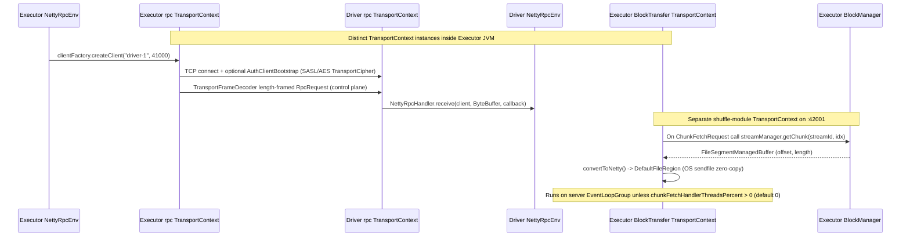

# Netty TransportContext: shared framing, pooling, and zero-copy I/O

[component index](README.md)

`TransportContext` (in `common/network-common`) is **not** a standalone proxy daemon and is **not** an extra network hop on worker nodes. It is Spark's shared Netty 4 transport library embedded inside the **Driver JVM**, every **Executor JVM**, and the **External Shuffle Service (ESS)** inside YARN NodeManagers. Crucially, Spark does **not** collapse all traffic into one shared `TransportContext` per JVM: [`NettyRpcEnv`](rpc-env.md) and [`NettyBlockTransferService`](block-transfer-service.md) instantiate **distinct** `TransportContext` objects with separate module `TransportConf` prefixes (`spark.rpc.io.*` vs `spark.shuffle.io.*`), separate `TransportServer` ports, and separate `TransportClientFactory` connection pools.

## Flow at a glance

1. **Per-service `TransportContext` creation**: `NettyRpcEnv` binds control-plane RPCs on its own `TransportContext` (`NettyRpcHandler`), while `NettyBlockTransferService` (and ESS) binds block/shuffle data transfers on a separate `TransportContext` (`NettyBlockRpcServer` or `ExternalBlockHandler`).
2. **Pipeline framing, auth, and connection pooling**: `TransportClientFactory` maintains per-peer `ClientPool` arrays keyed by unresolved `SocketAddress`, running optional SASL/AES bootstraps (`AuthClientBootstrap` / `AuthServerBootstrap`) and wiring `TransportFrameDecoder`, `MessageEncoder`/`MessageDecoder`, `IdleStateHandler`, and `TransportChannelHandler` onto each channel.
3. **Control RPC vs zero-copy `FileRegion` chunk streaming**: Control RPCs flow strictly between `NettyRpcEnv`'s `TransportContext` instances; on the data-plane `TransportContext`, `ChunkFetchRequest` serves `FileSegmentManagedBuffer` chunks via Netty `DefaultFileRegion` (OS `sendfile()` zero-copy), optionally isolated onto a dedicated `chunkFetchWorkers` pool only when `spark.shuffle.server.chunkFetchHandlerThreadsPercent > 0` (default `0`).

> **Key distinction:** `TransportContext` is shared library infrastructure embedded in multiple JVMs, and within a single Executor or Driver JVM, `NettyRpcEnv` and `NettyBlockTransferService` own **distinct** `TransportContext` instances (plus a separate `files` download context in `NettyRpcEnv`). Control RPCs never ride on the block-transfer `TransportContext`.

> **Interactive explorer:** [Open in Spark Visualizer](https://nuthanreddy.github.io/spark-visualizer/#component=transport-context) to step through commands, wire payloads, category filters, and fault simulations on the live cluster canvas.

## Distinct `TransportContext` instances inside Driver, Executor, and ESS

| Owning service | Module `TransportConf` prefix | Registered `RpcHandler` | Server / client role |
|---|---|---|---|
| **Driver & Executor [`NettyRpcEnv`][rpc-ctx]** | `rpc` (`spark.rpc.io.*`) | `NettyRpcHandler` (routes to `Dispatcher` inboxes) | Binds driver RPC port (e.g. `:41000`); executors also create a `TransportClientFactory` on this `rpc` context to talk to driver endpoints. |
| **Driver & Executor [`NettyRpcEnv` file download][rpc-file-ctx]** | `files` (`spark.files.io.*`) | `NoOpRpcHandler` (`closeIdleConnections = true`) | Client-only `TransportContext` lazily built inside `NettyRpcEnv` for streaming driver files/JARs. |
| **Driver & Executor [`NettyBlockTransferService`][bts-ctx]** | `shuffle` (`spark.shuffle.io.*`) | `NettyBlockRpcServer` (serves `OpenBlocks`, `FetchShuffleBlocks`, `UploadBlock`, `UploadBlockStream`) | Binds `spark.blockManager.port` / `spark.driver.blockManager.port` (ephemeral `:0` by default) and creates its own pooled `TransportClientFactory`. |
| **NodeManager `ExternalShuffleService` (`YarnShuffleService`)** | `shuffle` (`spark.shuffle.io.*`) | `ExternalBlockHandler` (serves shuffle reads, host-local dir lookups, push-based merge) | Binds `:7337` inside the NodeManager JVM, sharing the exact same `common/network-common` framing and zero-copy layer. |

## Pipeline layout, SASL/AES encryption, and conditional `chunkFetchWorkers`

[`TransportContext.initializePipeline()`][tc-pipeline] installs a deterministic Netty handler chain on every accepted or connected `SocketChannel`:

1. **Optional TLS (`SslHandler` + `ChunkedWriteHandler`)**: Added first when RPC SSL is enabled (`sslEncryptionEnabled()`). Because HTTPS cannot use OS `sendfile()` zero-copy, `FileSegmentManagedBuffer.convertToNettyForSsl()` falls back to `ChunkedStream` and `SslMessageEncoder`.
2. **Framing & codec (`MessageEncoder`, [`TransportFrameDecoder`][frame-dec], `MessageDecoder`)**: `TransportFrameDecoder` reads an 8-byte frame length header and slices complete frames from a FIFO `ArrayDeque<ByteBuf>`. When a streamed upload or chunk body starts, it switches into **interceptor mode**, feeding raw bytes directly to the stream callback until the body finishes, then resuming frame decoding.
3. **Idle timeout & dispatch (`IdleStateHandler`, `TransportChannelHandler`)**: `IdleStateHandler` enforces `spark.network.timeout`; `TransportChannelHandler` binds a bidirectional `TransportClient`, `TransportRequestHandler`, and `TransportResponseHandler` to the channel so either peer can send RPCs over an existing socket.
4. **Optional SASL / AES authentication ([`AuthServerBootstrap`][auth-boot] & [`TransportCipher`][cipher])**: On the server, `TransportServer` runs `initializePipeline` installing `TransportChannelHandler` with `AuthServerBootstrap`-wrapped `RpcHandler` first; authentication then runs when the client sends its SASL or AES auth RPC during `createClient` bootstrap, attaching `TransportCipher` (`addToChannel`) to encrypt subsequent frames.
5. **Conditional `chunkFetchWorkers` (`ChunkFetchRequestHandler`)**: Per [`TransportContext`][tc-ctor] and [`TransportConf.separateChunkFetchRequest()`][tconf-chunk], Spark creates a dedicated `shuffle-chunk-fetch-handler` `EventLoopGroup` **only** when `module == "shuffle"`, `!isClientOnly`, and `spark.shuffle.server.chunkFetchHandlerThreadsPercent > 0`. Because that property defaults to **`0`**, `chunkFetchWorkers` is `null` by default and `ChunkFetchRequest` executes on the standard `TransportServer` worker `EventLoopGroup`. When enabled (`> 0`), [`ChunkFetchRequestHandler`][chunk-handler] runs with `syncModeEnabled = true` to throttle `writeAndFlush` backpressure and reserve regular server threads for control RPCs.

On the data plane, [`FileSegmentManagedBuffer.convertToNetty()`][file-seg] wraps the file slice in Netty's `DefaultFileRegion` (either lazy file descriptor or open `FileChannel`), allowing the OS kernel to transfer shuffle/RDD bytes straight from page cache to the NIC via `sendfile()` without copying through JVM heap buffers. When SSL or AES `TransportCipher` encryption is active, bytes must be transformed in user space, switching from `DefaultFileRegion` to chunked buffer streaming.

## Inputs, outputs, and state

| Boundary | Contract |
|---|---|
| Inputs | Module-scoped `TransportConf` (`rpc`, `shuffle`, `files`: `io.mode` `NIO`/`EPOLL`, `io.numConnectionsPerPeer`, `io.serverThreads`, `io.clientThreads`, `spark.network.timeout`, `spark.shuffle.server.chunkFetchHandlerThreadsPercent`), pluggable `RpcHandler`, and optional `TransportServerBootstrap` / `TransportClientBootstrap` lists. |
| Owned state | [`TransportServer`][t-server] `ServerBootstrap` (`bossGroup`, `workerGroup`, bound port, `PooledByteBufAllocator`, `NettyMemoryMetrics`); [`TransportClientFactory`][t-factory] `connectionPool: ConcurrentHashMap[SocketAddress, ClientPool]` (randomly picking among `numConnectionsPerPeer` slots, with automatic dead-event-loop worker recreation per SPARK-58292); optional `SSLFactory` and conditional `chunkFetchWorkers` `EventLoopGroup`. |
| Outputs | Bound Netty listening sockets, pooled bidirectional `TransportClient` channels, length-framed `RpcRequest` / `OneWayMessage` / `ChunkFetchRequest` / `StreamRequest` / `PushBlockStream` wire exchanges, and zero-copy `DefaultFileRegion` chunk responses. |

## Failure clues and diagnosis

- **`OutOfDirectMemoryError` inside Netty handlers:** Pooled off-heap direct buffers (`PooledByteBufAllocator`) allocated across concurrent shuffle/RPC frames exceeded JVM `-XX:MaxDirectMemorySize` (or container memory overhead). Check `NettyMemoryMetrics` (`usedDirectMemory`), tune `spark.shuffle.io.numConnectionsPerPeer` / `spark.maxRemoteBlockSizeFetchToMem`, or raise `spark.executor.memoryOverhead`.
- **Tuning `spark.rpc.io.*` had no effect on shuffle fetches (or vice versa):** Because `NettyRpcEnv` (`rpc`) and `NettyBlockTransferService` / ESS (`shuffle`) instantiate separate `TransportContext`s with distinct module prefixes, timeouts, thread counts, and connection pool sizes must be configured under the matching prefix (`spark.rpc.io.*` vs `spark.shuffle.io.*`).
- **`Connection reset by peer` or `ClosedChannelException` during heavy GC or auth handshake:** `IdleStateHandler` closes channels idle beyond `spark.network.timeout`, and mismatched SASL/AES secrets or missing `AuthClientBootstrap`/`AuthServerBootstrap` abort the channel during `TransportClientFactory.createClient()`. Verify `spark.authenticate` and `spark.network.crypto.enabled` match across driver, executors, and ESS.
- **`The number of chunks being transferred ... is above ..., close the connection` warning:** [`ChunkFetchRequestHandler`][chunk-handler] closed a client channel because in-flight chunks hit `spark.shuffle.maxChunksBeingTransferred`. Consider whether `spark.shuffle.server.chunkFetchHandlerThreadsPercent` (default `0`, deprecated for removal in 4.2.0) or shuffle concurrency limits need adjustment.
- **High CPU during shuffle fetch despite `FileSegmentManagedBuffer`:** Confirm whether SSL (`spark.ssl.rpc.enabled`) or AES transport encryption (`spark.network.crypto.enabled`) is active; both disable OS `sendfile()` `DefaultFileRegion` zero-copy and require user-space chunk encryption.

[tc-ctor]: https://github.com/apache/spark/blob/dada2a6db5d73b152d6ba16e4fe21406f86abfe3/common/network-common/src/main/java/org/apache/spark/network/TransportContext.java#L112-L152
[tc-pipeline]: https://github.com/apache/spark/blob/dada2a6db5d73b152d6ba16e4fe21406f86abfe3/common/network-common/src/main/java/org/apache/spark/network/TransportContext.java#L202-L248
[t-server]: https://github.com/apache/spark/blob/dada2a6db5d73b152d6ba16e4fe21406f86abfe3/common/network-common/src/main/java/org/apache/spark/network/server/TransportServer.java#L45-L155
[t-factory]: https://github.com/apache/spark/blob/dada2a6db5d73b152d6ba16e4fe21406f86abfe3/common/network-common/src/main/java/org/apache/spark/network/client/TransportClientFactory.java#L66-L200
[tconf-chunk]: https://github.com/apache/spark/blob/dada2a6db5d73b152d6ba16e4fe21406f86abfe3/common/network-common/src/main/java/org/apache/spark/network/util/TransportConf.java#L482-L496
[chunk-handler]: https://github.com/apache/spark/blob/dada2a6db5d73b152d6ba16e4fe21406f86abfe3/common/network-common/src/main/java/org/apache/spark/network/server/ChunkFetchRequestHandler.java#L55-L140
[frame-dec]: https://github.com/apache/spark/blob/dada2a6db5d73b152d6ba16e4fe21406f86abfe3/common/network-common/src/main/java/org/apache/spark/network/util/TransportFrameDecoder.java#L45-L102
[file-seg]: https://github.com/apache/spark/blob/dada2a6db5d73b152d6ba16e4fe21406f86abfe3/common/network-common/src/main/java/org/apache/spark/network/buffer/FileSegmentManagedBuffer.java#L120-L137
[auth-boot]: https://github.com/apache/spark/blob/dada2a6db5d73b152d6ba16e4fe21406f86abfe3/common/network-common/src/main/java/org/apache/spark/network/crypto/AuthServerBootstrap.java#L40-L56
[cipher]: https://github.com/apache/spark/blob/dada2a6db5d73b152d6ba16e4fe21406f86abfe3/common/network-common/src/main/java/org/apache/spark/network/crypto/TransportCipher.java#L20-L28
[rpc-ctx]: https://github.com/apache/spark/blob/dada2a6db5d73b152d6ba16e4fe21406f86abfe3/core/src/main/scala/org/apache/spark/rpc/netty/NettyRpcEnv.scala#L68-L130
[rpc-file-ctx]: https://github.com/apache/spark/blob/dada2a6db5d73b152d6ba16e4fe21406f86abfe3/core/src/main/scala/org/apache/spark/rpc/netty/NettyRpcEnv.scala#L398-L408
[bts-ctx]: https://github.com/apache/spark/blob/dada2a6db5d73b152d6ba16e4fe21406f86abfe3/core/src/main/scala/org/apache/spark/network/netty/NettyBlockTransferService.scala#L65-L85
