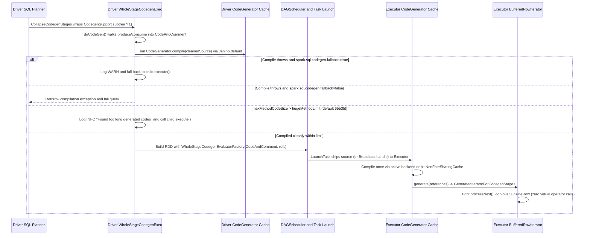

# WholeStageCodegen: fusing SQL operators into generated JVM bytecode

[component index](README.md)

Whole-stage code generation (`WholeStageCodegenExec` and `CodeGenerator`) is **not** a standalone compilation daemon and does **not** ship compiled `.class` bytecode across the network. It is Spark SQL's physical-plan fusion layer spanning the **Driver JVM** and every **Executor JVM**. On the driver, `CollapseCodegenStages` groups adjacent row-based `CodegenSupport` operators (`FileSourceScanExec`, `FilterExec`, `ProjectExec`, `HashAggregateExec`, `BroadcastHashJoinExec`) into a single `WholeStageCodegenExec` subtree, emits one generated Java source class extending `BufferedRowIterator`, and runs a driver-side trial compile to validate bytecode size and compilability. Executors receive the compact Java source string (`CodeAndComment`) inside the serialized task or broadcast, compile it locally (with **Janino** by default, or JDK `javax.tools.JavaCompiler` when configured), cache the generated class, and drive one tight JVM loop over Tungsten `UnsafeRow`s without Volcano virtual `next()` dispatch.

## Flow at a glance

1. **Plan fusion on the driver**: `CollapseCodegenStages` wraps consecutive `CodegenSupport` operators in `WholeStageCodegenExec(codegenStageId)` (shown as `*(1)`, `*(2)` in `EXPLAIN`), placing `InputAdapter` boundaries around non-codegen children.
2. **Driver `doCodeGen()` and trial compile**: `WholeStageCodegenExec.doExecute()` generates `CodeAndComment` via `doCodeGen()`, runs a trial `CodeGenerator.compile(cleanedSource)` to check compiler errors and `spark.sql.codegen.hugeMethodLimit` (default `65535` bytes), and attaches `WholeStageCodegenEvaluatorFactory` carrying the source (not `.class` bytes) and `references` array.
3. **Executor compile/cache hit and fused loop**: Each executor task calls `CodeGenerator.compile(cleanedSource)` against its JVM-local `NonFateSharingCache`, instantiates the generated `BufferedRowIterator` subclass, and loops in `processNext()` directly over `UnsafeRow` memory.

> **Key distinction:** The driver generates Java source and runs a trial compile to decide whether codegen stays active, whereas executors independently compile or hit their local bytecode cache per task. Oversized-method fallback (`> 65535` bytes by default) logs `INFO` unconditionally, whereas compilation-exception fallback happens only when `spark.sql.codegen.fallback=true`.

> **Interactive explorer:** [Open in Spark Visualizer](https://nuthanreddy.github.io/spark-visualizer/#component=whole-stage-codegen) to step through commands, wire payloads, category filters, and fault simulations on the live cluster canvas.

## Driver source generation vs executor compilation and fallback

During `QueryExecution.prepareForExecution()`, [`CollapseCodegenStages`][collapse] traverses the physical plan from top to bottom. An operator joins a codegen stage only if it implements `CodegenSupport`, has `supportCodegen == true`, contains no `CodegenFallback` expressions, does not output a single `ObjectType` domain column, and stays within `spark.sql.codegen.maxFields` (default `100`). Exchange boundaries (`ShuffleExchangeExec`), `BatchEvalPythonExec`, and wide schemas break fusion and receive [`InputAdapter`][input-adapter] wrappers.

| Phase | Where it runs | Artifact and mechanism | Failure or size-limit behavior |
|---|---|---|---|
| **Fusion (`CollapseCodegenStages`)** | Driver JVM (`prepareForExecution`) | Walks `SparkPlan` and wraps eligible subtrees in `WholeStageCodegenExec(child)(codegenStageId)`. Children of `SortMergeJoinExec`, `ShuffledHashJoinExec`, and `SortMergeAsOfJoinExec` are wrapped separately via `InputAdapter`. | Operators failing eligibility stay interpreted outside `*(N)`; no exception is thrown. |
| **Codegen (`doCodeGen`)** | Driver JVM ([`WholeStageCodegenExec.doCodeGen`][docodegen]) | Walks `produce()` / `consume()` templates across fused children to emit `GeneratedIteratorForCodegenStage<N> extends BufferedRowIterator` into a `CodeAndComment` plus `ctx.references` array. When `spark.sql.codegen.wholeStage.splitExpressions=true`, may run `chooseCode()` to selectively split hot expressions. | Produces Java source text only; does not transmit `.class` bytecode. |
| **Trial compile and fallback checks** | Driver JVM ([`WholeStageCodegenExec.doExecute`][doexecute]) | Calls [`CodeGenerator.compile(cleanedSource)`][cg-compile] on the driver to obtain `(GeneratedClass, ByteCodeStats)` before building the stage RDD. | **Two separate paths:** (1) `NonFatal` compile exception logs `WARN` and falls back to `child.execute()` **only** when `spark.sql.codegen.fallback=true` (when `false`, rethrows and fails the query); (2) `maxMethodCodeSize > spark.sql.codegen.hugeMethodLimit` (default `65535`) logs `INFO` and falls back to `child.execute()`. |
| **Source shipping** | Driver -> Executor via task closure or broadcast | [`WholeStageCodegenEvaluatorFactory`][eval-factory] holds `Either[Broadcast[CodeAndComment], CodeAndComment]`, `pipelineTime` metric, and `references: Array[Any]`. | Compact Java source ships once (or via `TorrentBroadcast` for large code); executors never receive `.class` bytes from the driver. |
| **Executor compile and execution** | Executor JVM ([`WholeStageCodegenEvaluatorFactory`][eval-factory] & [`BufferedRowIterator`][buf-iter]) | Task calls `CodeGenerator.compile(cleanedSource)` keyed by `(classLoader, backend, CodeAndComment)` in `NonFateSharingCache`, calls `clazz.generate(references)`, and drives `buffer.init(partitionIndex, inputs)` -> `hasNext()` / `processNext()`. | First task on an executor compiles the source; subsequent tasks hit the cache in microseconds. Execution updates the stage's `pipelineTime` SQL metric. |

## Compiler selection, `hugeMethodLimit`, and split controls

Janino is the **default** compiler, not the only compiler. [`spark.sql.codegen.compiler`][conf-compiler] accepts `"janino"` (default, fast cold start) or `"jdk"` (`javax.tools.JavaCompiler`, slower cold start). Even when `"jdk"` is selected, Spark deterministically routes REPL/interactive sessions, classes nested inside Scala package objects, and unrewritable anonymous/local classes back to `"janino"`, and falls back to `"janino"` with a warning on JRE-only images lacking `JavaCompiler`.

Key configuration controls in [`SQLConf`][conf-huge]:

- **`spark.sql.codegen.hugeMethodLimit` (default `65535`)**: Matches the 64 KiB JVM bytecode ceiling for a valid Java method. Operators sometimes lower this setting (for example to `8000`, `CodeGenerator.DEFAULT_JVM_HUGE_METHOD_LIMIT`) so HotSpot C2 JIT does not skip compiling generated methods past its `HugeMethodLimit` threshold.
- **`spark.sql.codegen.fallback` (default `true`)**: Gates only compilation-exception fallback in [`doExecute()`][doexecute] (disabled in unit tests via `!Utils.isTesting`). Setting it to `false` forces compilation bugs to surface as hard query failures instead of silently reverting to interpreted execution.
- **`spark.sql.codegen.methodSplitThreshold` (default `1024`)**, **`spark.sql.codegen.splitConsumeFuncByOperator` (default `true`)**, and **`spark.sql.codegen.wholeStage.splitExpressions`**: Split large expressions and per-operator consume blocks into helper methods so generated bytecode stays below HotSpot JIT limits without tripping `hugeMethodLimit`.
- **`spark.sql.codegen.wholeStage` (default `true`)** and **`spark.sql.codegen.maxFields` (default `100`)**: Global enable switch and wide-schema cutoff checked by `CollapseCodegenStages`.

## Inputs, outputs, and state

| Boundary | Contract |
|---|---|
| Inputs | Physical `SparkPlan` subtrees implementing `CodegenSupport`, SQL configs (`spark.sql.codegen.wholeStage`, `maxFields`, `hugeMethodLimit`, `fallback`, `compiler`, `methodSplitThreshold`), and input `RDD[InternalRow]` (or columnar batch RDDs converted inside the stage). |
| Owned state | Driver-side `CodegenContext` (mutable states, fresh names, `references` array) and `codegenStageId`; per-JVM `CodeGenerator.cache` (`NonFateSharingCache` keyed by weak `ClassLoader`, active `CodeCompiler`, and `CodeAndComment`); task-local `BufferedRowIterator` (`ArrayDeque<InternalRow>` output buffer and `startTimeNs`). |
| Outputs | Generated `BufferedRowIterator` subclass streaming `UnsafeRow`s through fused operators with zero per-row virtual operator calls, `pipelineTime` SQL metrics, `CodegenMetrics` Dropwizard histograms (`sourceCodeSize`, `compilationTime`), or interpreted `child.execute()` fallback RDDs. |

## Failure clues and diagnosis

- **Missing `*(N)` prefix in `df.explain()`:** Expected whenever an operator breaks fusion. Check for `ShuffleExchangeExec`, `BatchEvalPythonExec` ([Python UDFs](python-udf-operator.md)), wide schemas exceeding `spark.sql.codegen.maxFields` (`100`), `CodegenFallback` expressions, or domain `ObjectType` outputs from typed `Dataset` operators.
- **Driver log shows `INFO Found too long generated codes and JIT optimization might not work`:** `compiledCodeStats.maxMethodCodeSize` exceeded `spark.sql.codegen.hugeMethodLimit` (`65535` default, or a lowered HotSpot value like `8000`). Whole-stage codegen was disabled only for that subtree and fell back to `child.execute()`. Inspect generated code with `EXPLAIN CODEGEN` or adjust `hugeMethodLimit` / expression splitting.
- **Driver log shows `WARN Whole-stage codegen disabled for plan` (or query fails during planning with `CompileException`):** A compiler error occurred in `CodeGenerator.compile(cleanedSource)`. With `spark.sql.codegen.fallback=true`, Spark logs `WARN` and executes the interpreted child plan; with `fallback=false`, the exception propagates and fails the query immediately.
- **High first-task latency or Metaspace growth on executors:** Because executors compile `CodeAndComment` locally on cache miss, workloads that generate thousands of structurally distinct dynamic SQL queries (for example, unparameterized literal lists or varying projection schemas) can trigger repeated Janino compilations and pressure JVM Metaspace before `codegenCacheMaxEntries` evicts older entries.
- **Unexpected `"janino"` usage after setting `spark.sql.codegen.compiler=jdk`:** Check one-time `INFO` logs for deterministic routing overrides (interactive REPL/Spark Connect artifacts, package-object nested classes, or unrewritable anonymous classes) or a `WARN` indicating a JRE-only image without `javax.tools.JavaCompiler`.

[collapse]: https://github.com/apache/spark/blob/dada2a6db5d73b152d6ba16e4fe21406f86abfe3/sql/core/src/main/scala/org/apache/spark/sql/execution/WholeStageCodegenExec.scala#L1197-L1275
[input-adapter]: https://github.com/apache/spark/blob/dada2a6db5d73b152d6ba16e4fe21406f86abfe3/sql/core/src/main/scala/org/apache/spark/sql/execution/WholeStageCodegenExec.scala#L518-L585
[docodegen]: https://github.com/apache/spark/blob/dada2a6db5d73b152d6ba16e4fe21406f86abfe3/sql/core/src/main/scala/org/apache/spark/sql/execution/WholeStageCodegenExec.scala#L783-L793
[doexecute]: https://github.com/apache/spark/blob/dada2a6db5d73b152d6ba16e4fe21406f86abfe3/sql/core/src/main/scala/org/apache/spark/sql/execution/WholeStageCodegenExec.scala#L1021-L1060
[eval-factory]: https://github.com/apache/spark/blob/dada2a6db5d73b152d6ba16e4fe21406f86abfe3/sql/core/src/main/scala/org/apache/spark/sql/execution/WholeStageCodegenEvaluatorFactory.scala#L25-L58
[cg-compile]: https://github.com/apache/spark/blob/dada2a6db5d73b152d6ba16e4fe21406f86abfe3/sql/catalyst/src/main/scala/org/apache/spark/sql/catalyst/expressions/codegen/CodeGenerator.scala#L2692-L2752
[buf-iter]: https://github.com/apache/spark/blob/dada2a6db5d73b152d6ba16e4fe21406f86abfe3/sql/core/src/main/java/org/apache/spark/sql/execution/BufferedRowIterator.java#L34-L111
[conf-compiler]: https://github.com/apache/spark/blob/dada2a6db5d73b152d6ba16e4fe21406f86abfe3/sql/catalyst/src/main/scala/org/apache/spark/sql/internal/SQLConf.scala#L3333-L3358
[conf-huge]: https://github.com/apache/spark/blob/dada2a6db5d73b152d6ba16e4fe21406f86abfe3/sql/catalyst/src/main/scala/org/apache/spark/sql/internal/SQLConf.scala#L3360-L3400
