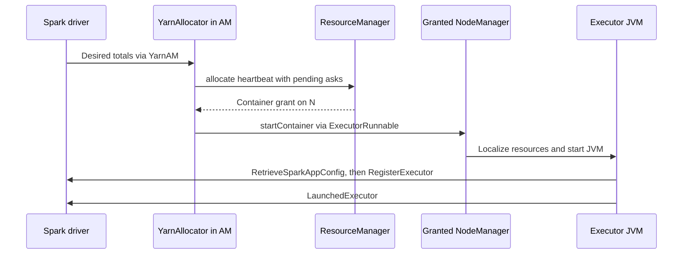

# YarnAllocator: turning executor targets into container requests

[Component index](README.md) · [Parent: ApplicationMaster](application-master.md)

`YarnAllocator` lives in the **ApplicationMaster JVM**, in both deploy modes. It reconciles the driver's desired executor counts with outstanding YARN requests and executor launches. The [ResourceManager (RM)](resource-manager.md) decides **where** to grant capacity, the selected [NodeManager (NM)](node-manager.md) **starts** the process, and the [executor backend](executor-backend.md) **registers itself** with the driver. The allocator never assigns Spark tasks or certifies that an executor is ready for them.

## Flow at a glance

1. **Spark driver**: Sets a target of five executors for one resource profile.
2. **YarnAllocator**: Counts two running, one starting and one pending, then requests one more.
3. **Launch worker**: Sends a start request to the NodeManager named in a matching grant.

> **Key distinction:** The allocator can count an executor as running before that executor registers with the driver.

Show the animated flow

## Interfaces and state

| Counterparty | Inputs, outputs, and local state |
|---|---|
| AM and Spark driver | The AM supplies an already-registered `AMRMClient`, attempt ID, driver URL/reference, credentials context, and executor `LocalResource` manifest. `initDefaultProfile` seeds the initial target. `RequestExecutors` later carries **absolute totals** per `ResourceProfile`, locality hints and excluded nodes. `requestTotalExecutorsWithPreferredLocalities` updates that state; `KillExecutors` is a separate request naming particular executors. [Constructor and state][state] · [initial target][init] · [target updates][target] |
| ResourceManager | The allocator maps each Spark resource profile to a YARN `Resource` (total memory, vcores, applicable custom resources) and uses the **profile ID as YARN request priority** to distinguish shapes. Hadoop's `AMRMClient` tracks pending `ContainerRequest`s. `allocate` exchanges asks/releases for grants, updated-node information, and completed `ContainerStatus` records. It also heartbeats when there is nothing new to ask for. [Priority mapping][priority] · [resource shape][shape] · [poll][poll] |
| NodeManager and driver | A launch worker uses `ExecutorRunnable` to call `NMClient.startContainer(grant, launchContext)` on the assigned NM. The allocator tracks starting counts, running executor IDs per profile, host/container/executor mappings, and containers already released. **Its `running` set is not the driver's executor registry**: the AM updates its own set after the NM start call returns, provided the container has not already completed. [Launch and bookkeeping][launch] · [NM call][nm] |

## Trace one allocation cycle

1. Suppose the driver wants **5** executors of one profile. The AM knows of **2 running, 1 starting and 1 pending**. `updateResourceRequests()` computes `missing = target - pending - running - starting`, so it needs **1** more, not 3 or 5. It can replace stale locality requests, form node/rack-preferred asks, and use any-host asks for the remainder. `addContainerRequest` updates AMRMClient bookkeeping; it is not a container grant. [Demand arithmetic][delta] · [placement and cancellations][asks]
2. The AM's reporter calls `allocateResources()`: update the asks, then call `amClient.allocate(0.1f)`. That fixed argument is not the fraction of tasks finished. The response may contain no grant, several grants, and/or completions. `handleAllocatedContainers` tries **host, then rack, then any host**, using the grant's priority and the requested capability. It removes one matching request. A late grant with no matching demand can be released unused. [Heartbeat/result][poll] · [grant matching][match]
3. If a grant matches and the running count is below target, `runAllocatedContainers` assigns a Spark executor ID, marks the launch in flight and submits work to the `ContainerLauncher` pool. The NM gets a command with `--driver-url`, `--executor-id`, `--cores`, `--app-id` and `--resourceProfileId`. It localizes the files and starts `YarnCoarseGrainedExecutorBackend`. A Spark executor ID is **not** a YARN container ID. The allocator seeds its counter with `RetrieveLastAllocatedExecutorId` from the driver; a replacement client-mode AM must not reuse IDs the surviving driver already knows. [ID initialization][id-init] · [launch worker][launch] · [command][command]
4. The executor independently fetches driver configuration, sends `RegisterExecutor` to the driver's `CoarseGrainedScheduler`, then signals `LaunchedExecutor` when ready. In cluster mode that driver endpoint is in the AM JVM; in client mode it is on the submit host. Neither uses `YarnAllocator` as a proxy. A second heartbeat must not re-request a container just because the JVM has not registered yet. [Executor bootstrap][bootstrap] · [registration][register] · [ready handling][ready]

## Scale-down, failure, and shutdown

- **Reduced target:** a negative delta cancels pending asks, up to the number pending. Lowering the target does **not** select existing executors to kill. `killExecutor(id)` instead resolves a known executor to its container, records the intentional release and asks the RM to release it. This distinction prevents a normal downscale from being diagnosed as an unexpected process loss. [Cancel pending asks][asks] · [explicit release][kill]
- **Launch failure versus executor loss:** on a nonfatal NM launch exception the worker clears its starting bookkeeping and requests release of the grant. If a launched container later completes, `processCompletedContainers` removes the mappings and computes an `ExecutorExited` reason. Preemption is not attributed to the application; a YARN physical-memory-limit kill normally is. Pending `GetExecutorLossReason` calls receive the reason, or it is saved for a later query. An unexpected completion for a mapped executor also sends `RemoveExecutor` to the driver. The next poll can ask for a replacement **if the target still requires one**. [Launch failure][launch] · [exit classification][completed] · [loss notifications][loss]
- **AM shutdown:** the reporter stops the allocator in `finally`; `stop()` calls `launcherPool.shutdownNow()` so queued launches do not start. The [AM](application-master.md), not the allocator, owns the attempt's final status. [Reporter cleanup][stop-reporter] · [pool shutdown][stop-pool]

**Where to look:** compare the AM's `target`, `pending`, `running`, and `executorsStarting` for the **same profile**. Pending without grants points first to RM capacity or placement. A grant and an AM launch log but no executor in the Spark UI calls for checking that container's NM/executor diagnostics and its advertised driver URL, not just increasing the target.

[state]: https://github.com/apache/spark/blob/dada2a6db5d73b152d6ba16e4fe21406f86abfe3/resource-managers/yarn/src/main/scala/org/apache/spark/deploy/yarn/YarnAllocator.scala#L67-L148
[init]: https://github.com/apache/spark/blob/dada2a6db5d73b152d6ba16e4fe21406f86abfe3/resource-managers/yarn/src/main/scala/org/apache/spark/deploy/yarn/YarnAllocator.scala#L213-L229
[target]: https://github.com/apache/spark/blob/dada2a6db5d73b152d6ba16e4fe21406f86abfe3/resource-managers/yarn/src/main/scala/org/apache/spark/deploy/yarn/YarnAllocator.scala#L371-L415
[priority]: https://github.com/apache/spark/blob/dada2a6db5d73b152d6ba16e4fe21406f86abfe3/resource-managers/yarn/src/main/scala/org/apache/spark/deploy/yarn/YarnAllocator.scala#L251-L275
[shape]: https://github.com/apache/spark/blob/dada2a6db5d73b152d6ba16e4fe21406f86abfe3/resource-managers/yarn/src/main/scala/org/apache/spark/deploy/yarn/YarnAllocator.scala#L313-L368
[poll]: https://github.com/apache/spark/blob/dada2a6db5d73b152d6ba16e4fe21406f86abfe3/resource-managers/yarn/src/main/scala/org/apache/spark/deploy/yarn/YarnAllocator.scala#L439-L473
[delta]: https://github.com/apache/spark/blob/dada2a6db5d73b152d6ba16e4fe21406f86abfe3/resource-managers/yarn/src/main/scala/org/apache/spark/deploy/yarn/YarnAllocator.scala#L498-L521
[asks]: https://github.com/apache/spark/blob/dada2a6db5d73b152d6ba16e4fe21406f86abfe3/resource-managers/yarn/src/main/scala/org/apache/spark/deploy/yarn/YarnAllocator.scala#L540-L609
[match]: https://github.com/apache/spark/blob/dada2a6db5d73b152d6ba16e4fe21406f86abfe3/resource-managers/yarn/src/main/scala/org/apache/spark/deploy/yarn/YarnAllocator.scala#L646-L749
[id-init]: https://github.com/apache/spark/blob/dada2a6db5d73b152d6ba16e4fe21406f86abfe3/resource-managers/yarn/src/main/scala/org/apache/spark/deploy/yarn/YarnAllocator.scala#L150-L165
[launch]: https://github.com/apache/spark/blob/dada2a6db5d73b152d6ba16e4fe21406f86abfe3/resource-managers/yarn/src/main/scala/org/apache/spark/deploy/yarn/YarnAllocator.scala#L755-L845
[nm]: https://github.com/apache/spark/blob/dada2a6db5d73b152d6ba16e4fe21406f86abfe3/resource-managers/yarn/src/main/scala/org/apache/spark/deploy/yarn/ExecutorRunnable.scala#L65-L126
[command]: https://github.com/apache/spark/blob/dada2a6db5d73b152d6ba16e4fe21406f86abfe3/resource-managers/yarn/src/main/scala/org/apache/spark/deploy/yarn/ExecutorRunnable.scala#L197-L211
[bootstrap]: https://github.com/apache/spark/blob/dada2a6db5d73b152d6ba16e4fe21406f86abfe3/core/src/main/scala/org/apache/spark/executor/CoarseGrainedExecutorBackend.scala#L439-L465
[register]: https://github.com/apache/spark/blob/dada2a6db5d73b152d6ba16e4fe21406f86abfe3/core/src/main/scala/org/apache/spark/executor/CoarseGrainedExecutorBackend.scala#L101-L113
[ready]: https://github.com/apache/spark/blob/dada2a6db5d73b152d6ba16e4fe21406f86abfe3/core/src/main/scala/org/apache/spark/scheduler/cluster/CoarseGrainedSchedulerBackend.scala#L247-L252
[kill]: https://github.com/apache/spark/blob/dada2a6db5d73b152d6ba16e4fe21406f86abfe3/resource-managers/yarn/src/main/scala/org/apache/spark/deploy/yarn/YarnAllocator.scala#L417-L429
[completed]: https://github.com/apache/spark/blob/dada2a6db5d73b152d6ba16e4fe21406f86abfe3/resource-managers/yarn/src/main/scala/org/apache/spark/deploy/yarn/YarnAllocator.scala#L848-L906
[loss]: https://github.com/apache/spark/blob/dada2a6db5d73b152d6ba16e4fe21406f86abfe3/resource-managers/yarn/src/main/scala/org/apache/spark/deploy/yarn/YarnAllocator.scala#L958-L1008
[stop-reporter]: https://github.com/apache/spark/blob/dada2a6db5d73b152d6ba16e4fe21406f86abfe3/resource-managers/yarn/src/main/scala/org/apache/spark/deploy/yarn/ApplicationMaster.scala#L670-L685
[stop-pool]: https://github.com/apache/spark/blob/dada2a6db5d73b152d6ba16e4fe21406f86abfe3/resource-managers/yarn/src/main/scala/org/apache/spark/deploy/yarn/YarnAllocator.scala#L611-L615
