# YARN submission client: building the first container's launch instructions

[Component index](README.md) · [Previous: spark-submit](spark-submit.md) · [Next: ApplicationMaster](application-master.md)

Spark's `org.apache.spark.deploy.yarn.Client` translates one Spark submission into a YARN `ApplicationSubmissionContext`. It runs on the submit host, wrapping Hadoop's `YarnClient`. In **cluster** mode `YarnClusterApplication` owns the call; in **client** mode the already-running driver's `YarnClientSchedulerBackend` owns it. It is **not** the AM-side `YarnRMClient`: the submission client requests an application ID and submits an AM specification, not executor containers. This page follows a managed AM. [Client fields][fields] · [cluster caller][cluster-caller] · [client caller][client-caller]

## Flow at a glance

1. **ResourceManager**: Gives the submission client an application ID.
2. **Submission client**: Stages the local script and submits the cluster-mode AM launch record.
3. **NodeManager**: Fetches or reuses the listed files for the AM container.

> **Key distinction:** Staging makes a file available to the cluster. Localization makes it visible in one container's working directory.

> **Interactive explorer:** [Open in Spark Visualizer](https://nuthanreddy.github.io/spark-visualizer/#component=yarn-client) to step through commands, wire payloads, category filters, and fault simulations on the live cluster canvas.

## Two different records go to YARN

| Record | Who consumes it and why |
|---|---|
| `ApplicationSubmissionContext` | The [ResourceManager (RM)](resource-manager.md) receives the application ID, name, queue, AM resource capability, optional attempt/placement settings, and the nested AM container specification. This asks YARN to run **one AM**; it does not reserve all the executors at submission time. [Submission context][outer] |
| `ContainerLaunchContext` | YARN passes these instructions to the selected [NodeManager (NM)](node-manager.md): a map from container filenames to `LocalResource` descriptors, environment, Java command, credentials, and ACLs. Cluster mode invokes `ApplicationMaster` with a user class and the script basename; client mode invokes `ExecutorLauncher` with the external driver's `host:port`. Both get paths to the Spark properties and distributed-cache metadata. [Resources/environment][inner] · [command/credentials][command] |

## Trace `orders.py` and `--py-files rules.zip`

1. **Get an identity, not a grant.** `submitApplication()` initializes the Hadoop client with `YarnConfiguration`, calls `createApplication()`, saves `appId`, and derives `stagingDirPath`. By default the path is `.sparkStaging/<applicationId>` under the user's home on the default filesystem. `verifyClusterResources` checks **per-container** limits: executor heap + off-heap + overhead + explicit PySpark worker memory, and separately AM heap + overhead. Cluster mode uses the driver memory/cores for the AM; client mode uses the AM settings because the driver is elsewhere. This does not test current queue capacity. [Order and staging base][submit] · [resource choices][fields] · [memory checks][limits]
2. **Stage shareable bytes.** `prepareLocalResources` builds a manifest. For a submit-host `file:` dependency, `copyFileToRemote` uploads to staging (typically HDFS). A dependency already on the same remote filesystem can be referenced in place. A `local:` dependency denotes an already-installed cluster path and is not uploaded. These are different from `spark-submit` downloading a remote dependency to its own temporary directory. [Copy rules][copy] · [URI and link-name rules][distribute]
3. **Describe who needs which bytes.** In cluster mode the primary `orders.py` is AM-only; the client-mode driver already has its copy. `rules.zip` goes into the shared dependency metadata, as do eligible PySpark runtime libraries. `ClientDistributedCacheManager` records a link name, URL, type, size, timestamp, and visibility. AM-only entries go into the AM map but not the executor manifest. Spark creates a config archive containing Spark properties and executor cache metadata, uploads it, and advertises it as an `ARCHIVE` under `__spark_conf__`. [Python resources and archive][archive] · [manifest writer][manifest] · [archive contents][archive-contents]
4. **Submit, then localize.** The client attaches the AM launch record and calls `yarnClient.submitApplication(appContext)`. Now the RM can arrange the first container. Its NM fetches or reuses the named resources and makes them available in that container's working directory. The client never copies files into a worker's process directory. The AM later reconstructs the executor `LocalResource` map for executor launches on other NMs. [Submission call][submit] · [AM reconstruction][rebuild]

The client's state reflects this handoff: `appId` correlates reports; `stagingDirPath` supports cleanup; `distCacheMgr` and `cachedResourcesConf` build the manifests; `launcherBackend` reports launcher state. None is a registry of running executors.

## Failure, monitoring, and cleanup

| Observation | What it means / where to look |
|---|---|
| Application ID printed, then `above the max threshold` | The client got a new ID but refused the memory request **before submitting** the AM. Look at submit-side memory arithmetic; increasing queue capacity cannot help. Submission exceptions after a staging path was set trigger a cleanup attempt unless preservation is enabled. [Checks][limits] · [error cleanup][cleanup] |
| File exists on the submit host but is absent in the AM | Look for upload or same-filesystem reuse on the submit host, then the manifest's URI/type/link name. After submission, check the selected NM's localization diagnostics. A local path existing on the submit host is not evidence it exists on that worker. [Copy rules][copy] · [manifest][manifest] |
| `RUNNING` or a successful return from the launcher | Neither proves `orders.py` finished. `monitorApplication` distinguishes YARN application state from final status. Normal cluster `run()` polls to completion and raises on failed/killed or undefined final status; cluster fire-and-forget without a connected launcher backend only inspects one report. In client mode the backend initially waits for `RUNNING`, then monitors asynchronously and stops the client on driver shutdown. [Report polling][reports] · [cluster result][result] · [client startup][client-caller] · [client shutdown][client-stop] |

[fields]: https://github.com/apache/spark/blob/dada2a6db5d73b152d6ba16e4fe21406f86abfe3/resource-managers/yarn/src/main/scala/org/apache/spark/deploy/yarn/Client.scala#L66-L138
[cluster-caller]: https://github.com/apache/spark/blob/dada2a6db5d73b152d6ba16e4fe21406f86abfe3/resource-managers/yarn/src/main/scala/org/apache/spark/deploy/yarn/Client.scala#L1829-L1841
[client-caller]: https://github.com/apache/spark/blob/dada2a6db5d73b152d6ba16e4fe21406f86abfe3/resource-managers/yarn/src/main/scala/org/apache/spark/scheduler/cluster/YarnClientSchedulerBackend.scala#L49-L103
[outer]: https://github.com/apache/spark/blob/dada2a6db5d73b152d6ba16e4fe21406f86abfe3/resource-managers/yarn/src/main/scala/org/apache/spark/deploy/yarn/Client.scala#L273-L324
[inner]: https://github.com/apache/spark/blob/dada2a6db5d73b152d6ba16e4fe21406f86abfe3/resource-managers/yarn/src/main/scala/org/apache/spark/deploy/yarn/Client.scala#L1033-L1049
[command]: https://github.com/apache/spark/blob/dada2a6db5d73b152d6ba16e4fe21406f86abfe3/resource-managers/yarn/src/main/scala/org/apache/spark/deploy/yarn/Client.scala#L1119-L1195
[submit]: https://github.com/apache/spark/blob/dada2a6db5d73b152d6ba16e4fe21406f86abfe3/resource-managers/yarn/src/main/scala/org/apache/spark/deploy/yarn/Client.scala#L194-L238
[limits]: https://github.com/apache/spark/blob/dada2a6db5d73b152d6ba16e4fe21406f86abfe3/resource-managers/yarn/src/main/scala/org/apache/spark/deploy/yarn/Client.scala#L404-L432
[copy]: https://github.com/apache/spark/blob/dada2a6db5d73b152d6ba16e4fe21406f86abfe3/resource-managers/yarn/src/main/scala/org/apache/spark/deploy/yarn/Client.scala#L434-L477
[distribute]: https://github.com/apache/spark/blob/dada2a6db5d73b152d6ba16e4fe21406f86abfe3/resource-managers/yarn/src/main/scala/org/apache/spark/deploy/yarn/Client.scala#L578-L619
[archive]: https://github.com/apache/spark/blob/dada2a6db5d73b152d6ba16e4fe21406f86abfe3/resource-managers/yarn/src/main/scala/org/apache/spark/deploy/yarn/Client.scala#L783-L837
[manifest]: https://github.com/apache/spark/blob/dada2a6db5d73b152d6ba16e4fe21406f86abfe3/resource-managers/yarn/src/main/scala/org/apache/spark/deploy/yarn/ClientDistributedCacheManager.scala#L62-L100
[archive-contents]: https://github.com/apache/spark/blob/dada2a6db5d73b152d6ba16e4fe21406f86abfe3/resource-managers/yarn/src/main/scala/org/apache/spark/deploy/yarn/Client.scala#L928-L959
[rebuild]: https://github.com/apache/spark/blob/dada2a6db5d73b152d6ba16e4fe21406f86abfe3/resource-managers/yarn/src/main/scala/org/apache/spark/deploy/yarn/ApplicationMaster.scala#L141-L190
[cleanup]: https://github.com/apache/spark/blob/dada2a6db5d73b152d6ba16e4fe21406f86abfe3/resource-managers/yarn/src/main/scala/org/apache/spark/deploy/yarn/Client.scala#L236-L266
[reports]: https://github.com/apache/spark/blob/dada2a6db5d73b152d6ba16e4fe21406f86abfe3/resource-managers/yarn/src/main/scala/org/apache/spark/deploy/yarn/Client.scala#L1210-L1282
[result]: https://github.com/apache/spark/blob/dada2a6db5d73b152d6ba16e4fe21406f86abfe3/resource-managers/yarn/src/main/scala/org/apache/spark/deploy/yarn/Client.scala#L1386-L1412
[client-stop]: https://github.com/apache/spark/blob/dada2a6db5d73b152d6ba16e4fe21406f86abfe3/resource-managers/yarn/src/main/scala/org/apache/spark/scheduler/cluster/YarnClientSchedulerBackend.scala#L174-L192
