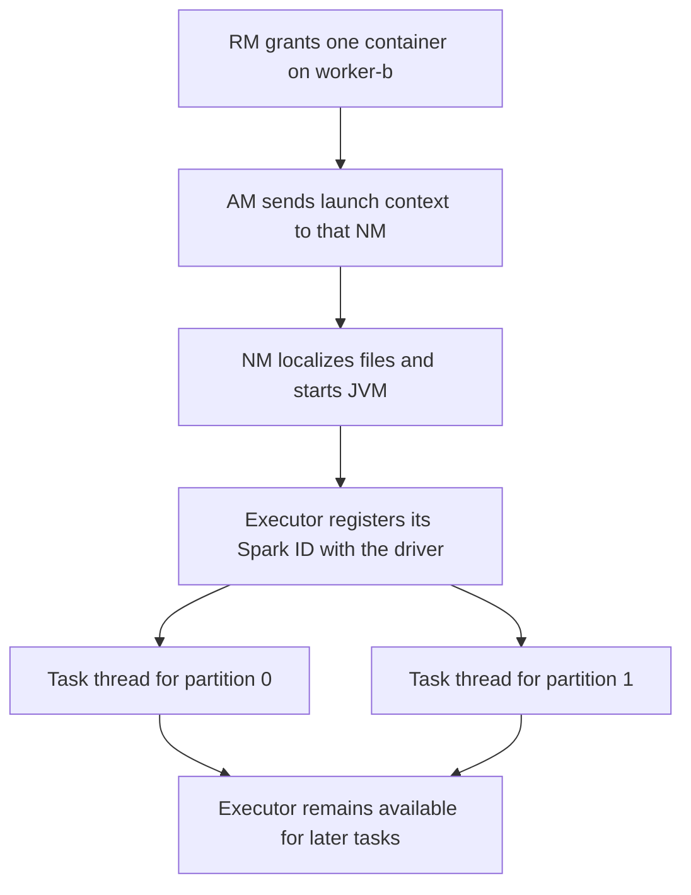

# YARN container: one allocation, several lifecycle milestones

[component index](README.md) | [PySpark on YARN walkthrough](../pyspark-on-yarn.md)

A YARN container is a resource grant on a named node and the lifecycle YARN
tracks under its `ContainerId`. **It is not another daemon, a Spark executor
ID, a task, or necessarily a Docker container.** It has no RPC listener of
its own. The host and port in the grant identify the [NodeManager (NM)](node-manager.md), not the
executor. The executor JVM need not even exist yet.

## Flow at a glance

1. **ResourceManager**: Grants one container with two vcores on worker-b.
2. **ApplicationMaster**: Sends the grant token and launch instructions to that node.
3. **NodeManager**: Starts the executor JVM, which then registers with the Spark driver.

> **Key distinction:** YARN can grant both vcores before the executor process even exists.

> **Interactive explorer:** [Open in Spark Visualizer](https://nuthanreddy.github.io/spark-visualizer/#component=yarn-container) to step through commands, wire payloads, category filters, and fault simulations on the live cluster canvas.

## Who owns which record?

For executor capacity, the [ApplicationMaster (AM)](application-master.md) deals
with the [ResourceManager (RM)](resource-manager.md) first and the assigned NM second.

| Record and owner | Concrete input | Result and meaning |
|---|---|---|
| `ResourceRequest`, AM to RM for executor capacity | Count, priority, capability (e.g. memory and vcores), and host/rack/`*` preference | Demand the scheduler tries to place. An outstanding ask has no assigned node or process. |
| `Container`, RM to AM in `AllocateResponse` | A fit between an outstanding ask, queue policy, and available node resources | Grant with `ContainerId`, `NodeId`, capacity, priority, and a container token. A container ID identifies an allocating application attempt and a container sequence, not an OS PID. |
| `StartContainerRequest`, launcher to chosen NM | The grant's container token **plus** a `ContainerLaunchContext`: commands, environment, local resources, credentials | NM authorization and asynchronous start. The NM token used for the caller's RPC and the container token proving the specific grant serve different purposes. |
| `ContainerStatus`, NM to RM and onward to AM | Node-side state, process exit, resource-limit kill, or cleanup event | ID, state, exit status, and diagnostic text. Spark separately records executor registration and the success or failure of individual task attempts. |

The scheduler grants the allocation; the NM creates and monitors the local
process tree. A normal child exit, an AM stop/release, preemption, or application
cleanup can end it. The RM accounts for the released resources. A replacement
executor normally receives a **new** allocation; retrying one Spark task can
reuse an executor and need not allocate anything.

## Worked flow: where two Spark slots come from

1. The walkthrough requests **three two-core executors**. The cluster-mode AM/driver needs its own container. At full allocation this is four YARN containers, not one per partition. In client mode the AM still has a container, but the driver runs on the submit host.
2. For one illustrative executor, 4,096 MiB heap + 1,024 MiB overhead, with no configured off-heap or separate PySpark memory, yields a **5,120 MiB** memory request before YARN normalization. Spark adds those latter two allocations when configured and applicable. The grant is a process-tree budget, not the JVM `-Xmx` value; vcores also do not necessarily mean dedicated physical cores.
3. The RM places the executor grant. The AM maps it to a Spark executor ID and sends the launch context directly to the NM. For the **AM** container the caller is instead the RM, using the client's previously submitted launch context.
4. After registration the driver may run two ordinary one-CPU tasks concurrently in that executor. Finishing either task frees a Spark slot; it does not release the container. If Python workers are needed they are child processes in the same allocation, not new YARN containers.
5. On shutdown or loss, match the container ID in the AM logs to its Spark executor ID. A final YARN status explains the allocation's end; use Spark's event or task logs to find which partition attempts were affected.

## Interpreting state and failure

- **Granted, not launched:** there may be no NM record yet. Check the AM's launch request and the assigned node, not a nonexistent executor log.
- **`RUNNING`, no executor:** in Hadoop 3.4.1 `ContainerImpl` maps even its internal `LOCALIZING` and `SCHEDULED` states to public `RUNNING`, with substate `SCHEDULED`. Check the substate or localization logs first, then JVM startup and driver registration.
- **`COMPLETE`, unexpected loss:** compare exit status and diagnostics, not just the word `COMPLETE`. `PREEMPTED` (`-102`) signals scheduler action; `KILLED_EXCEEDED_PMEM` (`-104`) signals a physical-memory limit. An ordinary nonzero process exit calls for inspecting its `stderr`.

Use `yarn container -list <app_attempt_id>` and `yarn container -status <container_id>`
to follow the YARN record. The Spark UI's Executors tab answers
the different question of whether the driver ever knew that executor.

## Sources

- Hadoop 3.4.1: [application launch flow](https://hadoop.apache.org/docs/r3.4.1/hadoop-yarn/hadoop-yarn-site/WritingYarnApplications.html) and [YARN diagnostic commands](https://hadoop.apache.org/docs/r3.4.1/hadoop-yarn/hadoop-yarn-site/YarnCommands.html).
- Hadoop 3.4.1 source: [allocation, launch context, and status fields](https://github.com/apache/hadoop/blob/4d7825309348956336b8f06a08322b78422849b1/hadoop-yarn-project/hadoop-yarn/hadoop-yarn-api/src/main/proto/yarn_protos.proto), [node-side state mapping](https://github.com/apache/hadoop/blob/4d7825309348956336b8f06a08322b78422849b1/hadoop-yarn-project/hadoop-yarn/hadoop-yarn-server/hadoop-yarn-server-nodemanager/src/main/java/org/apache/hadoop/yarn/server/nodemanager/containermanager/container/ContainerImpl.java#L751-L805), and [exit-status definitions](https://github.com/apache/hadoop/blob/4d7825309348956336b8f06a08322b78422849b1/hadoop-yarn-project/hadoop-yarn/hadoop-yarn-api/src/main/java/org/apache/hadoop/yarn/api/records/ContainerExitStatus.java).
- Spark integration: [executor memory calculation](https://github.com/apache/spark/blob/dada2a6db5d73b152d6ba16e4fe21406f86abfe3/core/src/main/scala/org/apache/spark/resource/ResourceProfile.scala#L561-L613) and [mapping grants to executor launches](https://github.com/apache/spark/blob/dada2a6db5d73b152d6ba16e4fe21406f86abfe3/resource-managers/yarn/src/main/scala/org/apache/spark/deploy/yarn/YarnAllocator.scala#L755-L809).
