# YarnSchedulerBackend: the driver's adapter to the ApplicationMaster

[component index](README.md) · Driver JVM, AM-facing endpoint · Apache Spark `dada2a6`

## Overview

`YarnSchedulerBackend` communicates **how many executors Spark wants** and
**why a particular executor disappeared**. It is not the AM's [YarnAllocator](yarn-allocator.md).
The driver sends Spark RPC messages to the [ApplicationMaster](application-master.md)
(AM); the allocator translates demand into YARN container requests and receives
grants from the [ResourceManager](resource-manager.md) (RM). Once an executor registers, the inherited
[driver scheduler backend](driver-scheduler-backend.md) handles its free cores
and task launches without routing each task through the AM.

## Flow at a glance

1. **Driver backend**: Stops offering executor 3 and asks the AM why it disconnected.
2. **ApplicationMaster**: Checks the container's exit status and reports YARN preemption.
3. **Task set manager**: Can retry the interrupted task without counting it against the failure limit.

> **Watch for:** A disconnect stops new offers immediately; it does not tell you why the executor disappeared.

Show the animated flow

## Requirements analysis

The same task-scheduling code must work with a driver inside the AM container
(cluster mode) or outside it (client mode). Express demand as a **target per
resource profile**, not a stream of increments that could double-count pending
executors. Separate a request acknowledgement from a grant, and a broken network
connection from an application-caused executor failure.
[Target contract][totals] · [AM request handler][am] · [loss inquiry][loss].

## Component architecture and lifetime

| Deploy mode | Who constructs, starts and stops the backend |
|---|---|
| Cluster | `YarnClusterManager` creates `YarnClusterSchedulerBackend`. On `start`, it binds the AM's YARN application and attempt IDs, starts the base backend, and sets the initial expected executor count. Its `stop(exitCode)` signals the AM, then calls common backend shutdown. [Factory][factory] · [cluster lifecycle][cluster] |
| Client | The same factory creates `YarnClientSchedulerBackend` in the submitting driver. Its `start` starts the base, builds the driver host:port argument, submits the YARN application via `Client`, binds its application ID (no backend attempt ID), waits for the application to run, and starts a monitor. Unexpected application exit can stop the context. Normal stop signals the AM, stops the monitor and backend, then closes the client. [Startup][client-start] · [monitor][monitor] · [stop][client-stop] |

`TaskSchedulerImpl` calls `backend.start()`/`backend.stop(exitCode)`. The common
YARN constructor registers its `YarnSchedulerEndpoint` (`YarnScheduler`) in the
driver `RpcEnv`; separately the inherited executor-facing endpoint is a
`YarnDriverEndpoint` (`CoarseGrainedScheduler`). At AM startup,
`AMEndpoint.onStart` sends `RegisterClusterManager(self)` to `YarnScheduler`.
Common shutdown requests empty executor targets to avoid replacements, then
invokes the coarse-grained shutdown; a `finally` sets the stopped flag.
[Driver calls][task-start] · [shutdown caller][task-stop] · [adapter state][state] ·
[AM registration][register-am] · [shared shutdown][bind].

## Data models and concurrency

| Value | Owner and interpretation |
|---|---|
| `appId`, optional `attemptId`, `amEndpoint: Option[RpcEndpointRef]` | Driver-side YARN identity and current AM route. The cluster-mode attempt string is a YARN attempt counter, **not** a stage or task attempt. Client mode can have a live YARN AM without setting this driver's `attemptId`. |
| `totalExpectedExecutors`, `totalRegisteredExecutors` | Initial expectation and inherited registration count. Startup readiness is `registered >= expected * minRegisteredRatio` (YARN default `0.8`) **or** expiry of the base maximum wait. With five expected and no override, four registrations meet the ratio; this says nothing about four free task slots. |
| `Map[ResourceProfile, Int]` plus locality and exclusions | Desired executor totals, counts of locality-aware tasks by profile, preferred host counts by profile, and excluded nodes go to the AM. The allocator, not the driver endpoint, owns `executorId ↔ containerId` and pending/running/starting container accounting. |

The AM-facing endpoint is a `ThreadSafeRpcEndpoint`: its message handlers run
serially, but a forwarded `ask` completes asynchronously. The driver returns
the AM's Boolean or failure through the original `RpcCallContext`; it does
not hold that handler waiting for a container to be launched. The outer
`requestTotalExecutors` API does wait for the acknowledgement after leaving
its synchronized update. [Identity and request fields][identity] ·
[readiness tests][ratio] · [timeout][ready] · [RPC forwarding][forward] ·
[target publication][totals] · [container identity][ids].

## Design patterns used

**Adapter and proxy (structural).** `doRequestTotalExecutors` adapts the
cluster-neutral backend contract to Spark's `RequestExecutors` message, removing
excluded hosts from preferences. `YarnSchedulerEndpoint` proxies the request
to the registered AM ref. This keeps Hadoop's allocation protocol out of
[TaskSchedulerImpl](task-scheduler.md) and allows the AM ref to change across
attempts; unlike a direct call, it has an explicit "no AM registered" case,
timeouts, and replies that do not prove the work is finished.
[Request construction][requests] · [forwarding and errors][forward].

## API/interface definitions

| Caller and message | Response or next action |
|---|---|
| [ExecutorAllocationManager](executor-allocation-manager.md) → `requestTotalExecutors(profileIdToTotal, localityCounts, hostCounts)` | Base backend resolves profile IDs and publishes totals. YARN sends `RequestExecutors` via the driver endpoint named `YarnScheduler` to the AM. A ready allocator updating or retaining its target yields `true`; no registered AM or no ready allocator yields `false`. A failed ask to a registered AM is propagated. [Caller][caller] · [YARN request][requests] · [AM side][am] |
| Driver → `doKillExecutors(Seq[executorId])` | Forwards `KillExecutors` to the AM; allocator maps IDs to containers for release. This is not a `KillTask(TID, ...)`. In this revision the AM's kill handler replies `true` even if it only warned that the allocator was not ready: it is not proof of release. [Forwarder][forward] · [AM handler][am] · [allocator release][allocator] |
| AM → `RegisterClusterManager(amRef)` / driver → AM `Shutdown(exitCode)` | Registration installs the AM ref and calls `reset()`. Shutdown marks the AM/allocator as shutting down; it is distinct from executor-facing `StopExecutor`. [Driver receive/send][control] · [AM receive][am] |
| Executor disconnect at `YarnDriverEndpoint` → AM `GetExecutorLossReason(executorId)` | Disables offers for that executor, obtains the detailed reason asynchronously if possible, and posts `RemoveExecutor(id, reason)` to the executor-facing driver endpoint. The AM can also send `RemoveExecutor` unsolicited. [Disconnect][loss] · [remove forwarding][control] |

## Implementation notes: a target of five, not five more

1. Suppose the driver sends a target of **five** for one resource profile.
   The AM applies the target and can wake its allocation loop before replying;
   the Boolean is an acknowledgement of demand. Sending the same target again
   does not add five more executors. [Target preparation][requests] · [AM reply][am].
2. If the allocator has **two running, one starting and one pending request**,
   its deficit is `5 - 2 - 1 - 1 = 1`. It prepares the missing request and its
   `allocate()` call to the RM returns whatever containers YARN actually grants.
   Capacity, locality and timing need not produce a grant on that call.
   [Deficit calculation][deficit] · [allocation heartbeat][allocate].
3. An allocated executor container is launched on its node. The Spark executor
   must still register and send `LaunchedExecutor` to the
   [executor-facing endpoint](driver-scheduler-backend.md) before its CPUs
   become available for task offers. A stage's missing shuffle parent or a
   task's locality wait is unaffected by the acknowledgement in step 1.
   [Container launch and association][ids] · [Spark-side launch acknowledgement][launched].

**Loss, late replies and AM replacement.** If executor `3` disconnects, the
driver stops offering it with `LossReasonPending`. The AM can hold the
loss-reason request until container completion, or return a previously stored
reason. A YARN preemption is classified as not caused by the application; the
[task-set manager](task-set-manager.md) can retry an ordinary running task
without charging that event to its failure limit. A missing AM or failed/timed
out inquiry instead produces `ExecutorProcessLost`; a disconnect alone does
not establish preemption. An AM disconnect clears the matching AM ref. On
registration/re-registration, reset removes lingering executors and resets the
optional allocation manager (the base handles held executor targets specially).
This repairs driver routing, not Python or job state after a dead driver.
[Pending/failed inquiry][loss] · [AM-side race][loss-race] ·
[preemption classification][preempt] · [task accounting][task-loss] ·
[AM ref removal][forward] · [reset][reset] · [stale executors][base-reset].

## Scalability and performance considerations

Requests summarize demand per resource profile instead of making an RM request
per task. AM/RM allocation and executor startup introduce delay that faster
driver offer rounds cannot eliminate. **Diagnostic:** the driver warning
`Attempted to request executors before the AM has registered!` means the
driver had no AM route, not that a YARN queue rejected a container. If the
request was acknowledged, compare the AM's per-profile target/pending/starting/
running counts with executor registrations before attributing the delay to
task placement. [No-AM branch][forward] · [allocator counts and request log][deficit].

[totals]: https://github.com/apache/spark/blob/dada2a6db5d73b152d6ba16e4fe21406f86abfe3/core/src/main/scala/org/apache/spark/scheduler/cluster/CoarseGrainedSchedulerBackend.scala#L1009-L1055
[am]: https://github.com/apache/spark/blob/dada2a6db5d73b152d6ba16e4fe21406f86abfe3/resource-managers/yarn/src/main/scala/org/apache/spark/deploy/yarn/ApplicationMaster.scala#L831-L877
[loss]: https://github.com/apache/spark/blob/dada2a6db5d73b152d6ba16e4fe21406f86abfe3/resource-managers/yarn/src/main/scala/org/apache/spark/scheduler/cluster/YarnSchedulerBackend.scala#L274-L328
[factory]: https://github.com/apache/spark/blob/dada2a6db5d73b152d6ba16e4fe21406f86abfe3/resource-managers/yarn/src/main/scala/org/apache/spark/scheduler/cluster/YarnClusterManager.scala#L26-L55
[cluster]: https://github.com/apache/spark/blob/dada2a6db5d73b152d6ba16e4fe21406f86abfe3/resource-managers/yarn/src/main/scala/org/apache/spark/scheduler/cluster/YarnClusterSchedulerBackend.scala#L25-L42
[client-start]: https://github.com/apache/spark/blob/dada2a6db5d73b152d6ba16e4fe21406f86abfe3/resource-managers/yarn/src/main/scala/org/apache/spark/scheduler/cluster/YarnClientSchedulerBackend.scala#L45-L75
[monitor]: https://github.com/apache/spark/blob/dada2a6db5d73b152d6ba16e4fe21406f86abfe3/resource-managers/yarn/src/main/scala/org/apache/spark/scheduler/cluster/YarnClientSchedulerBackend.scala#L114-L150
[client-stop]: https://github.com/apache/spark/blob/dada2a6db5d73b152d6ba16e4fe21406f86abfe3/resource-managers/yarn/src/main/scala/org/apache/spark/scheduler/cluster/YarnClientSchedulerBackend.scala#L174-L193
[task-start]: https://github.com/apache/spark/blob/dada2a6db5d73b152d6ba16e4fe21406f86abfe3/core/src/main/scala/org/apache/spark/scheduler/TaskSchedulerImpl.scala#L284-L297
[task-stop]: https://github.com/apache/spark/blob/dada2a6db5d73b152d6ba16e4fe21406f86abfe3/core/src/main/scala/org/apache/spark/scheduler/TaskSchedulerImpl.scala#L1018-L1028
[state]: https://github.com/apache/spark/blob/dada2a6db5d73b152d6ba16e4fe21406f86abfe3/resource-managers/yarn/src/main/scala/org/apache/spark/scheduler/cluster/YarnSchedulerBackend.scala#L46-L83
[register-am]: https://github.com/apache/spark/blob/dada2a6db5d73b152d6ba16e4fe21406f86abfe3/resource-managers/yarn/src/main/scala/org/apache/spark/deploy/yarn/ApplicationMaster.scala#L810-L828
[bind]: https://github.com/apache/spark/blob/dada2a6db5d73b152d6ba16e4fe21406f86abfe3/resource-managers/yarn/src/main/scala/org/apache/spark/scheduler/cluster/YarnSchedulerBackend.scala#L102-L120
[identity]: https://github.com/apache/spark/blob/dada2a6db5d73b152d6ba16e4fe21406f86abfe3/resource-managers/yarn/src/main/scala/org/apache/spark/scheduler/cluster/YarnSchedulerBackend.scala#L122-L156
[ratio]: https://github.com/apache/spark/blob/dada2a6db5d73b152d6ba16e4fe21406f86abfe3/resource-managers/yarn/src/main/scala/org/apache/spark/scheduler/cluster/YarnSchedulerBackend.scala#L175-L179
[ready]: https://github.com/apache/spark/blob/dada2a6db5d73b152d6ba16e4fe21406f86abfe3/core/src/main/scala/org/apache/spark/scheduler/cluster/CoarseGrainedSchedulerBackend.scala#L787-L800
[forward]: https://github.com/apache/spark/blob/dada2a6db5d73b152d6ba16e4fe21406f86abfe3/resource-managers/yarn/src/main/scala/org/apache/spark/scheduler/cluster/YarnSchedulerBackend.scala#L366-L409
[ids]: https://github.com/apache/spark/blob/dada2a6db5d73b152d6ba16e4fe21406f86abfe3/resource-managers/yarn/src/main/scala/org/apache/spark/deploy/yarn/YarnAllocator.scala#L774-L836
[requests]: https://github.com/apache/spark/blob/dada2a6db5d73b152d6ba16e4fe21406f86abfe3/resource-managers/yarn/src/main/scala/org/apache/spark/scheduler/cluster/YarnSchedulerBackend.scala#L146-L175
[caller]: https://github.com/apache/spark/blob/dada2a6db5d73b152d6ba16e4fe21406f86abfe3/core/src/main/scala/org/apache/spark/ExecutorAllocationManager.scala#L558-L579
[allocator]: https://github.com/apache/spark/blob/dada2a6db5d73b152d6ba16e4fe21406f86abfe3/resource-managers/yarn/src/main/scala/org/apache/spark/deploy/yarn/YarnAllocator.scala#L385-L431
[control]: https://github.com/apache/spark/blob/dada2a6db5d73b152d6ba16e4fe21406f86abfe3/resource-managers/yarn/src/main/scala/org/apache/spark/scheduler/cluster/YarnSchedulerBackend.scala#L330-L359
[deficit]: https://github.com/apache/spark/blob/dada2a6db5d73b152d6ba16e4fe21406f86abfe3/resource-managers/yarn/src/main/scala/org/apache/spark/deploy/yarn/YarnAllocator.scala#L498-L530
[allocate]: https://github.com/apache/spark/blob/dada2a6db5d73b152d6ba16e4fe21406f86abfe3/resource-managers/yarn/src/main/scala/org/apache/spark/deploy/yarn/YarnAllocator.scala#L439-L467
[launched]: https://github.com/apache/spark/blob/dada2a6db5d73b152d6ba16e4fe21406f86abfe3/core/src/main/scala/org/apache/spark/scheduler/cluster/CoarseGrainedSchedulerBackend.scala#L247-L252
[loss-race]: https://github.com/apache/spark/blob/dada2a6db5d73b152d6ba16e4fe21406f86abfe3/resource-managers/yarn/src/main/scala/org/apache/spark/deploy/yarn/YarnAllocator.scala#L958-L1003
[preempt]: https://github.com/apache/spark/blob/dada2a6db5d73b152d6ba16e4fe21406f86abfe3/resource-managers/yarn/src/main/scala/org/apache/spark/deploy/yarn/YarnAllocator.scala#L876-L893
[task-loss]: https://github.com/apache/spark/blob/dada2a6db5d73b152d6ba16e4fe21406f86abfe3/core/src/main/scala/org/apache/spark/scheduler/TaskSetManager.scala#L1284-L1302
[reset]: https://github.com/apache/spark/blob/dada2a6db5d73b152d6ba16e4fe21406f86abfe3/resource-managers/yarn/src/main/scala/org/apache/spark/scheduler/cluster/YarnSchedulerBackend.scala#L251-L264
[base-reset]: https://github.com/apache/spark/blob/dada2a6db5d73b152d6ba16e4fe21406f86abfe3/core/src/main/scala/org/apache/spark/scheduler/cluster/CoarseGrainedSchedulerBackend.scala#L734-L758
