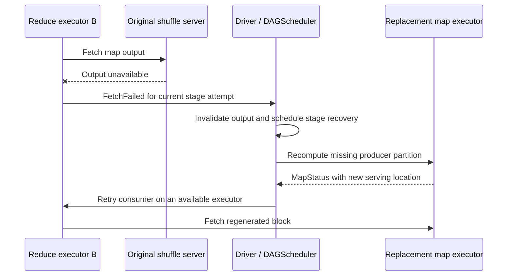
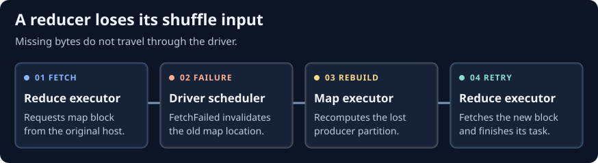
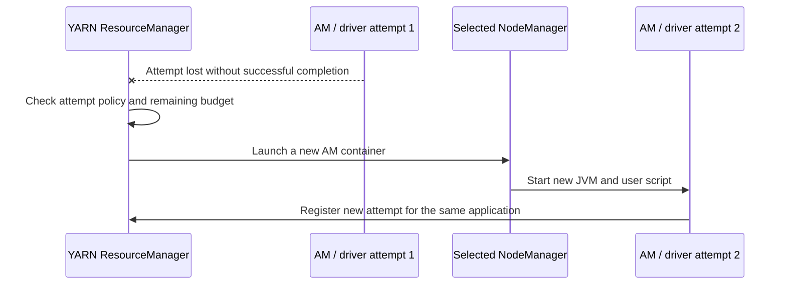
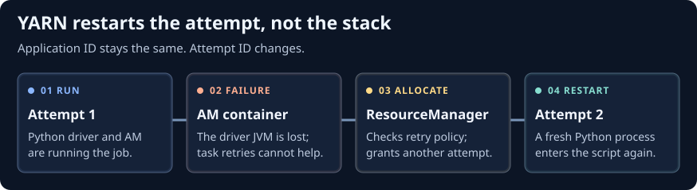
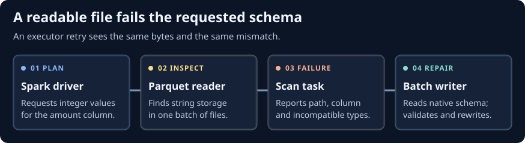

# PySpark on YARN: 40 scenarios traced through the Spark source

Why can YARN show running containers while Spark shows no executors? Why does
losing one shuffle block sometimes repeat a stage, while killing a whole
executor need not count against a task's retry budget? The answer depends on
**which component detects the event and what unit of work it can recover**.

This is a companion to [PySpark on YARN: lifecycle, networking, and discovery](pyspark-on-yarn.md).
The [component design reference](pyspark-on-yarn-components/README.md) explains
the inputs, outputs, and internal decisions of the participants in each case.
The cases follow classic PySpark batch applications through
[Apache Spark revision `dada2a6`](https://github.com/apache/spark/tree/dada2a6db5d73b152d6ba16e4fe21406f86abfe3).
They are source walkthroughs, not reports from a live cluster. Examples assume
ordinary non-barrier stages and a managed YARN ApplicationMaster (AM) unless noted.
Log fragments and UI observations below are clues to look for, not evidence that
any particular production incident had that cause.

**Start with the first unexpected observation, not the last exception.** The
[Spark Advanced Topics Working Group](https://holdenk.github.io/spark-flowchart/) inspired
the symptom routing and several cases below; see its [slow-job](https://holdenk.github.io/spark-flowchart/flowchart/slow/)
and [error](https://holdenk.github.io/spark-flowchart/flowchart/error/) paths. The examples
here trace this Spark revision rather than assuming the same behavior in every release.

| First observation | Next evidence | Cases |
|---|---|---|
| Nothing reaches a worker | Was the app submitted, the AM started, and the executor registered? | 01–04, 21–25 |
| One stage dominates elapsed time | Compare bytes and duration across tasks. If there is only one task, inspect the plan before increasing the executor count. | 10, 13, 28–30, 32, 34 |
| An exception stops the action | Find the first failing process, partition, and attempt: bad value, bad schema, lost block, or lost container? | 11–18, 24–25, 36–37 |
| Tasks are green but output is absent or wrong | Check final application status, save mode, partition paths, driver commit, and data-file counts. | 18, 20, 22, 38–40 |

**Trying a case:** Use small synthetic inputs, a private test application, and fresh scratch
directories. `spark` means a classic `SparkSession`, `sc` its context, and `F` is
`pyspark.sql.functions`. Where forcing an outage would be disruptive, a named test
fixture or event-log replay exercises the decision without breaking a shared cluster.
The animated figures highlight one step at a time; their numbered labels also work as still diagrams.

## Scenario index

| Where the symptom appears | Scenarios |
|---|---|
| Submission and driver startup | [01. Oversized request](#01-the-container-request-is-too-large) · [02. Context initialization timeout](#02-the-driver-never-initializes-sparkcontext) · [03. Executor cannot register](#03-yarn-grants-containers-but-spark-has-no-executors) · [04. Client driver disconnect](#04-the-client-mode-driver-disappears) |
| Capacity and storage | [05. Backlog scales up](#05-a-task-backlog-requests-more-executors) · [06. Idle scale-down](#06-an-idle-executor-is-or-is-not-removed) · [07. Cache miss after eviction](#07-a-persisted-partition-is-missing-on-the-second-action) |
| SQL and Python execution | [08. Python UDF boundary](#08-a-filter-crosses-into-python) · [09. Broadcast join](#09-a-small-dimension-table-is-broadcast) · [10. Skewed join](#10-aqe-splits-a-skewed-join-partition) |
| Task, stage, and executor recovery | [11. Shuffle fetch failure](#11-a-reducer-cannot-fetch-a-shuffle-block) · [12. Repeatable task exception](#12-the-same-partition-fails-on-every-attempt) · [13. Speculation](#13-a-slow-task-gets-a-speculative-copy) · [14. Missing heartbeats](#14-the-driver-stops-hearing-executor-heartbeats) · [15. YARN preemption](#15-yarn-preempts-a-healthy-executor) · [16. Container memory kill](#16-yarn-kills-an-executor-for-exceeding-physical-memory) |
| Results, output, and application lifetime | [17. Oversized collect](#17-collect-exceeds-the-driver-result-limit) · [18. Failed write commit](#18-all-write-tasks-succeed-but-the-job-commit-fails) · [19. Job-group cancellation](#19-one-job-group-is-cancelled-in-a-shared-application) · [20. AM attempt restart](#20-the-cluster-mode-am-crashes-and-yarn-retries-it) |
| Deployment and Python dependencies | [21. JAR upload](#21-every-submission-uploads-the-spark-jars) · [22. Early client exit](#22-spark-submit-exits-before-the-report-is-ready) · [23. Missing module](#23-a-module-imports-on-the-driver-but-not-on-workers) · [24. Python version mismatch](#24-a-python-worker-rejects-the-driver-version) · [25. Driver-only closure](#25-a-closure-captures-the-sparkcontext) |
| Jobs and partitioning | [26. Local iteration](#26-local-iteration-still-needs-room-for-a-partition) · [27. Sparse take](#27-taking-three-records-starts-several-jobs) · [28. Global window](#28-a-window-query-sends-every-row-to-one-partition) · [29. Key aggregation](#29-grouping-values-moves-more-data-than-summing-them) · [30. One busy core](#30-coalescing-to-one-leaves-most-cores-idle) |
| Checkpoints, spill, and broadcast lifetime | [31. Reliable checkpoint](#31-a-reliable-checkpoint-is-empty-until-an-action) · [32. Sorter spill](#32-a-task-spills-to-disk-and-still-succeeds) · [33. Destroyed broadcast](#33-a-broadcast-works-after-unpersist-but-not-after-destroy) |
| Adaptive plans, schemas, and file scans | [34. AQE coalescing](#34-an-adaptive-shuffle-has-fewer-reader-tasks-than-expected) · [35. Partition pruning](#35-a-date-filter-eliminates-entire-input-partitions) · [36. Incompatible Parquet type](#36-one-parquet-file-has-an-incompatible-column-type) · [37. Missing input](#37-an-input-file-disappears-after-listing) |
| File output on reruns | [38. Existing output](#38-a-rerun-succeeds-without-writing-anything) · [39. Dynamic overwrite](#39-overwrite-replaces-only-the-dates-written) · [40. File rollover](#40-one-successful-task-creates-three-data-files) |

## Submission and driver startup

### 01. The container request is too large

**Trigger:** `--executor-memory 8g` is set on a cluster with an 8 GiB maximum
per container. Eight GiB of JVM heap **plus** any positive overhead already
exceeds the limit, even on an otherwise empty cluster.

1. The **submit-side YARN client** requests an application ID. The
   **ResourceManager (RM)** returns its maximum per-container capability.
2. Spark's `Client.verifyClusterResources` adds executor heap, configured off-heap
   memory, overhead, and any explicit PySpark worker memory. It separately checks
   AM memory plus overhead.
3. The **client** throws before submitting the AM launch context if either sum
   exceeds the maximum. No executor can start for this submission.

**Consequence / clue:** An application ID is not proof an application was submitted.
Look for `above the max threshold` in the submit process, not an executor log.
Waiting for queue capacity cannot fix this error; that is a different condition.
[Submission order][submit-order] · [memory calculation and checks][resource-limit]

**Components:** Submit client → ResourceManager capability → client-side validation.

**Reproduce:** Find the maximum per-container memory of a private test queue. Request exactly that much executor *heap*, with positive overhead. Check whether the client gets an application ID but never sends the AM launch request.

**Resolve / verify:** Lower the sum of heap, overhead, and other counted memory to fit the maximum. The next submission should pass validation; it can still wait for currently available queue capacity.

### 02. The driver never initializes SparkContext

**Trigger:** In **cluster mode**, `orders.py` blocks on an external dependency
before `SparkSession.builder.getOrCreate()`.

1. The **AM** starts the user application thread; `PythonRunner` starts the Python
   process. Startup logging from the script can therefore be visible already.
2. The **AM** waits for the `SparkContext` initialization signal. It needs the
   driver's RPC endpoint before registering with the RM and creating the executor allocator.
3. If `spark.yarn.am.waitTime` expires, the AM marks the attempt failed for context
   initialization. A script that exits or throws earlier follows a different path.

**Consequence / clue:** Zero executors is expected here: none have been requested.
Inspect the AM/driver log for `Waiting for spark context initialization` and the
earlier Python output. Increasing executor count does not make blocked driver code finish.
[AM startup, wait, and timeout][am-init]

**Components:** Python driver → AM context wait → application-attempt failure.

**Reproduce:** In a test script, sleep 20 seconds before `getOrCreate()` and submit with `spark.yarn.am.waitTime=5s`. Compare the timeout in the AM log with the absence of executor requests.

**Resolve / verify:** Move slow initialization after context creation when possible; otherwise allow for measured startup time. Verify AM registration, not merely an early Python print.

### 03. YARN grants containers but Spark has no executors

**Trigger:** A client-mode driver advertises `localhost` or another address that
the worker nodes cannot reach.

1. The **AM** receives a container grant and asks the selected **NodeManager (NM)**
   to start the executor with a `--driver-url`. YARN has fulfilled a placement request,
   not proved the process can reach the driver.
2. The **executor JVM** attempts to fetch the driver's configuration, then register
   its scheduler endpoint. A bad address can fail at the first RPC, before
   `RegisterExecutor` is ever sent.
3. The **driver** only schedules work on registered, ready executors. A failed
   container can be replaced while capacity is still requested, but its replacement
   receives the same bad address.

**Consequence / clue:** Compare the YARN container list with the Spark UI Executors
tab. Inspect the driver URL in executor logs from the **worker's** point of view.
An open driver web UI is not proof the driver RPC endpoint is reachable.
[Launch arguments][exec-command] · [bootstrap RPC][exec-bootstrap] · [registration failure][exec-register]

**Components:** NodeManager → executor bootstrap → driver RPC endpoint.

**Reproduce:** On a multi-host test cluster, use client mode with `spark.driver.host=localhost`. Compare the driver URL in the executor launch log, the failed bootstrap, and the driver's executor count.

**Resolve / verify:** Advertise a worker-reachable submit-host address; configure the local bind address separately if necessary. Verify that registration and `LaunchedExecutor` succeed.

### 04. The client-mode driver disappears

**Trigger:** The submit-host driver dies, or the AM loses its RPC connection
to it without a prior orderly shutdown message.

1. The **client-mode AM** detects the disconnect. It knows the connection was lost,
   not whether the external program finished its business logic.
2. With `spark.yarn.am.clientModeTreatDisconnectAsFailed=true`, an **unexpected**
   disconnect takes the failed path. With the default `false` and no nonzero exit
   code reported, the AM can finish with `SUCCEEDED`.
3. **YARN** can clean up cluster containers. It cannot relaunch the external Python
   driver or recover the stack of the interrupted action.

**Consequence / clue:** A successful YARN final status alone does not prove the last
write committed. Correlate the AM disconnect message with the submit-host logs and
the sink's commit evidence. This behavior is not the cluster-mode restart in case 20.
[AM disconnect decision][am-disconnect] · [configuration and default][disconnect-default]

**Components:** External driver → AM disconnect handler → RM final report.

**Reproduce:** In a disposable client-mode application, terminate only its own external driver without an orderly shutdown. Compare the AM diagnostics with and without `spark.yarn.am.clientModeTreatDisconnectAsFailed=true`.

**Resolve / verify:** Enable disconnect-as-failure when loss must signal failure. Choose cluster mode if YARN must own driver attempts. Verify that the final report and the actual sink commit agree.

## Capacity and storage

### 05. A task backlog requests more executors

**Trigger:** Dynamic allocation is enabled. A stage exposes hundreds of runnable
partitions, but its few existing executors have no free slots.

1. The **driver's allocation listener** observes pending tasks and starts the
   `spark.dynamicAllocation.schedulerBacklogTimeout` timer. A brief queue that
   drains before the deadline need not cause a request.
2. `ExecutorAllocationManager` estimates demand from running/pending tasks and
   executor capacity. With sustained backlog it raises the **target** in rounds,
   bounded by demand and configuration; it does not ask for one container per task.
3. The **YARN backend and AM** request the new total from the RM. Selected NMs
   launch JVMs; the new slots become usable only after executors register.

**Consequence / clue:** The driver's target may rise while the live executor count
stays flat because the queue has no capacity. Compare the driver's
`because tasks are backlogged` log with YARN grants and actual executor additions.
[Demand estimate][alloc-demand] · [target requests and timing][alloc-request]

**Components:** Backlog listener → allocation manager → AM → YARN grant → driver registration.

**Reproduce:** Use a test queue with spare capacity, dynamic allocation and shuffle tracking, one initial one-core executor, and a maximum of three. Run 12 partitions that each sleep two seconds; set the backlog timeout to one second. Compare requested and live counts over time.

**Resolve / verify:** If grants lag requests, inspect queue capacity; if requests never increase, check the target bounds and count runnable partitions. Verify newly registered slots drain pending tasks.

### 06. An idle executor is or is not removed

**Trigger:** A wide stage finishes. One executor has no tasks left but may still
hold cached partitions or shuffle data needed by another job.

1. The driver's **`ExecutorMonitor`** tracks idleness and deadlines. Cached blocks
   can use a different idle timeout; with shuffle tracking, an active shuffle can
   keep its owner from being eligible for removal.
2. **`ExecutorAllocationManager`** considers eligible executors, preserving the
   configured minimum and the current target. It requests decommissioning when
   enabled, otherwise removal.
3. The **backend and cluster manager** carry out an accepted request. Removing
   the executor does not stop the driver or end the application.

**Consequence / clue:** “No active tasks” and “safe to remove” are different.
Check the executor timeline, Storage tab, and dynamic-allocation settings before
interpreting an idle JVM as leaked capacity. Loss of an unreplicated cached
partition can lead to case 07. [Eligibility scan][idle-monitor] · [removal decision][idle-remove]

**Components:** ExecutorMonitor → allocation manager → backend → idle container removal.

**Reproduce:** Set `spark.dynamicAllocation.minExecutors=0`, a 5 s executor idle timeout, and a long cached-executor idle timeout. Materialize a small persisted RDD without a shuffle, wait past 5 s, then unpersist it with `blocking=True` and wait again.

**Resolve / verify:** Release caches when finished, or deliberately retain them. Compare cached blocks and removal reasons before and after; an active tracked shuffle or a minimum executor count can still keep the JVM alive.

### 07. A persisted partition is missing on the second action

**Trigger:** A Python program persists an RDD and calls `count()` twice. Between
the actions, the only usable cached copy of partition 12 is evicted.

1. On the second action, an **executor task** enters `RDD.iterator`; because the
   RDD is persisted, it calls `getOrCompute` for that **partition**.
2. The **BlockManager** returns an available local or remote block on a hit. With
   no copy, Spark invokes the computation from lineage, or reads a checkpoint
   where applicable, and tries to store the result at the selected storage level.
3. If it cannot retain the new block, the current task can still consume the
   iterator. Other partitions with valid cached copies keep using them.

**Consequence / clue:** `persist()` is not a guarantee against recomputation or a
durable checkpoint. Compare cached partition counts in the Storage tab across
the two actions; losing one partition does not imply rebuilding the entire RDD.
[RDD cache path][rdd-cache] · [BlockManager hit, miss, and store paths][block-cache]

**Components:** Executor task → BlockManager lookup → cached iterator or lineage.

**Reproduce:** Persist and count a small RDD. As an all-block miss control, call `unpersist(blocking=True)`, persist it again, and count. Compare with a third count while the cache is warm. This control does not simulate eviction of just one partition.

**Resolve / verify:** Use a storage level appropriate to the reuse pattern, such as memory and disk, and materialize it. Verify cached partition coverage before the next action rather than assuming `persist()` pinned every block.

## SQL and Python execution

### 08. A filter crosses into Python

**Trigger:** Compare `df.filter(F.col("age") > 18)` with a filter that calls an
equivalent **regular, non-Arrow scalar Python UDF**.

1. The **driver's SQL planner** can express the first predicate directly in the
   JVM plan. The second requires a Python evaluation operator whose result the
   filter can consume.
2. For the UDF, an **executor JVM** batches and pickles the selected inputs. A
   **local Python worker** executes the function and returns serialized results.
3. The **executor JVM** associates the returned values with their input rows and
   continues the plan. The Python driver does not make a network call per row.

**Consequence / clue:** Similar-looking Python source can create very different
runtime work: the UDF adds a process boundary, conversion, and serialization.
Compare `df.explain("formatted")` for `BatchEvalPython`; Arrow and pandas UDFs
use other paths. [Partition execution][eval-python] · [batched UDF evaluation][batch-python]

**Components:** SQL planner → JVM operator or Python evaluation operator → local worker.

**Reproduce:** Run the same nullable fixture through `age > 18` and a Boolean scalar Python UDF with equivalent null handling and `useArrow=False`. Inspect the formatted plans and collect the small outputs.

**Resolve / verify:** Use a built-in expression where semantics match. Verify identical results, including null cases, and the disappearance of `BatchEvalPython`; do not infer speedup solely from syntax.

### 09. A small dimension table is broadcast

**Trigger:** An orders table joins a small regions table on `region_id`. Join
type and size estimates, or an applicable hint, allow a broadcast hash join.

1. The **SQL planner** selects a build side and requires it in hashed broadcast
   form. The physical plan identifies which child is built and which is streamed.
2. The **build-side exchange** materializes the relation for broadcast. **Executor
   tasks** on the streamed side obtain the broadcast value and probe it with
   their local input rows.
3. This join need not repartition the large input by join key. Upstream or
   downstream operators can still shuffle for their own reasons.

**Consequence / clue:** Broadcasting can save a large shuffle but requires space
to build and distribute the relation. A “small” row count alone is not proof it
fits. Look for `BroadcastHashJoin`, `BuildLeft`/`BuildRight`, and `BroadcastExchange`
in the physical plan. [Distribution contract][broadcast-distribution] · [executor probe path][broadcast-probe]

**Components:** Planner → broadcast exchange → streamed-side executor probes.

**Reproduce:** Join `spark.range(1000)` to `F.broadcast(spark.range(10))` on `id`; materialize the result and inspect the final plan. Ten matching keys are expected. Compare with an unhinted run.

**Resolve / verify:** Broadcast only a measured build side that fits. If it is too large, remove the hint and inspect the alternative plan. Verify the build side and result count, not merely a lower stage count.

### 10. AQE splits a skewed join partition

**Trigger:** An eligible sort-merge join has one very large reducer partition
for a popular key. Adaptive Query Execution (AQE) and skew-join handling are enabled.

1. After shuffle stages materialize, the **adaptive optimizer** reads actual map
   output statistics. A candidate must exceed both the configured absolute
   threshold and the median partition size times the skew factor.
2. For an eligible join side with splittable data, **`OptimizeSkewedJoin`** builds
   smaller shuffle-read specifications. Each gets the corresponding data from
   the other side; that matching data may be read repeatedly.
3. If the rewrite satisfies the plan's distribution requirements, **executors**
   run the new partition pairings instead of one oversized task.

**Consequence / clue:** Tail latency can fall at the cost of extra reads and
tasks. Not every big partition is splittable or eligible. Inspect the **final**
adaptive plan and skewed shuffle reads, not just the pre-execution plan. Unlike
case 13, this changes the division of work instead of duplicating the same task.
[Thresholds and split construction][skew-split] · [eligible joins][skew-joins]

**Components:** Shuffle map statistics → adaptive optimizer → split reader tasks.

**Reproduce:** In a test session disable automatic broadcast, enable AQE/skew join, and use eight shuffle partitions. Spread a heavily repeated key over many map partitions, include several smaller keys, and join to a unique-key dimension. Lower the skew-size threshold for this small fixture and inspect the final plan after the action.

**Resolve / verify:** First verify the input skew and eligibility. If Spark splits it, compare maximum task read size/duration against the median and confirm row counts are unchanged. A hot key in one unsplittable map block may need upstream repartitioning or a different key strategy.

## Task, stage, and executor recovery

### 11. A reducer cannot fetch a shuffle block

**Trigger:** A reducer needs a remote map output. Its serving node or files are
gone, and fetch retries cannot deliver the bytes. Assume a normal, durable shuffle.

1. The **reduce executor** reports `FetchFailed`. The **DAGScheduler** checks that
   the report belongs to the current stage attempt; an old report need not trigger
   another recovery.
2. The **driver** marks the consuming attempt failed and invalidates affected
   map-output metadata. It queues the producer and consumer stages for resubmission,
   subject to the stage-failure limit.
3. **Executors** regenerate missing map output. The retried consumer can now fetch
   from its new location. Already available map outputs need not all be regenerated.

**Consequence / clue:** Retrying only the reducer against the old address would
not help. Look for `FetchFailed` followed by stage resubmission and new map task
attempts. Executor exit alone does not imply data loss if an external shuffle
service still serves the files. [Invalidating map output][fetch-invalidate] · [resubmission or abort][fetch-resubmit]

**Components:** Reduce executor → DAGScheduler → replacement map task → retried reduce task.

**Reproduce:** Use `DAGSchedulerSuite`'s `run trivial shuffle with fetch failure` fixture: finish the map stage, inject a fetch failure for the current consumer attempt, then complete the resubmitted work. Compare the producer location and stage attempt IDs before and after.

**Resolve / verify:** Correlate the missing producer block with executor, disk, and shuffle-service logs. Restore a reliable serving path; verify both regenerated map output and a successful downstream retry. More fetch retries cannot recreate a deleted file.

### 12. The same partition fails on every attempt

**Trigger:** A Python mapping function raises an ordinary data-dependent exception
whenever it encounters one malformed record in partition 12.

1. The **Python worker/executor** reports a task failure. The **driver's
   `TaskSetManager`** classifies the reason and increments the counter for this
   partition index if the reason counts toward task failures.
2. Below the limit the task goes back on the pending list. **Another executor**
   can run it, but sees the same input and code.
3. Once the effective `spark.task.maxFailures` threshold is reached, the **driver**
   aborts the task set and the dependent job fails. With a limit of four, that is
   four counted failed attempts, not four retries after the first.

**Consequence / clue:** More executors will not repair a deterministic bad record.
Compare the partition index, attempt IDs, and Python exception across hosts. The
action fails; whether the application ends depends on what the driver does with
that exception. [Task failure accounting and requeue][task-failure]

**Components:** Python worker → executor status → TaskSetManager → driver action.

**Reproduce:** With `spark.task.maxFailures=2`, run `sc.parallelize(['1','bad','3'], 3).map(int).collect()` on a test YARN application. Match the bad partition and `ValueError` across attempts.

**Resolve / verify:** Validate or quarantine bad records before conversion; record rejected rows explicitly. Re-run the fixture and account for two accepted rows and one rejection, without repeated task failures.

### 13. A slow task gets a speculative copy

**Trigger:** With `spark.speculation` enabled, one task continues running far
longer than its eligible peers. No task failure has been reported.

1. The **scheduler** periodically checks running attempts. `TaskSetManager` applies
   timing and eligibility checks and marks a qualifying task as speculatable.
2. Given a suitable resource offer, the **driver** launches a second attempt for
   the same partition while the original is still running.
3. The **first accepted success** wins. The driver requests cancellation of any
   still-running sibling and does not count a late duplicate as a second result.

**Consequence / clue:** The job consumes one logical result, but both attempts may
already have performed external side effects. A direct database insert inside
`foreachPartition` is not made exactly-once by speculation. Look for distinct
attempt IDs for the same task index and a sibling killed after success.
[Speculation eligibility][speculate] · [accept winner and kill duplicate][speculation-winner]

**Components:** TaskSetManager → concurrent attempts → first accepted result.

**Reproduce:** Replay `TaskSetManagerSuite`'s `SPARK-26755 Ensure that a speculative task is submitted only once for execution`. Observe two attempt IDs for one partition and a single logical result. For logs from a real run, match attempts by stage *and* partition.

**Resolve / verify:** If duplicate side effects are the problem, use an idempotent key or a commit protocol; disabling speculation alone does not eliminate normal retries. Verify one committed logical record per key.

### 14. The driver stops hearing executor heartbeats

**Trigger:** An executor stops sending timely Spark heartbeats, for example during
a prolonged process pause or a network interruption. Its NM may still be heartbeating to YARN.

1. The driver's **`HeartbeatReceiver`** compares the last-seen time to its timeout
   on a periodic expiry check. One late heartbeat is not an immediate declaration
   that the node died.
2. On expiry, the **driver** asynchronously asks to kill and replace the executor.
   It also notifies the coarse-grained scheduler backend to remove the executor
   rather than waiting indefinitely for an RPC disconnect.
3. The **task scheduler** can now fail or reschedule attempts assigned there;
   a replacement still needs YARN capacity and must register with the driver.

**Consequence / clue:** `Executor heartbeat timed out` proves the **driver**
did not hear from the executor in time, not that the entire host failed. Compare
Spark timestamps with NM/container health and the executor's GC logs.
[Driver expiry and replacement path][heartbeat-expiry]

**Components:** Executor heartbeater → driver HeartbeatReceiver → removal and replacement.

**Reproduce:** Use `HeartbeatReceiverSuite`'s `expire dead hosts` fixture: register a test executor, advance its test clock without an update, and run expiry. Repeat with an intervening heartbeat as the control.

**Resolve / verify:** Check GC pauses, CPU starvation and the executor-to-driver network path before increasing timeouts. Verify last-seen timestamps recover and replacements stop; a healthy NM heartbeat is not the control for Spark RPC.

### 15. YARN preempts a healthy executor

**Trigger:** The YARN scheduler reclaims an executor container for resource
sharing while it is running tasks.

1. **YARN** ends the container and reports `PREEMPTED` to the AM through its
   allocation cycle. The Spark user's task need not have done anything wrong.
2. **`YarnAllocator`** records the container loss as `exitCausedByApp=false`
   and provides the loss reason to the **driver**.
3. A running ordinary task can be retried. When that reason reaches it,
   **`TaskSetManager`** does not charge the executor loss against that task's
   normal failure budget. The AM can request replacement capacity if needed.

**Consequence / clue:** Work already done by interrupted tasks can be lost even
though the failure is not charged to the code. Check for `was preempted` in the
AM log before chasing a Python exception or increasing `spark.task.maxFailures`.
[YARN preemption classification][preemption] · [task failure counting rule][executor-loss-rule]

**Components:** RM completion report → YarnAllocator → driver task-loss classification.

**Reproduce:** Use the completed-container fixture in `YarnAllocatorSuite` (SPARK-26269). Feed a completion with `PREEMPTED` and inspect the allocator's reason; compare it with the memory-limit completion in case 16. No real queue preemption is needed.

**Resolve / verify:** If losses repeat, inspect queue policy and usable capacity, not just task code. Check that replacement executors register and lost work finishes without repeatedly charging application failures.

### 16. YARN kills an executor for exceeding physical memory

**Trigger:** The executor's container exceeds its enforced physical-memory
limit. Python workers, JVM heap, and native allocations can contribute; a JVM
`OutOfMemoryError` is not required.

1. The **NM/YARN** terminates the container and supplies a physical-memory exit
   status and diagnostics to the **AM**.
2. **`YarnAllocator`** recognizes `KILLED_EXCEEDED_PMEM`, extracts available
   usage details, and marks the exit `exitCausedByApp=true`, unlike preemption.
3. The **driver** removes the executor. Ordinary tasks lost for this reason can
   count toward their failure limits; running the same oversized partition on
   an identical replacement can repeat the kill.

**Consequence / clue:** Inspect the container's physical usage/limit and partition
sizes, not just the Spark UI's storage-memory chart. Contrast case 01 (the request
was never accepted) and case 15 (capacity was reclaimed, not exceeded).
[YARN memory exit classification][pmem] · [task failure counting rule][executor-loss-rule]

**Components:** NodeManager memory enforcement → AM diagnostics → executor/task loss.

**Reproduce:** In the same allocator fixture, submit a synthetic `KILLED_EXCEEDED_PMEM` completion. Correlate its classification with a historical container report showing physical memory usage. Do not exhaust a shared node to reproduce this.

**Resolve / verify:** Measure container RSS, including Python and native work, and locate oversized partitions. Reduce the working set or adjust overhead within YARN limits. Verify comparable data completes without another physical-memory kill.

## Results, output, and application lifetime

### 17. Collect exceeds the driver result limit

**Trigger:** A PySpark RDD `collect()` requests every record. Suppose 100
partitions each return about 6 MiB serialized, with `spark.driver.maxResultSize`
set to 512 MiB. Every partition fits individually; their total does not.

1. **Executors** serialize partition results. A small result can travel in the
   task status message. A larger *permitted* result may be stored as a block, with
   a reference sent to the driver instead.
2. The driver's **`TaskResultGetter` / `TaskSetManager`** account for serialized
   result sizes. For this result stage, the cumulative positive limit applies
   regardless of direct or indirect transport.
3. Once the total exceeds the limit, the **driver** aborts the task set. Python
   does not receive a partial list as a successful `collect()`.

**Consequence / clue:** The driver error refers to the **total size of serialized
results**. Spreading identical output over more partitions or fetching via block
managers does not reduce that total. A limit of zero disables the guard, not the
driver's physical memory limit. [Executor result transport][result-wire] · [cumulative guard][result-guard]

**Components:** Executor result serialization → TaskResultGetter → cumulative driver guard.

**Reproduce:** Use a fresh test context with `spark.driver.maxResultSize=1m`. Collect several partitions of small, distinct byte arrays well under 1 MiB each but over 1 MiB together. Read the error's serialized-byte total; compression affects the required sample size.

**Resolve / verify:** Aggregate or write distributed output and return only a bounded summary. Confirm the expected aggregate without materializing all rows in Python. Raising the limit does not create driver memory.

### 18. All write tasks succeed but the job commit fails

**Trigger:** A V1 Hadoop-backed file write, such as a Parquet write using that
path, finishes its output tasks but encounters a filesystem error during `commitJob`.

1. On each **executor**, the writer creates task output and commits that task
   through the commit protocol. Successful commit messages return to the driver.
2. The **driver's `FileFormatWriter`** invokes job-level commit using those
   messages. The **Hadoop committer/filesystem** now has to finalize the output.
3. If this throws, Spark attempts **job abort/cleanup** and propagates the failure.
   A task failure earlier in the sequence would instead enter task-abort handling.

**Consequence / clue:** Green tasks do not prove the dataset was published.
Check driver commit/abort logs and the destination before retrying. Cleanup is
committer- and filesystem-dependent; do not assume universal atomic rollback or
extend this V1 behavior to every transactional table format.
[Driver commit][write-commit] · [write failure handling][write-abort] · [Hadoop commit protocol][hadoop-commit]

**Components:** Executor task commit → driver job commit → commit protocol abort.

**Reproduce:** Use `ParquetIOSuite`'s `JobCommitFailureParquetOutputCommitter` with a scratch output path. Its injected failure is in `commitJob`, not `commitTask`. Compare successful task commits with the driver exception.

**Resolve / verify:** Correct the filesystem or committer cause and inspect partial output before retrying. Verify a fresh read of the intended dataset after successful job commit, not just green tasks.

### 19. One job group is cancelled in a shared application

**Trigger:** Two clients share a Spark application, or two submitting threads
run jobs under different group IDs. The driver calls `sc.cancelJobGroup("report-A")`.

1. The **DAGScheduler** uses the captured job-group property to find matching
   jobs. The ordinary cancellation targets the group currently submitted; it
   does not permanently forbid reuse of the same group ID.
2. For a matching job, the **driver** finds running stages that belong **only**
   to that job and asks the task scheduler to kill their attempts. A stage
   still needed by another active job is not cancelled on that basis.
3. The cancelled job's **caller** receives failure/cancellation. The
   `SparkContext`, unrelated jobs, and YARN application can continue.

**Consequence / clue:** A job marked cancelled beside a still-running shared
stage is consistent. Killing the entire YARN application would have a much wider
effect. Check group IDs and stage ownership in addition to the app's YARN state.
[Group matching][group-cancel] · [independent-stage cancellation][independent-stages]

**Components:** Driver thread's job group → DAGScheduler → targeted stage cancellation.

**Reproduce:** Run two bounded slow jobs from separate submitting threads with distinct group IDs. Set the group in each submitting thread and cancel only one while both are active. Compare job states in the UI.

**Resolve / verify:** Bind group IDs to requests and clear thread-local properties when reusing threads. Verify the chosen action was cancelled, the unrelated action completed, and the same context accepts another job.

### 20. The cluster-mode AM crashes and YARN retries it

**Trigger:** The **cluster-mode** AM/driver container dies before it can report
success. YARN policy and remaining attempt budget allow another attempt.

1. The **RM** detects the lost attempt. `spark.yarn.maxAppAttempts` cannot grant
   more attempts than `yarn.resourcemanager.am.max-attempts`. Spark's AM shutdown
   path distinguishes terminal cleanup from leaving room for a retry.
2. For an eligible retry, **YARN** starts a fresh AM container for the **same
   application ID** with a **new attempt ID**. It does not restore the old JVM.
3. The new **AM and Python driver** run the user application from its entry point,
   create a new context, and obtain executors. Durable files may survive; Python
   variables, cached driver state, and the interrupted call stack do not.

**Consequence / clue:** If the first attempt appended records before it died,
rerunning the script can append them again unless the application or sink prevents
duplicates. Correlate logs by **attempt ID**, not just application ID. This is a
whole-driver restart, not the task retry in case 12 or the stage repair in case 11.
[Attempt ceiling][am-attempts] · [cleanup and unregister policy][am-cleanup] · [driver startup][am-init]

**Components:** Lost AM/driver container → ResourceManager → fresh application attempt.

**Reproduce:** In a disposable managed YARN test with two AM attempts allowed, log an entry-point marker and run a bounded, long-enough action. Have the mini-cluster harness fail **only the first AM container**, not the application. Use `yarn applicationattempt -list` to compare attempt IDs and entry markers.

**Resolve / verify:** Fix the AM loss reason and make publication idempotent across attempts. Verify one logical output under the same application ID even though the script entered twice. Changing task retry limits cannot restore the old driver.

## Deployment and Python dependencies

### 21. Every submission uploads the Spark JARs

**Trigger:** Even a tiny `orders.py` takes a long time to submit. Neither `spark.yarn.archive`
nor `spark.yarn.jars` is configured.

1. The **submit-side YARN client** finds the local Spark JAR directory, creates a temporary
   ZIP, and adds its readable `.jar` files.
2. The client stages that ZIP and declares it as an `ARCHIVE` resource named `__spark_libs__`.
   The **NodeManager** localizes it for the container; the ResourceManager does not stream JARs.
3. A reusable archive on cluster-accessible storage changes this path: Spark declares the
   supplied archive instead of rebuilding it from the local installation for every submission.

**Consequence / clue:** Look for `falling back to uploading libraries under SPARK_HOME` in the
**submission** log. This delay precedes executor allocation; adding executors won't shorten it.
[Archive selection and fallback upload][jar-staging]

**Components:** Submit-side Client → staging filesystem → NodeManager localizer.

**Reproduce:** Submit a minimal script without either Spark-JAR setting. Inspect the fallback warning and staged archive; then submit the same script using a compatible prebuilt `spark.yarn.archive` on HDFS.

**Resolve / verify:** Store versioned, cluster-readable Spark archives with JARs at the archive root. Verify the fallback warning disappears and the AM loads the intended classes. Measure submission time separately from executor startup.

### 22. Spark-submit exits before the report is ready

**Trigger:** A shell pipeline starts a downstream reader as soon as a cluster-mode
`spark-submit` command exits zero. It used `spark.yarn.submit.waitAppCompletion=false`.

1. The **client** submits the application and obtains an application ID.
2. On the fire-and-forget path without a connected launcher backend, the client reads one
   application report. It throws if YARN already reports `FAILED` or `KILLED`; otherwise it
   can exit without waiting for a terminal result.
3. The **AM, driver, and executors** continue independently. The output commit and even a
   later application failure can occur after the shell has started its next command.

**Consequence / clue:** A submit log ending with an `ACCEPTED` or `RUNNING` report is not a
completion receipt. Use the application ID to check final status, or retain completion monitoring
when the next step depends on published output. [Client monitoring decision][submit-monitor]

**Components:** Shell → Spark YARN client → application report → downstream workflow.

**Reproduce:** Submit a script with a brief delay before a scratch output write, using `spark.yarn.submit.waitAppCompletion=false`. Record shell exit, YARN state, and first readable output. Repeat with the setting true.

**Resolve / verify:** Make the consumer wait for terminal success and the sink's publication condition, or retain client monitoring. Verify the downstream reader cannot start against an incomplete dataset.

### 23. A module imports on the driver but not on workers

**Trigger:** The driver imports a local pure-Python helper, but an RDD function doing
`import pricing_rules` raises `ModuleNotFoundError` on an executor.

1. The **driver** and executor-side **Python workers** have separate import paths. An import
   succeeding on the AM node establishes nothing about the worker nodes.
2. For future tasks, `sc.addPyFile("hdfs:///deps/pricing_rules_v2.zip")` registers the file
   and records its archive name among the Python includes. The ZIP must contain an importable
   `pricing_rules` package or module.
3. Worker setup adds its localized Spark-files root and included archives to `sys.path`
   before executing the Python command. This distributes Python code, not a Python interpreter.

**Consequence / clue:** Compare the module path on the driver with the import traceback in
executor logs. Register the dependency before the affected action; adding the same path again
is not an in-place package upgrade. [Driver registration][add-pyfile] · [worker path setup][pyfile-path]

**Components:** Driver include list → executor-local SparkFiles path → Python import.

**Reproduce:** Use a unique test module name installed only beside the driver script. Import it *inside* an RDD function. After observing the worker import error, put the module at the root of a versioned ZIP and pass it with `--py-files` on the next submission.

**Resolve / verify:** Distribute the pure-Python dependency rather than editing one host. Return the module's version from each partition and verify the worker results, not just the driver's import.

### 24. A Python worker rejects the driver version

**Trigger:** A built-in DataFrame aggregation succeeds, but a Python RDD task fails when
the AM's Python driver uses Python 3.11 and the worker starts Python 3.12.

1. The **executor JVM** starts a Python worker for the Python operation and supplies the
   expected driver Python version during initialization.
2. The **worker** compares it with its own `major.minor` before deserializing the user
   function. The mismatch raises `PYTHON_VERSION_MISMATCH`; the function body never runs.
3. A retry on a node with the same mismatch fails for the same reason. A JVM-only SQL
   operation can succeed because it does not perform this worker handshake.

**Consequence / clue:** The error names the worker and driver versions. Check the executables
selected **inside the containers**; Python patch-level differences alone are not this check.
[Worker initialization order][worker-init-order] · [version comparison][py-version]

**Components:** Driver version metadata → executor Python launcher → worker version check.

**Reproduce:** In a private test environment with two supported Python minors already installed, select one for the driver and the other for executors. Run a JVM-only expression, then `sc.parallelize([1]).map(lambda x: x+1).collect()`.

**Resolve / verify:** Point the containers to a consistent interpreter or packaged environment. Return `sys.version_info[:2]` from a worker and compare it to the driver, then verify the Python action returns `[2]`.

### 25. A closure captures the SparkContext

**Trigger:** A Python RDD transformation contains `lambda row: (sc.applicationId, row)`.
The programmer only wanted a string, but the function references the driver context itself.

1. When preparing the Python command, the **driver** serializes the function and captured
   objects with `CloudPickleSerializer`.
2. `SparkContext.__getnewargs__` deliberately rejects pickling the context. Preparation
   fails **on the driver**, before an executor can run this function.
3. Reading `app_id = sc.applicationId` on the driver and capturing only `app_id` removes
   that dependency. The worker receives data, not access to the driver's scheduler.

**Consequence / clue:** Look for `CONTEXT_ONLY_VALID_ON_DRIVER` in the serialization traceback,
not four failed task attempts. Increasing the task retry limit does not fix this error.
[Command serialization][pickle-command] · [context guard][context-pickle]

**Components:** Driver closure serializer → SparkContext pickling guard; no worker execution.

**Reproduce:** Evaluate `sc.parallelize([1]).map(lambda x: (sc.applicationId, x)).collect()`. Then assign `app_id = sc.applicationId` outside the lambda and repeat using `app_id`.

**Resolve / verify:** Capture the small value rather than `sc`, `spark`, or an object holding either. Verify the second closure returns the expected pair and the first failed before the task could execute.

## Jobs and partitioning

### 26. Local iteration still needs room for a partition

**Trigger:** A report switches from `rdd.collect()` to `rdd.toLocalIterator()` to avoid
holding the whole result, but one exceptionally large partition still overwhelms the driver.

1. As the **Python consumer** requests more data, the **driver JVM** submits a job for a
   partition. The partition computation materializes its result as an array.
2. The JVM waits for that partition and serves its elements to Python over a local socket.
   With `prefetchPartitions=True`, it can submit the next partition job before finishing this one.
3. Consumption can stop early. If the consumer instead calls `list()` on the iterator,
   Python again retains the entire result.

**Consequence / clue:** Expect successive partition jobs, not one RPC per row. Budget for the
largest partition (potentially two with prefetch); limiting driver retention is not a guarantee
that an individual partition result fits. [Partition submission and handoff][local-iter]

**Components:** Python iterator → driver partition job → executor result → local socket.

**Reproduce:** Iterate over `sc.parallelize(range(8), 4).toLocalIterator(prefetchPartitions=False)` one element at a time and observe jobs. Repeat with prefetch on and compare the timing of the next partition job.

**Resolve / verify:** Consume incrementally; do not rebuild a list. If a single partition is oversized, change partitioning or keep processing distributed. Verify bounded partition sizes and equivalent output counts.

### 27. Taking three records starts several jobs

**Trigger:** `rdd.filter(is_late).take(3)` runs on an RDD whose early partitions contain
no late records. The Jobs tab shows multiple successful jobs.

1. PySpark's **driver** starts by asking `runJob` to scan one partition. Each selected
   partition returns at most the number of records still needed.
2. If the batch found nothing, the driver increases the number of partitions to try; if it
   found too few, it estimates the next batch from the hit rate.
3. It stops when it has enough records or has scanned every partition, and returns at most
   three records. A shuffle dependency upstream can still require broader map-side work.

**Consequence / clue:** Several jobs at the same `take` call site, with no failed attempts,
can be intentional. `take(3)` limits the result size, not how much input must be searched.
[PySpark RDD.take scan loop][take-batches]

**Components:** Python take loop → repeated runJob calls → bounded partition results.

**Reproduce:** Run `sc.parallelize(range(100), 100).filter(lambda x: x >= 90).take(3)`. Compare with `x < 10` on the same input. Both return three rows, but the late-match run scans farther.

**Resolve / verify:** For an inspection sample, accept the extra search. For recurring large scans, prune or index the source where possible. Verify reduced input work rather than raising the requested sample size.

### 28. A window query sends every row to one partition

**Trigger:** A report computes a row number ordered by time, without specifying a
window partition. There are eight input partitions but one task at the window.

1. The **driver's `WindowExecBase`** requires `AllTuples` for an empty partition
   specification. With multiple input partitions Spark inserts an exchange to bring all rows
   together and sorts the input as required.
2. A single **executor task** evaluates the global window. Adding workers or calling
   `repartition(8)` *before* the window cannot remove the distribution requirement.
3. A keyed window requires clustered distribution by key instead. It is a valid alternative
   only if the intended answer is a ranking **per key** rather than a global ranking.

**Consequence / clue:** `Exchange SinglePartition` and the `No Partition Defined` warning
point to operator semantics, not missing YARN capacity. [Window distribution][window-contract]
· [upstream diagnostic topic](https://holdenk.github.io/spark-flowchart/details/singlepartition/)

**Components:** Window planner → SinglePartition exchange → one executor window task.

**Reproduce:** Use `df = spark.range(64, numPartitions=8)` and `row_number().over(Window.orderBy('id'))` (from `pyspark.sql.functions` and `pyspark.sql.window`). Select the rank and collect the small result so the optimizer cannot prune the window. Inspect the exchange and task count.

**Resolve / verify:** If ranks should restart per customer, use `Window.partitionBy('customer').orderBy('id')` on a keyed fixture. Verify rank 1 per customer and the disappearance of the global-window requirement. Do not change the key if the required rank is genuinely global.

### 29. Grouping values moves more data than summing them

**Trigger:** A pair RDD has many `(region, amount)` records per input partition. The code
uses `groupByKey().mapValues(sum)`; the only desired result is one sum per region.

1. PySpark's **map-side Python workers** can combine values locally for `groupByKey`, but
   the combiner is a **list of values**. Local packing does not eliminate the amounts.
2. With `reduceByKey(add)`, the map-side combiner keeps a **partial sum** per key instead.
   When repartitioning is necessary, workers shuffle the partials and merge them by key.
3. Repeated keys within a partition can therefore reduce shuffle volume substantially.
   Changing to `reduceByKey` is appropriate for an associative, commutative reduction,
   not for callers that need all original values.

**Consequence / clue:** Compare shuffle bytes, not just final row counts or task counts.
A single hot key still belongs to one final reduce partition. [Grouping combiners][group-lists]
· [reduceByKey delegation][reduce-key] · [local and post-shuffle merges][combine-key]

**Components:** Python local combiner → shuffle → per-key merger.

**Reproduce:** Build `pairs = sc.parallelize(range(20000), 8).map(lambda i: (i % 4, 1))`. Compare `pairs.groupByKey().mapValues(sum)` and `pairs.reduceByKey(lambda a,b: a+b)`. Materialize both and read shuffle metrics.

**Resolve / verify:** For this sum, use `reduceByKey`. Verify all four totals are 5,000. Compare measured shuffle bytes on the same inputs rather than assuming a fixed reduction ratio.

### 30. Coalescing to one leaves most cores idle

**Trigger:** A narrow, uncached RDD pipeline ends with `coalesce(1)` before a save.
YARN shows plenty of executors, but one task does most of the work.

1. Without a shuffle the **driver** constructs a `CoalescedRDD` with a narrow dependency.
   The one output partition can walk many parent partitions.
2. One **executor task** can consequently evaluate the narrow upstream chain and write the
   output. There are no other ready partitions of that stage for idle cores to take.
3. Shuffling (for example, `repartition(1)`) lets upstream tasks run in parallel before a
   **single final partition**. It buys parallelism at the cost of a shuffle, not a parallel final writer.

**Consequence / clue:** Compare the stage DAG and number of tasks before requesting more
containers. A one-task stage is a work-partitioning limit, not necessarily a YARN shortage.
[RDD.coalesce: narrow and shuffle branches][coalesce-rdd]

**Components:** RDD dependency builder → narrow coalesced partition → single writer.

**Reproduce:** Compare `sc.parallelize(range(1000), 8).map(str).coalesce(1)` with the same pipeline using `repartition(1)`; save to two fresh scratch paths. Inspect upstream versus final-stage task counts.

**Resolve / verify:** Avoid forcing one output partition unless the consumer requires it. If it does, shuffle later, after expensive parallel work; verify output equivalence and where the one-task stage now begins.

## Checkpoints, spill, and broadcast lifetime

### 31. A reliable checkpoint is empty until an action

**Trigger:** The driver calls `sc.setCheckpointDir(...)` on shared storage and
`rdd.checkpoint()` before its first action. `rdd.getCheckpointFile()` still returns `None`.

1. The **driver** has marked the RDD for checkpointing; it has not eagerly written its partitions.
2. After an action on that RDD, the checkpoint path runs a job to write partition data to
   the reliable filesystem. An uncached parent can be computed again during this write.
3. After successful materialization Spark installs a checkpoint RDD as the new parent and
   clears the original dependencies. This differs from eviction of a cache block in case 07.

**Consequence / clue:** Compare `getCheckpointFile()` before and after `count()`, or look
for `Done checkpointing RDD` in the driver log. These files checkpoint the RDD, not the
Python driver's variables or the YARN application attempt.
[PySpark checkpoint example][checkpoint-api] · [checkpoint write job][checkpoint-write] · [lineage handoff][checkpoint-switch]

**Components:** Driver checkpoint mark → filesystem write job → new RDD dependency.

**Reproduce:** Set a fresh HDFS checkpoint directory; persist a small RDD, call `checkpoint()` before its first action and inspect `getCheckpointFile()`. Call `count()` and inspect it again.

**Resolve / verify:** For durable lineage truncation, use accessible reliable storage and wait for materialization. Verify the returned checkpoint path and the shortened dependency chain; use persistence alone if the goal is only faster reuse.

### 32. A task spills to disk and still succeeds

**Trigger:** A JVM-side operation using `ExternalSorter` builds a collection that needs
more execution memory than the task can obtain. The task is not killed.

1. The **executor's sorter** checks its estimated collection size. At its memory threshold it
   requests more execution memory; insufficient growth can trigger a spill. A forced-spill
   threshold is another route.
2. The sorter writes an intermediate run to local disk, releases execution memory, and
   continues. It can read and merge spilled data when producing its output.
3. The task records memory and disk spill metrics. The estimated in-memory bytes released
   and serialized bytes actually written are different measures.

**Consequence / clue:** A successful stage can show both spill metrics and spend time in disk
I/O. This is neither a YARN memory-limit kill (case 16) nor evidence that an RDD cache block
was evicted. [Spill decision][sort-spill] · [sorter accounting][sort-metrics]

**Components:** ExternalSorter → execution memory manager → local spill files → merged result.

**Reproduce:** Use `ExternalSorterSuite`'s `spilling with hash collisions`: it lowers the element spill threshold for a bounded fixture. Compare sorted/aggregated output and the spill path with a control that fits in memory.

**Resolve / verify:** For repeated costly spill, reduce records per partition or combine earlier before adding memory. Compare spill bytes and duration **and** identical output. A modest spill on a successful task needs no corrective action.

### 33. A broadcast works after unpersist but not after destroy

**Trigger:** Two actions use `rates = sc.broadcast(lookup)`. The driver calls
`rates.unpersist()` or `rates.destroy()` between actions, expecting identical behavior.

1. `unpersist()` asks Spark to remove the broadcast blocks from **executors**, leaving the
   driver-side broadcast valid. A later action can fetch those pieces again.
2. `destroy()` invalidates the **driver's broadcast handle** and also requests removal of
   driver-side state. Spark checks validity when serializing that handle again.
3. A new closure using the destroyed broadcast cannot rely on it. To use the lookup again
   after destruction, create a new broadcast. Blocking cleanup changes waiting, not validity.

**Consequence / clue:** Failure preparing a later task that captures a destroyed broadcast
is different from a live broadcast being fetched again after `unpersist()`. This is a
user-created broadcast variable, not a SQL broadcast-join planning choice.
[Validity and destruction][broadcast-valid] · [which blocks are removed][broadcast-blocks]

**Components:** Python broadcast handle → driver block manager → executor copies.

**Reproduce:** Broadcast a small dictionary, look it up in an RDD action, call `unpersist(blocking=True)`, and repeat. Then `destroy(blocking=True)` and submit a new closure using the same handle.

**Resolve / verify:** Use `unpersist` for evictable, reusable data and `destroy` only after its last consumer. Create a fresh broadcast for subsequent jobs and verify equal lookup results.

## Adaptive plans, schemas, and file scans

### 34. An adaptive shuffle has fewer reader tasks than expected

**Trigger:** An eligible SQL aggregation is planned with 200 shuffle partitions, but after
filtering, most shuffle outputs are tiny. AQE and shuffle partition coalescing are enabled.

1. Once shuffle map statistics are available, the **driver's adaptive rule** considers
   compatible shuffle stages together, using bytes per partition, target size, and
   parallelism constraints.
2. Where useful, it builds new read specifications that group reducer partitions and
   rewrites the shuffle **read**. It need not rerun the map tasks to write fewer buckets.
3. Downstream tasks read the groups. Unlike skew splitting in case 10, this combines small
   partitions to reduce scheduling overhead; it does not request fewer executor containers.

**Consequence / clue:** Inspect the **final** adaptive SQL plan for a coalesced `AQEShuffleRead`
and compare map and reader task counts. An advisory size isn't a promise of a precise count.
[Coalescing decision and read rewrite][aqe-coalescing]

**Components:** Shuffle map statistics → adaptive coalescing rule → grouped reducer reads.

**Reproduce:** Group a small `spark.range` with multiple input partitions by `id % 5` using 200 initial SQL shuffle partitions. Execute with AQE enabled; compare the final adaptive plan with coalescing enabled and disabled.

**Resolve / verify:** If the smaller reader stage is faster and the five totals match, keep it. If tasks become too large, adjust the advisory size and parallelism settings against observed shuffle bytes.

### 35. A date filter eliminates entire input partitions

**Trigger:** A V1 catalog-backed Parquet table is partitioned by `sale_date`. Compare
`WHERE sale_date = DATE '2026-11-24'` with a filter only on the non-partition `amount` column.

1. The **driver's optimizer** separates eligible partition-key predicates from data
   predicates. For this catalog rule the filter must be suitable for pruning; Python UDFs
   and subqueries are not used by this rule.
2. For the date predicate Spark asks the catalog file index for matching partitions,
   replaces the relation's file index, and updates its estimated size.
3. **Scan tasks** need not open the excluded dates' files. The `amount` predicate may still
   benefit from Parquet filtering, but it does not identify directories by date.

**Consequence / clue:** Compare `PartitionFilters` in `explain("formatted")` and the scan's
file metrics. `PushedFilters` is not proof of directory pruning.
[Catalog partition pruning and statistics][catalog-prune]

**Components:** Catalyst partition filters → catalog file index → selected scan files.

**Reproduce:** Create a disposable V1 catalog Parquet table partitioned by `sale_date` with two dates. Compare a date equality predicate with an amount-only predicate; inspect `explain('formatted')` and scan file counts after execution.

**Resolve / verify:** Use a direct predicate on the partition key where it expresses the requested rows. Verify only the intended dates are read and keep any necessary data-column filter; predicate pushdown and directory pruning are different.

### 36. One Parquet file has an incompatible column type

**Trigger:** The report requests `amount INT`, but one batch of Parquet files contains
a string `amount`. The file exists and its footer is readable.

1. The **driver** supplies the read schema. An **executor's vectorized Parquet reader**
   chooses a column updater using both the file's physical type and Spark's requested type.
2. For an unsupported conversion the reader throws rather than silently casting. The scan
   reports a failure with the offending path and column. Retrying identical bytes cannot fix it.
3. The writer or batch must be identified: this is not a missing file, and skipping files
   can silently remove revenue from an otherwise successful report.

**Consequence / clue:** Compare the expected and actual types in the error with the schema
of the offending file alone. `count()` can prune the column; materialize the values.
[Spark schema-mismatch regression][parquet-mismatch] · [upstream diagnostic topic](https://holdenk.github.io/spark-flowchart/details/SchemaColumnConvertNotSupportedException/)

**Components:** Driver read schema → vectorized Parquet reader → failed task → caller.

**Reproduce:** Write a scratch Parquet file with a string `amount` of `'42'` and read it with `spark.read.schema('amount INT').parquet(path).select('amount').collect()`, with the vectorized reader enabled. Contrast with reading the file's native string schema.

**Resolve / verify:** Read each compatible batch with its native schema, validate values, cast to the canonical type, and rewrite to a new path. Read that output back and check the type, count and total (42 for this fixture). Merely disabling vectorization is not a schema repair.

### 37. An input file disappears after listing

**Trigger:** A V1 file scan lists a partition successfully; another process removes a data
file before its executor task opens it. The operator enables `ignoreCorruptFiles` and expects success.

1. The **scan task** opens the planned file lazily. A missing path raises `FileNotFoundException`,
   which the scan treats separately from a corrupt record or file.
2. With `ignoreMissingFiles=true`, it logs `Skipped missing file` and advances. With that
   option false, a missing file is not excused just because `ignoreCorruptFiles=true`.
3. Skipping makes a successful action possible **without that file's rows**. It does not
   restore the file or grant blanket permission to ignore access-control or missing HDFS-block errors.

**Consequence / clue:** Compare executor warnings with the file listing and result counts.
A green job after enabling the option is not evidence that the input snapshot was complete.
[Executor scan exception branches][missing-scan]

**Components:** Driver file listing → executor opens planned split → FileScanRDD exception handling.

**Reproduce:** Write two nonempty data files to a scratch directory. Supply an explicit schema, create the DataFrame and inspect `inputFiles()` to force listing; move one data file aside, then materialize a data column. Compare runs with `ignoreMissingFiles` off and on, restoring the fixture before each listing.

**Resolve / verify:** Publish immutable input snapshots or coordinate retention with readers. Restore the missing file and verify the full expected row count; enable skipping only if partial results are explicitly acceptable.

## File output on reruns

### 38. A rerun succeeds without writing anything

**Trigger:** A V1 Parquet batch is rerun against an existing output directory, once with
the default error-if-exists mode and once with `.mode("ignore")`.

1. The **driver's file-write command** checks whether the destination exists.
2. With `ErrorIfExists`, an existing path raises an error. With `Ignore`, the same test
   makes `doInsertion` false and Spark skips the file-write path.
3. No new output tasks need be launched for the skipped write. Spark did not read the
   existing dataset to confirm that it contains the expected date, rows, or schema.

**Consequence / clue:** A successful return with unchanged files is expected under `ignore`.
Unlike case 18, this can happen before any task or job commit. It is not a content-based
deduplication or concurrency guarantee. [Save-mode decision before insertion][save-existing]

**Components:** Driver save-mode check → filesystem existence check → write skipped or rejected.

**Reproduce:** Write a one-row Parquet dataset to a fresh path; attempt a different two-row write to that same path in default mode, then in `ignore` mode. Read back the path each time.

**Resolve / verify:** If a rerun should replace data, use an explicit publication policy and validate its scope first. Confirm the intended values after reading back; `ignore` should preserve the original one-row content.

### 39. Overwrite replaces only the dates written

**Trigger:** An HDFS-backed V1 table is partitioned by date. A dynamic partition overwrite
writes rows for Monday and Wednesday but none for Tuesday. The Hadoop file committer supports this mode.

1. The **driver** recognizes overwrite with dynamic partition columns and dynamic overwrite
   mode. It doesn't delete matching directories up front; it uses staging for the new files.
2. **Write tasks** report which partition paths they actually produced. At job commit the
   **driver's commit protocol** collects those paths and replaces those partitions' directories.
3. Tuesday's old data remains. Conversely, old Monday rows not included in the new Monday
   output are not merged back: the unit being replaced is the **partition**, not an individual row.

**Consequence / clue:** Inspect the dates present in the input and the destination before and
after commit. This is neither full-root overwrite nor a transactional upsert; commit behavior
depends on the filesystem and committer. [Mode and staging decision][dynamic-mode] · [commit-time replacement][dynamic-commit]

**Components:** V1 file writer → task partition paths → Hadoop committer → touched directories.

**Reproduce:** Write Monday and Tuesday to a scratch `partitionBy('day')` Parquet dataset. Overwrite it with only Monday and Wednesday using `.option('partitionOverwriteMode','dynamic')` and a supporting committer.

**Resolve / verify:** Use dynamic overwrite for replacement of touched dates, not per-row merge or full refresh. Verify Monday is replaced, Tuesday unchanged, Wednesday added; reconcile keys if duplicates or row-level updates matter.

### 40. One successful task creates three data files

**Trigger:** A single successful V1 writer task receives 2,500 rows for an unpartitioned
output directory with `.option("maxRecordsPerFile", 1000)`.

1. The **driver's file writer** resolves the write option, falling back to the SQL configuration
   if the option is absent, and puts that limit in the description sent to tasks.
2. The **executor writer** counts records in the current file. Before writing the next row
   after reaching the cap, it closes that writer, increments the file counter, and opens another.
3. This one task writes **1,000 + 1,000 + 500** rows to three files. No extra Spark partition,
   executor, or speculative attempt is needed.

**Consequence / clue:** Compare data filenames with distinct `c000`, `c001`, `c002` counters
against the single successful task in the Stages UI. The cap limits **rows**, not file size
in bytes; exclude markers such as `_SUCCESS` when counting data files.
[Option precedence][write-cap] · [file rollover in the task][file-rollover]

**Components:** Write option → task writer counter → roll files within one task → job commit.

**Reproduce:** Run `spark.range(2500, numPartitions=1).write.option('maxRecordsPerFile',1000).parquet(path)` on a fresh scratch path. Group the read-back rows by `input_file_name()` and count each group.

**Resolve / verify:** If rollover alone created unwanted tiny files, raise or remove the cap and repeat in a new directory. Verify counts of 1,000/1,000/500 before and 2,500 total after; for many writer tasks also inspect partitioning.

[jar-staging]: https://github.com/apache/spark/blob/dada2a6db5d73b152d6ba16e4fe21406f86abfe3/resource-managers/yarn/src/main/scala/org/apache/spark/deploy/yarn/Client.scala#L659-L734
[submit-monitor]: https://github.com/apache/spark/blob/dada2a6db5d73b152d6ba16e4fe21406f86abfe3/resource-managers/yarn/src/main/scala/org/apache/spark/deploy/yarn/Client.scala#L1378-L1412
[add-pyfile]: https://github.com/apache/spark/blob/dada2a6db5d73b152d6ba16e4fe21406f86abfe3/python/pyspark/core/context.py#L1965-L1996
[pyfile-path]: https://github.com/apache/spark/blob/dada2a6db5d73b152d6ba16e4fe21406f86abfe3/python/pyspark/worker_util.py#L196-L226
[worker-init-order]: https://github.com/apache/spark/blob/dada2a6db5d73b152d6ba16e4fe21406f86abfe3/python/pyspark/worker.py#L141-L174
[py-version]: https://github.com/apache/spark/blob/dada2a6db5d73b152d6ba16e4fe21406f86abfe3/python/pyspark/worker_util.py#L135-L151
[pickle-command]: https://github.com/apache/spark/blob/dada2a6db5d73b152d6ba16e4fe21406f86abfe3/python/pyspark/core/rdd.py#L5106-L5136
[context-pickle]: https://github.com/apache/spark/blob/dada2a6db5d73b152d6ba16e4fe21406f86abfe3/python/pyspark/core/context.py#L490-L495
[local-iter]: https://github.com/apache/spark/blob/dada2a6db5d73b152d6ba16e4fe21406f86abfe3/core/src/main/scala/org/apache/spark/api/python/PythonRDD.scala#L262-L306
[take-batches]: https://github.com/apache/spark/blob/dada2a6db5d73b152d6ba16e4fe21406f86abfe3/python/pyspark/core/rdd.py#L2680-L2720
[window-contract]: https://github.com/apache/spark/blob/dada2a6db5d73b152d6ba16e4fe21406f86abfe3/sql/core/src/main/scala/org/apache/spark/sql/execution/window/WindowExecBase.scala#L35-L47
[group-lists]: https://github.com/apache/spark/blob/dada2a6db5d73b152d6ba16e4fe21406f86abfe3/python/pyspark/core/rdd.py#L4019-L4049
[reduce-key]: https://github.com/apache/spark/blob/dada2a6db5d73b152d6ba16e4fe21406f86abfe3/python/pyspark/core/rdd.py#L3366-L3379
[combine-key]: https://github.com/apache/spark/blob/dada2a6db5d73b152d6ba16e4fe21406f86abfe3/python/pyspark/core/rdd.py#L3838-L3856
[coalesce-rdd]: https://github.com/apache/spark/blob/dada2a6db5d73b152d6ba16e4fe21406f86abfe3/core/src/main/scala/org/apache/spark/rdd/RDD.scala#L550-L593
[checkpoint-api]: https://github.com/apache/spark/blob/dada2a6db5d73b152d6ba16e4fe21406f86abfe3/python/pyspark/core/rdd.py#L417-L458
[checkpoint-write]: https://github.com/apache/spark/blob/dada2a6db5d73b152d6ba16e4fe21406f86abfe3/core/src/main/scala/org/apache/spark/rdd/ReliableCheckpointRDD.scala#L155-L187
[checkpoint-switch]: https://github.com/apache/spark/blob/dada2a6db5d73b152d6ba16e4fe21406f86abfe3/core/src/main/scala/org/apache/spark/rdd/RDDCheckpointData.scala#L62-L83
[sort-spill]: https://github.com/apache/spark/blob/dada2a6db5d73b152d6ba16e4fe21406f86abfe3/core/src/main/scala/org/apache/spark/util/collection/Spillable.scala#L86-L113
[sort-metrics]: https://github.com/apache/spark/blob/dada2a6db5d73b152d6ba16e4fe21406f86abfe3/core/src/main/scala/org/apache/spark/util/collection/ExternalSorter.scala#L690-L703
[broadcast-valid]: https://github.com/apache/spark/blob/dada2a6db5d73b152d6ba16e4fe21406f86abfe3/core/src/main/scala/org/apache/spark/broadcast/Broadcast.scala#L86-L118
[broadcast-blocks]: https://github.com/apache/spark/blob/dada2a6db5d73b152d6ba16e4fe21406f86abfe3/core/src/main/scala/org/apache/spark/broadcast/TorrentBroadcast.scala#L233-L251
[aqe-coalescing]: https://github.com/apache/spark/blob/dada2a6db5d73b152d6ba16e4fe21406f86abfe3/sql/core/src/main/scala/org/apache/spark/sql/execution/adaptive/CoalesceShufflePartitions.scala#L47-L129
[catalog-prune]: https://github.com/apache/spark/blob/dada2a6db5d73b152d6ba16e4fe21406f86abfe3/sql/core/src/main/scala/org/apache/spark/sql/execution/datasources/PruneFileSourcePartitions.scala#L50-L94
[parquet-mismatch]: https://github.com/apache/spark/blob/dada2a6db5d73b152d6ba16e4fe21406f86abfe3/sql/core/src/test/scala/org/apache/spark/sql/execution/datasources/parquet/ParquetSchemaSuite.scala#L1036-L1081
[missing-scan]: https://github.com/apache/spark/blob/dada2a6db5d73b152d6ba16e4fe21406f86abfe3/sql/core/src/main/scala/org/apache/spark/sql/execution/datasources/FileScanRDD.scala#L256-L290
[save-existing]: https://github.com/apache/spark/blob/dada2a6db5d73b152d6ba16e4fe21406f86abfe3/sql/core/src/main/scala/org/apache/spark/sql/execution/datasources/InsertIntoHadoopFsRelationCommand.scala#L123-L152
[dynamic-mode]: https://github.com/apache/spark/blob/dada2a6db5d73b152d6ba16e4fe21406f86abfe3/sql/core/src/main/scala/org/apache/spark/sql/execution/datasources/InsertIntoHadoopFsRelationCommand.scala#L63-L78
[dynamic-commit]: https://github.com/apache/spark/blob/dada2a6db5d73b152d6ba16e4fe21406f86abfe3/core/src/main/scala/org/apache/spark/internal/io/HadoopMapReduceCommitProtocol.scala#L190-L248
[write-cap]: https://github.com/apache/spark/blob/dada2a6db5d73b152d6ba16e4fe21406f86abfe3/sql/core/src/main/scala/org/apache/spark/sql/execution/datasources/FileFormatWriter.scala#L133-L146
[file-rollover]: https://github.com/apache/spark/blob/dada2a6db5d73b152d6ba16e4fe21406f86abfe3/sql/core/src/main/scala/org/apache/spark/sql/execution/datasources/FileFormatDataWriter.scala#L155-L198

[submit-order]: https://github.com/apache/spark/blob/dada2a6db5d73b152d6ba16e4fe21406f86abfe3/resource-managers/yarn/src/main/scala/org/apache/spark/deploy/yarn/Client.scala#L194-L235
[resource-limit]: https://github.com/apache/spark/blob/dada2a6db5d73b152d6ba16e4fe21406f86abfe3/resource-managers/yarn/src/main/scala/org/apache/spark/deploy/yarn/Client.scala#L404-L431
[am-init]: https://github.com/apache/spark/blob/dada2a6db5d73b152d6ba16e4fe21406f86abfe3/resource-managers/yarn/src/main/scala/org/apache/spark/deploy/yarn/ApplicationMaster.scala#L496-L539
[exec-command]: https://github.com/apache/spark/blob/dada2a6db5d73b152d6ba16e4fe21406f86abfe3/resource-managers/yarn/src/main/scala/org/apache/spark/deploy/yarn/ExecutorRunnable.scala#L196-L211
[exec-bootstrap]: https://github.com/apache/spark/blob/dada2a6db5d73b152d6ba16e4fe21406f86abfe3/core/src/main/scala/org/apache/spark/executor/CoarseGrainedExecutorBackend.scala#L439-L465
[exec-register]: https://github.com/apache/spark/blob/dada2a6db5d73b152d6ba16e4fe21406f86abfe3/core/src/main/scala/org/apache/spark/executor/CoarseGrainedExecutorBackend.scala#L102-L114
[am-disconnect]: https://github.com/apache/spark/blob/dada2a6db5d73b152d6ba16e4fe21406f86abfe3/resource-managers/yarn/src/main/scala/org/apache/spark/deploy/yarn/ApplicationMaster.scala#L878-L897
[disconnect-default]: https://github.com/apache/spark/blob/dada2a6db5d73b152d6ba16e4fe21406f86abfe3/docs/running-on-yarn.md#L477-L486
[alloc-demand]: https://github.com/apache/spark/blob/dada2a6db5d73b152d6ba16e4fe21406f86abfe3/core/src/main/scala/org/apache/spark/ExecutorAllocationManager.scala#L417-L450
[alloc-request]: https://github.com/apache/spark/blob/dada2a6db5d73b152d6ba16e4fe21406f86abfe3/core/src/main/scala/org/apache/spark/ExecutorAllocationManager.scala#L501-L602
[idle-monitor]: https://github.com/apache/spark/blob/dada2a6db5d73b152d6ba16e4fe21406f86abfe3/core/src/main/scala/org/apache/spark/scheduler/dynalloc/ExecutorMonitor.scala#L109-L139
[idle-remove]: https://github.com/apache/spark/blob/dada2a6db5d73b152d6ba16e4fe21406f86abfe3/core/src/main/scala/org/apache/spark/ExecutorAllocationManager.scala#L675-L755
[rdd-cache]: https://github.com/apache/spark/blob/dada2a6db5d73b152d6ba16e4fe21406f86abfe3/core/src/main/scala/org/apache/spark/rdd/RDD.scala#L430-L465
[block-cache]: https://github.com/apache/spark/blob/dada2a6db5d73b152d6ba16e4fe21406f86abfe3/core/src/main/scala/org/apache/spark/storage/BlockManager.scala#L1585-L1666
[eval-python]: https://github.com/apache/spark/blob/dada2a6db5d73b152d6ba16e4fe21406f86abfe3/sql/core/src/main/scala/org/apache/spark/sql/execution/python/EvalPythonExec.scala#L84-L90
[batch-python]: https://github.com/apache/spark/blob/dada2a6db5d73b152d6ba16e4fe21406f86abfe3/sql/core/src/main/scala/org/apache/spark/sql/execution/python/BatchEvalPythonExec.scala#L40-L150
[broadcast-distribution]: https://github.com/apache/spark/blob/dada2a6db5d73b152d6ba16e4fe21406f86abfe3/sql/core/src/main/scala/org/apache/spark/sql/execution/joins/BroadcastHashJoinExec.scala#L40-L70
[broadcast-probe]: https://github.com/apache/spark/blob/dada2a6db5d73b152d6ba16e4fe21406f86abfe3/sql/core/src/main/scala/org/apache/spark/sql/execution/joins/BroadcastHashJoinExec.scala#L133-L145
[skew-split]: https://github.com/apache/spark/blob/dada2a6db5d73b152d6ba16e4fe21406f86abfe3/sql/core/src/main/scala/org/apache/spark/sql/execution/adaptive/OptimizeSkewedJoin.scala#L46-L193
[skew-joins]: https://github.com/apache/spark/blob/dada2a6db5d73b152d6ba16e4fe21406f86abfe3/sql/core/src/main/scala/org/apache/spark/sql/execution/adaptive/OptimizeSkewedJoin.scala#L213-L258
[fetch-invalidate]: https://github.com/apache/spark/blob/dada2a6db5d73b152d6ba16e4fe21406f86abfe3/core/src/main/scala/org/apache/spark/scheduler/DAGScheduler.scala#L4224-L4263
[fetch-resubmit]: https://github.com/apache/spark/blob/dada2a6db5d73b152d6ba16e4fe21406f86abfe3/core/src/main/scala/org/apache/spark/scheduler/DAGScheduler.scala#L4281-L4324
[task-failure]: https://github.com/apache/spark/blob/dada2a6db5d73b152d6ba16e4fe21406f86abfe3/core/src/main/scala/org/apache/spark/scheduler/TaskSetManager.scala#L1139-L1163
[speculate]: https://github.com/apache/spark/blob/dada2a6db5d73b152d6ba16e4fe21406f86abfe3/core/src/main/scala/org/apache/spark/scheduler/TaskSetManager.scala#L1308-L1365
[speculation-winner]: https://github.com/apache/spark/blob/dada2a6db5d73b152d6ba16e4fe21406f86abfe3/core/src/main/scala/org/apache/spark/scheduler/TaskSetManager.scala#L847-L880
[heartbeat-expiry]: https://github.com/apache/spark/blob/dada2a6db5d73b152d6ba16e4fe21406f86abfe3/core/src/main/scala/org/apache/spark/HeartbeatReceiver.scala#L210-L246
[preemption]: https://github.com/apache/spark/blob/dada2a6db5d73b152d6ba16e4fe21406f86abfe3/resource-managers/yarn/src/main/scala/org/apache/spark/deploy/yarn/YarnAllocator.scala#L849-L887
[executor-loss-rule]: https://github.com/apache/spark/blob/dada2a6db5d73b152d6ba16e4fe21406f86abfe3/core/src/main/scala/org/apache/spark/TaskEndReason.scala#L261-L276
[pmem]: https://github.com/apache/spark/blob/dada2a6db5d73b152d6ba16e4fe21406f86abfe3/resource-managers/yarn/src/main/scala/org/apache/spark/deploy/yarn/YarnAllocator.scala#L888-L907
[result-wire]: https://github.com/apache/spark/blob/dada2a6db5d73b152d6ba16e4fe21406f86abfe3/core/src/main/scala/org/apache/spark/executor/Executor.scala#L1018-L1043
[result-guard]: https://github.com/apache/spark/blob/dada2a6db5d73b152d6ba16e4fe21406f86abfe3/core/src/main/scala/org/apache/spark/scheduler/TaskSetManager.scala#L810-L827
[write-commit]: https://github.com/apache/spark/blob/dada2a6db5d73b152d6ba16e4fe21406f86abfe3/sql/core/src/main/scala/org/apache/spark/sql/execution/datasources/FileFormatWriter.scala#L292-L304
[write-abort]: https://github.com/apache/spark/blob/dada2a6db5d73b152d6ba16e4fe21406f86abfe3/sql/core/src/main/scala/org/apache/spark/sql/execution/datasources/FileFormatWriter.scala#L214-L222
[hadoop-commit]: https://github.com/apache/spark/blob/dada2a6db5d73b152d6ba16e4fe21406f86abfe3/core/src/main/scala/org/apache/spark/internal/io/HadoopMapReduceCommitProtocol.scala#L215-L289
[group-cancel]: https://github.com/apache/spark/blob/dada2a6db5d73b152d6ba16e4fe21406f86abfe3/core/src/main/scala/org/apache/spark/scheduler/DAGScheduler.scala#L2471-L2500
[independent-stages]: https://github.com/apache/spark/blob/dada2a6db5d73b152d6ba16e4fe21406f86abfe3/core/src/main/scala/org/apache/spark/scheduler/DAGScheduler.scala#L5276-L5312
[am-attempts]: https://github.com/apache/spark/blob/dada2a6db5d73b152d6ba16e4fe21406f86abfe3/resource-managers/yarn/src/main/scala/org/apache/spark/deploy/yarn/YarnRMClient.scala#L125-L135
[am-cleanup]: https://github.com/apache/spark/blob/dada2a6db5d73b152d6ba16e4fe21406f86abfe3/resource-managers/yarn/src/main/scala/org/apache/spark/deploy/yarn/ApplicationMaster.scala#L225-L254
