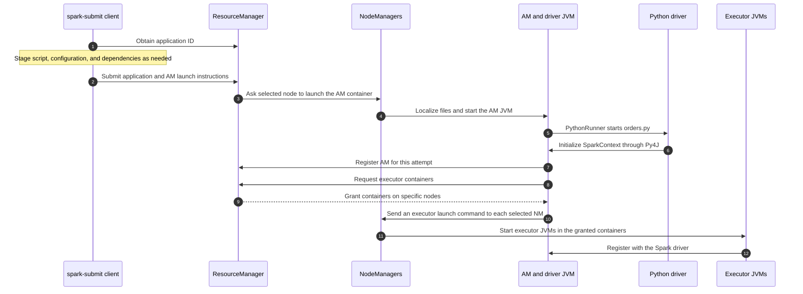
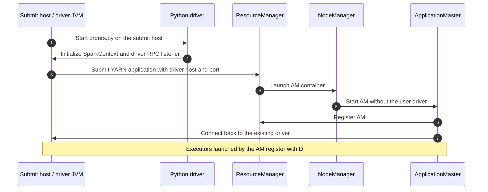
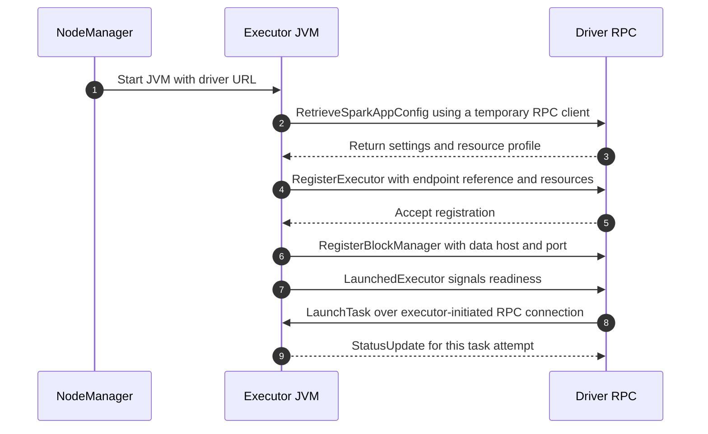
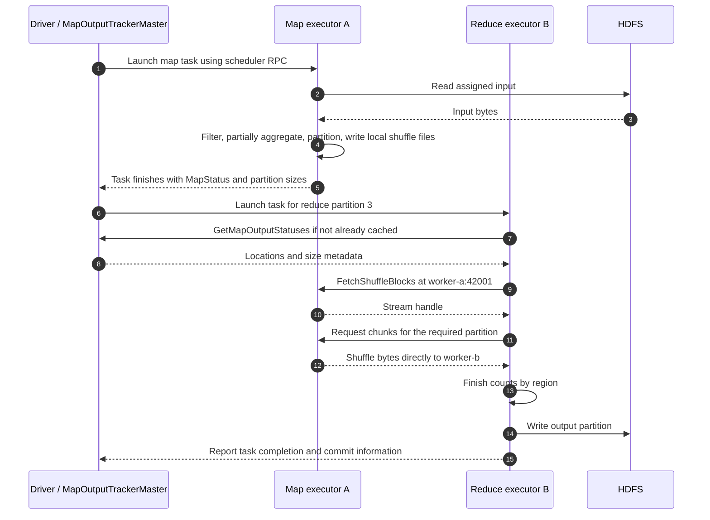
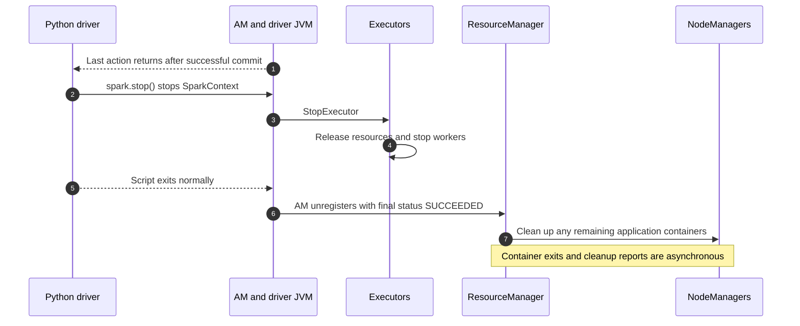

# PySpark on YARN: from `spark-submit` to the last shuffle block

YARN decides **where processes can run**. A NodeManager launches those processes.
The Spark driver decides **which tasks they run**. If executor B needs data produced
by executor A, the driver tells B what to run and where the data is; B fetches the
bytes from A's node. The ResourceManager does not relay tasks or shuffle data.

This guide traces a classic PySpark batch application, not Spark Connect. It covers
[startup](#startup-in-cluster-mode), [client mode](#what-changes-in-client-mode),
[discovery](#how-processes-find-each-other), [task execution](#from-a-dataframe-action-to-an-executor-thread),
[shuffle](#follow-one-shuffle-block), [ports](#protocols-and-listening-ports), and
[shutdown](#shutdown-failures-and-where-to-look). For individual troubleshooting
cases, see the companion [PySpark-on-YARN scenarios](pyspark-on-yarn-scenarios.md).
For the messages, state, and decisions each component owns, use the
[component design reference](pyspark-on-yarn-components/README.md).

## The application we will follow

```shell
export HADOOP_CONF_DIR=/etc/hadoop/conf
spark-submit --master yarn --deploy-mode cluster \
  --name paid-orders-by-region --queue analytics \
  --driver-memory 2g --driver-cores 1 --num-executors 3 --executor-cores 2 \
  --conf spark.dynamicAllocation.enabled=false orders.py --date 2026-11-24
```

```python
import argparse

from pyspark.sql import SparkSession

parser = argparse.ArgumentParser()
parser.add_argument("--date", required=True)
args = parser.parse_args()
spark = SparkSession.builder.getOrCreate()
try:
    orders = spark.read.parquet(f"hdfs:///warehouse/orders/date={args.date}")
    paid = orders.where("status = 'PAID'")
    counts = paid.groupBy("region").count()
    counts.write.parquet(f"hdfs:///reports/paid-orders-by-region/date={args.date}")
finally:
    spark.stop()
```

An **application** is the lifetime of this driver and its executors. A **job** is a
distributed computation within that application. A job has **stages**, separated by
dependencies such as shuffles. A **task attempt** is one attempt to compute a stage
partition, on an executor thread. It is not a new process or YARN container.

Once all resources are granted, this example has **four containers**: one for the
ApplicationMaster (AM) and three for executor JVMs. A YARN container is a resource
allocation on a node, not necessarily a Docker container. With one CPU per task and
no other constraint, the three two-core executors can run six tasks concurrently.
A 12-partition stage therefore takes at least two waves, not 12 containers.

## Startup in cluster mode



### What the two YARN launch requests carry

`org.apache.spark.deploy.SparkSubmit` runs on the submitting machine. For YARN
cluster mode it selects `YarnClusterApplication`, which runs Spark's YARN `Client`.
The client obtains an application ID and uploads the local `orders.py` to shared
storage, typically `.sparkStaging/<application-id>/` under the user's HDFS home.
If neither `spark.yarn.archive` nor `spark.yarn.jars` is set, Spark zips the JARs
from `$SPARK_HOME/jars` and stages the archive. The Spark YARN JAR contains
`ApplicationMaster`; it need not be preinstalled on each worker.

**Submit JVM → ResourceManager:** `ApplicationClientProtocol.submitApplication`.
This is a field-level view of the request for the example, not a wire dump:

```text
SubmitApplicationRequest
  applicationSubmissionContext: ApplicationSubmissionContext
    applicationId: <assigned by RM>
    applicationName: paid-orders-by-region
    applicationType: SPARK
    queue: analytics
    unmanagedAM: false
    resource: {memorySize: 2048 MiB + driver memory overhead, virtualCores: 1}
    amContainerSpec: ContainerLaunchContext
      commands: <AM launch command below>
      localResources:
        orders.py:      {resource: <staged URI>, type: FILE, size, timestamp, visibility}
        __spark_libs__: <Spark JAR archive; type ARCHIVE>
        __spark_conf__: <configuration archive; type ARCHIVE>
      environment:
        CLASSPATH: <includes __spark_libs__/*>
        PYTHONPATH: <localized Python dependencies>
        SPARK_YARN_STAGING_DIR: <application staging directory>
      tokens: <serialized Hadoop credentials>
      applicationACLs: <YARN view/modify settings>
```

`applicationType` labels the application; `commands` selects the program.
`spark.yarn.appMasterEnv.<NAME>` adds `<NAME>` to the AM environment.
If configured, `tokensConf` carries Hadoop settings matching `spark.yarn.am.tokenConfRegex`
for token renewal. The outer context can also specify tags, priority, attempt limits,
and log aggregation. With an AM node label, Spark sets `amContainerResourceRequests`
for one matching container instead of setting `resource` directly.

**ResourceManager → selected NodeManager:** after the grant, the RM's `AMLauncher`
calls `ContainerManagementProtocol.startContainers`. The NodeManager receives the
container launch context, **not** the whole application submission:

```text
StartContainersRequest
  startContainerRequests[0]: StartContainerRequest
    containerToken: <RM-issued authorization for this container on this node>
    containerLaunchContext: ContainerLaunchContext
      commands: <includes --primary-py-file orders.py>
      localResources: <includes orders.py -> staged URI>
      environment: <container environment>
      tokens: <credentials for the container to use>
      applicationACLs: <application access settings>
```

The filename travels **twice**, for different consumers: `localResources["orders.py"]`
tells the NodeManager what to fetch and which local name to expose;
`--primary-py-file orders.py` tells the AM which file to run. Neither RPC carries the
file bytes. On a cache miss the NodeManager gets block locations from the HDFS
NameNode and reads bytes from DataNodes. It unpacks archive resources and exposes
them in the container working directory; valid cached resources can be reused.

### Which JVM starts Python and initializes Spark?

The NodeManager launches Java with generated JVM options (including `-Xmx2048m`
here), container stdout/stderr redirection, and the following main class and
arguments. `$PWD` denotes the container working directory:

```text
org.apache.spark.deploy.yarn.ApplicationMaster
--class org.apache.spark.deploy.PythonRunner
--primary-py-file orders.py
--arg --date
--arg 2026-11-24
--properties-file $PWD/__spark_conf__/__spark_conf__.properties
--dist-cache-conf $PWD/__spark_conf__/__spark_dist_cache__.properties
```

1. Java invokes `ApplicationMaster.main()`. The AM reads `--class`; because
   `args.userClass != null`, it takes the `runDriver()` branch. A thread named
   `Driver` invokes `PythonRunner.main()` **in that same JVM**.
2. `PythonRunner` starts a separate Python process in the AM container, supplies
   the Py4J gateway connection information, and runs `orders.py --date 2026-11-24`.
3. On the first `SparkSession.builder.getOrCreate()`, the Python builder calls
   `SparkContext.getOrCreate()`. Py4J constructs a `JavaSparkContext` wrapping the
   JVM `SparkContext`. The context sets up `HeartbeatReceiver`, the schedulers, the
   YARN scheduler backend, the driver metrics system, and the listener bus.
4. `YarnClusterScheduler.postStartHook()` signals `ApplicationMaster.sparkContextInitialized(sc)`.
   The AM can now register with the RM (`registerApplicationMaster`), locate the
   driver endpoint, and start requesting executors **before `getOrCreate()` returns**.
5. The builder returns a Python `SparkSession` backed by a JVM SQL session.
   `spark.sparkContext` is the Python handle for the application-wide context.
   `spark.newSession()` creates separate SQL settings and temporary views, not a
   second context, executor fleet, JVM, or YARN application.

The submit client normally stays to report YARN status. With
`spark.yarn.submit.waitAppCompletion=false`, it can exit after submission; the
cluster-mode driver does not depend on it. Executor launches are asynchronous:
Spark need not wait for every requested executor before starting tasks.

## What changes in client mode?



With `--deploy-mode client`, the driver is already alive **before** YARN starts
the AM. The AM negotiates and launches executors but does not run the user script.
The submit host must stay alive and reachable from the cluster. YARN cannot restart
that external driver. A `print()` in the main script goes to the submit host in
client mode and to the AM container logs in cluster mode.

## How processes find each other

There is no cluster-wide search for Spark services. Each participant either starts
with configuration, receives an address from a participant it already knows, or
registers itself.

| Discovery question | Source of the address |
|---|---|
| How does the submit client find YARN? | `--master yarn` selects the manager, not a host. `HADOOP_CONF_DIR` or `YARN_CONF_DIR` points to the Hadoop client configuration. The JVM's YARN client reads `yarn-site.xml`; `yarn.resourcemanager.address` is the submission endpoint. Spark makes the configuration available to its YARN containers too. |
| Which RM is active? | In a single-RM setup, `yarn.resourcemanager.hostname=rm01.example.net` supplies the default host for the RM services unless their addresses are overridden. In HA, `yarn.resourcemanager.ha.rm-ids` and per-RM hostnames or service addresses list candidates. The YARN failover client tries configured RMs until it reaches the active one. DNS resolves names; it does not elect the active RM. |
| How does the RM know which workers exist? | Each NM registers its `NodeId` and resources with the RM and continues to heartbeat. This happens independently of any Spark application. |
| How does the AM find the right NM? | The RM's container grant identifies the assigned node and its NM RPC address. That address belongs to the **NM**; the executor may not exist yet. |
| How does the AM find the driver? | In cluster mode it obtains the advertised host and actual bound port from the local driver context. In client mode the submit-side scheduler backend passes the already-listening driver's `host:port` in the AM launch arguments. |
| How does an executor find the driver? | Its launch command includes `--driver-url`, for example `spark://CoarseGrainedScheduler@driver-1.example.net:41000`. The AM constructs that URL. `CoarseGrainedScheduler` names a handler in the driver JVM; `41000` is an example runtime port. |
| How does the driver find executors? | **Executors call the driver.** Each sends `RegisterExecutor` with its ID, host, resources, and RPC endpoint reference. The driver records accepted executors. It does not ask YARN for a static executor list. |
| How does a process find another process's data? | A separate `RegisterBlockManager` advertises a data address such as `BlockManagerId(7, worker-a, 42001, ...)`. For shuffle, the driver tracks map-output locations and gives that metadata to reducers. |

The difference is observable: YARN can show allocated containers while Spark shows
zero registered executors. For example, a client-mode driver advertising `localhost`
tells each executor to contact **its own** loopback interface. `spark.driver.host`
must advertise a worker-reachable address; `spark.driver.bindAddress` controls
where the driver listens locally.

## From a DataFrame action to an executor thread

In `orders.py`, `groupBy("region").count()` builds an **aggregated DataFrame**.
It is the write that requires its contents. In contrast, `orders.count()` is an
action that returns a number to Python. Do not assume one source-code action
always equals one Spark job: file discovery, subqueries, or adaptive query
execution can produce additional jobs.

| Component | Responsibility |
|---|---|
| Spark SQL planner, driver JVM | Optimizes the logical DataFrame operations and chooses a physical plan. In this example the same region's records generally have to meet across partitions. |
| `DAGScheduler`, driver JVM | Pipelines operations that can run together and submits ready stages as task sets. |
| `TaskSchedulerImpl` / `TaskSetManager`, driver JVM | Match pending task attempts to available CPU and other resources, taking locality and scheduling policy into account. |
| `CoarseGrainedSchedulerBackend`, driver JVM | Tracks registered executors and free resources, creates internal `WorkerOffer`s, and sends serialized `TaskDescription`s to the chosen executor endpoints. A worker offer is an in-driver object, **not a YARN allocation request**. |
| `CoarseGrainedExecutorBackend` and `Executor`, executor JVM | Receive `LaunchTask`, decode the task description, run the attempt on the executor thread pool, and report status. |
| `YarnSchedulerBackend` / `YarnAllocator`, driver / AM | Adjust **executor capacity** rather than dispatching tasks. With dynamic allocation, the driver monitors backlog and idle executors; the AM negotiates changes with YARN. |

**Coarse-grained** means an executor retains its allocation across tasks, not that
a whole stage must execute on one machine. The wire-level handoff looks like this:



Modern Spark's executor scheduler RPC environment operates in client mode. The
driver can send `LaunchTask` back using the executor-initiated connection; it need
not dial a fixed executor scheduler port. The executor's **block-transfer server**,
on the other hand, must accept inbound data connections. `RpcEnv` dispatches
messages to named endpoints such as `CoarseGrainedScheduler`, `HeartbeatReceiver`,
`BlockManagerMaster`, and `MapOutputTracker`. These are not four listening ports.
Calls within the same RPC environment can be dispatched without TCP.

### When a Python closure is shipped

The built-in filter on `orders` is a SQL expression, not a Python closure. For
contrast, the following alternative uses a Python RDD function:

```python
def matches_status(target):
    return lambda row: row.status == target

paid_count = orders.select("status").rdd.filter(matches_status("PAID")).count()
```

The lambda and the `target` binding it uses (`"PAID"`) form the closure. The
**running Python driver**, not `spark-submit`, serializes the Python command with
`CloudPickleSerializer` in `_prepare_for_python_RDD`. Above the broadcast threshold,
PySpark broadcasts the serialized bytes and ships a reference. An executor-side Python
worker deserializes the function and applies it to its partition; it does not rerun
`orders.py` or create a `SparkContext`. The final count returns to Python as an integer.
Mutating a captured list does not change the driver's list. Capturing a driver-only
object such as the context can fail serialization before a task runs. A retried
partition may execute the closure again: key external writes by logical record,
not task attempt, if repeated writes must have the same effect.

## Follow one shuffle block

Suppose executor A on `worker-a` produced data needed by executor B's reduce
partition 3. The diagram shows a cross-host, pull-based shuffle without an external
shuffle service; `42001` is A's **example data port**.



The map and reduce lanes are roles, not dedicated executor pools. The same
executor may run both kinds of tasks. A successful write returns to Python after
the sink's commit completes; the output rows do **not** travel through the driver.

| Component | What it knows or serves |
|---|---|
| `MapOutputTrackerMaster` / `MapOutputTrackerWorker` | The driver records which map outputs exist, their serving locations and partition sizes. Reducers fetch and cache this metadata rather than asking the driver about every block or row. |
| `BlockManagerMaster` | The driver's directory of registered block managers and locations of reported storage blocks, such as cached RDD partitions. It does not proxy the contents of those blocks. |
| `BlockManager` / `NettyBlockTransferService` | Each executor and the driver have local block storage and a transfer listener. Cached partitions, broadcast pieces, or task-result blocks can be served from here. For shuffle, the shuffle writer, reader, and resolver manage the files; the remote fetcher connects to the advertised serving address. |
| External shuffle service (optional) | With this enabled on YARN, B normally fetches shuffle data from an NM auxiliary service on A's node, not from A's executor port. The service can serve existing files after A exits as long as the node and files survive. Local reads can avoid a network transfer altogether. |

Two exceptions help distinguish the paths:

- **Python execution:** Py4J connects the Python driver to its **local** JVM. A
  Python UDF or Python RDD function runs in a separate **local executor-side Python
  worker**, using a local socket and Python serialization or Arrow batches as
  appropriate. Workers can be reused; they do not rerun `orders.py`. The built-in
  filter and aggregation above need no per-row Python worker.
- **Results sent to the driver:** A small task result can go inside `StatusUpdate`.
  For a larger permissible result, the executor stores a `TaskResultBlock` and sends
  a reference; the driver fetches it from the executor's block-manager port.
  `collect()` deliberately brings rows to the driver, unlike writing a dataset.

## Protocols and listening ports

These are **destination** ports. The YARN/HDFS defaults below are for upstream
Hadoop 3.4.1; deployments can override them. **Dynamic** means the service binds
an available port and advertises the result. It does not mean peers guess it.

| Initiator -> listener | Default destination / setting | Protocol and use |
|---|---|---|
| Submission client -> RM | `8032`, `yarn.resourcemanager.address` | Hadoop RPC, `ApplicationClientProtocol`: obtain application ID, submit, query status. |
| AM -> RM | `8030`, `yarn.resourcemanager.scheduler.address` | Hadoop RPC, `ApplicationMasterProtocol`: register, `allocate()`/heartbeat, receive grants and completion reports, release resources, unregister. |
| NM -> RM | `8031`, `yarn.resourcemanager.resource-tracker.address` | Hadoop RPC, `ResourceTracker`: node registration, health and container status. |
| RM or AM -> NM | Dynamic (`hostname:0`), `yarn.nodemanager.address` | Hadoop RPC, `ContainerManagementProtocol`: launch the AM or executor container. **Not** the NM web UI port. |
| Executor or client-mode AM -> driver | Dynamic, `spark.driver.port` | Spark RPC over Netty/TCP: endpoint lookup, registration, task control, heartbeats and metadata. The channel also carries messages back to the executor. |
| Driver or executor -> peer block manager | Dynamic, `spark.blockManager.port`; override on driver with `spark.driver.blockManager.port` | Spark block-transfer protocol over Netty/TCP: cached blocks, broadcast pieces, indirect results, and shuffle when the executor serves it. |
| Reducer -> optional external shuffle service | `7337`, `spark.shuffle.service.port` | Spark shuffle/block-transfer protocol. This listener is distinct from NM container-management RPC. |
| HDFS client -> NameNode / DataNode | NameNode RPC configured, often `8020`; DataNode transfer `9866`, `dfs.datanode.address` | Hadoop RPC for namespace and block metadata; HDFS `DataTransferProtocol` for file bytes. An HDFS input block is not a Spark shuffle block. |
| Python driver <-> driver JVM; executor JVM <-> Python worker | Local, normally dynamically selected loopback ports; worker paths may use Unix-domain sockets where supported | Py4J for driver API calls; local Python worker protocol for partition data. Neither is an inter-node task protocol. |
| Browser -> Spark UI / History Server / RM UI / NM UI | `4040` / `18080` / `8088` / `8042` | HTTP, or HTTPS if configured. These are observation endpoints, not scheduler or data ports. |

YARN's RPC interfaces normally use Protocol Buffers over Hadoop IPC/TCP. Spark
RPC and Spark block transfer are distinct Spark protocols, both implemented using
Netty. Neither is REST or Spark Connect gRPC. `7077` is the Spark **Standalone**
master port, not a Spark-on-YARN submission or driver port.

## Who starts, monitors, and stops each component?

| Component | Who starts it? | Who monitors it? | Who stops it? |
|---|---|---|---|
| RM | Cluster service manager | Cluster monitoring and HA infrastructure, if configured | Operator/service manager; one Spark application never stops it. |
| NM | Cluster service manager on each worker | RM tracks node heartbeats | Operator/service manager; it remains after the app ends. |
| `spark-submit` | User or workflow scheduler | Calling shell or orchestrator can observe exit status | In cluster mode it exits after submission or completion according to configuration. In client mode the submit-side process hosts the driver JVM. |
| AM, one per application attempt | NM at the RM's request | NM monitors the container; RM monitors AM registration and heartbeats | Normally unregisters and exits; YARN can terminate its container. |
| Driver JVM / `SparkContext` | Cluster: hosted in AM JVM. Client: submit-side JVM. The application initializes the context. | Cluster: shares AM/container liveness. Client: external launcher owns the process; AM can detect a disconnect. | `spark.stop()` stops the context, not the Python interpreter. JVM exits when its owning application/launcher finishes. |
| Python driver | JVM `PythonRunner` starts the interpreter | `PythonRunner` waits for the exit code | Script returns, raises an uncaught exception, or is forcibly terminated. |
| Executor JVM | Selected NM at the AM's request | Driver receives heartbeats and task status; NM monitors the process and configured resource limits. AM receives container outcomes through the RM. | Driver requests a graceful stop; allocation changes, preemption, or YARN cleanup can also remove it. |
| Python worker | Executor's worker factory, directly or through a local daemon | Executor detects worker exit or broken communication. Its memory is part of the executor container's usage. | Executor reuses or retires it; executor/container cleanup removes remaining workers. |
| Task attempt | Driver schedules it; executor starts it on a thread | Executor reports status to driver's task scheduler | Completes, fails, or is cancelled by Spark. YARN does not manage individual tasks. |

### Three heartbeat paths during execution

| Sender → receiver | Message | Cadence |
|---|---|---|
| Executor JVM → driver JVM | Spark RPC `Heartbeat`: executor liveness, running-task counters, and executor metric peaks. | `spark.executor.heartbeatInterval`, default **10 s**, even if no task is running. |
| AM → RM | YARN `ApplicationMasterProtocol.allocate`: negotiates containers and receives grants and completions; no Spark task metrics. | `spark.yarn.scheduler.heartbeat.interval-ms`, default **3 s**, capped at half YARN's AM expiry interval. For pending allocations it can start at `spark.yarn.scheduler.initial-allocation.interval` (**200 ms**) and back off. |
| NM → RM | YARN `ResourceTracker.nodeHeartbeat`: machine health and container status across applications. | Controlled by YARN, independently of the Spark heartbeat. |

```text
Heartbeat
  executorId
  accumUpdates: task attempt ID -> accumulator updates for that running task
  blockManagerId
  executorUpdates: (stage ID, stage attempt ID) -> sampled executor metric peaks
HeartbeatResponse
  reregisterBlockManager: whether the executor should re-register its block manager
```

Shuffle-read counters and JVM GC time can arrive before a long task finishes.
`spark.executor.metrics.pollingInterval=0` samples executor metrics such as heap usage
on the heartbeat. A positive value enables separate sampling, not faster heartbeats.
On receipt the driver updates last-seen time and posts live metric updates through
the scheduler and listener bus. A short task can finish between heartbeats: **its
result and final metrics use task completion, not `Heartbeat`**. A periodic check
expires executors silent beyond the effective timeout (normally `spark.network.timeout`,
default **120 s**); a single missed heartbeat is not itself grounds for removal.

## Shutdown, failures, and where to look



Finishing a **job** does not stop the **application**: executors can run the next
job. In the normal cluster-mode path above, the Python process can still execute
ordinary Python after `spark.stop()`. Spark also has JVM shutdown hooks for
normal exit. YARN typically reports state `FINISHED` and final status `SUCCEEDED`;
those are separate fields. The cluster's RMs, NMs, storage services, and any
node-level shuffle services continue running.

During `SparkContext.stop()`, the context posts its application-end event, stops
the UI and schedulers, requests executor shutdown, and closes the listener, metrics,
event-log, and heartbeat services. This gives the event logger a chance to finish;
a hard crash need not leave a final event. `PythonRunner` waits for the script's exit.
The AM reports the final outcome through `finishApplicationMaster`. Spark normally
deletes its staging directory, not the user's output; `spark.yarn.preserve.staging.files`
can preserve it, and a failed non-final attempt can leave it for the next AM.

| Event | Who recovers, and what is retried? |
|---|---|
| Task raises or its executor-side Python worker crashes | The executor reports the failure. For ordinary tasks, `spark.task.maxFailures=4` means four counted consecutive failures of the **same task** (three retries). Exhaustion fails the job, not necessarily the driver if the script handles the exception. Inspect the failed task and executor stderr. |
| Executor or node is lost | The driver reschedules unfinished tasks; the AM can request replacement capacity. Lost cached RDD partitions can be rebuilt from lineage if inputs survive. Infrastructure loss need not count as an application-caused task failure. Check the YARN container diagnostics for memory limits or preemption. |
| Reducer cannot fetch shuffle output | `DAGScheduler` can invalidate missing map output, rerun its producers, and retry the consuming stage; `spark.stage.maxConsecutiveAttempts` defaults to 4. Executor loss alone need not lose shuffle files if an external shuffle service still serves them. |
| Python **driver process** exits nonzero | The AM JVM may still be alive: `PythonRunner` observes the exit, throws `SparkUserAppException`, and the AM marks the attempt failed. Look in AM container stderr for the original Python error. This is not a retry of one task. |
| Cluster-mode **AM JVM** or its node crashes | The JVM-side driver is gone too. If eligible, YARN launches a new attempt under the same application ID and a new attempt ID. A fresh driver runs the script from its entry point. `spark.yarn.maxAppAttempts` is subject to `yarn.resourcemanager.am.max-attempts`; it does not increase task retries. A retried script can encounter output already committed by an earlier attempt. |
| Client-mode driver dies | YARN cannot recreate the external driver. Inspect submit-host logs as well as the AM's diagnostics. |
| User kills the application | `yarn application -kill <application_id>` terminates the YARN application and its managed containers. Cancelling one Spark job is different and need not end the application. |

Use the symptom to choose the first place to look:

| What you see | Where to look first |
|---|---|
| Application stuck before the AM runs | `yarn application -status <application_id>`: inspect queue/resources, attempt state, and diagnostics. |
| Containers allocated but no registered executors | Executor launch logs and the advertised `spark://CoarseGrainedScheduler@host:port`. Verify the driver name and port are reachable from workers. |
| Map tasks finish; reducers report `FetchFailed` | The producer host and **data port** in the error, its shuffle files, and the executor or external shuffle service that should be serving them. Reaching the Spark UI proves nothing about this path. |
| YARN says `RUNNING`, but no Spark job is active | Open the live Spark UI's SQL, Jobs, Stages, and Executors tabs. YARN reports application-attempt state; the driver may not have submitted an action yet. |
| Need evidence after completion | Use `yarn applicationattempt -list <application_id>` to locate the first failing attempt. `yarn logs -applicationId <application_id>` reads available container logs if aggregation is enabled. The Spark History Server reconstructs the UI from Spark events if `spark.eventLog.enabled` was set and the directory is accessible. `spark.eventLog.logStageExecutorMetrics=true` also persists per-stage executor metric peaks, not every heartbeat. |

## Primary references

For the detailed launch, closure, and recovery paths in the [Spark checkout used for the scenarios](https://github.com/apache/spark/tree/dada2a6db5d73b152d6ba16e4fe21406f86abfe3), look for:

| Source | Methods or messages |
|---|---|
| YARN `Client.scala`, `ApplicationMaster.scala`, `YarnClusterScheduler.scala`, `YarnAllocator.scala` | `prepareLocalResources`, `createContainerLaunchContext`, `createApplicationSubmissionContext`, `runDriver`, `postStartHook`, `allocateResources`, `finish`, `unregister`. |
| `python/pyspark/sql/session.py`, `python/pyspark/core/context.py`, JVM `SparkContext.scala` | `getOrCreate`, `_initialize_context`, `newSession`, and `SparkContext.stop`. |
| `python/pyspark/core/rdd.py`, `python/pyspark/worker.py` | `_wrap_function`, `_prepare_for_python_RDD`, `read_command`, and partition-function execution. |
| `Executor.scala`, `HeartbeatReceiver.scala`, `DAGScheduler.scala`, `EventLoggingListener.scala` | `reportHeartBeat`, `expireDeadHosts`, `executorHeartbeatReceived`, `onExecutorMetricsUpdate`. |
| `TaskSetManager.scala`, `DAGScheduler.scala` | `handleFailedTask`, `FetchFailed` handling, and `resubmitFailedStages`. |

- [Spark on YARN](https://spark.apache.org/docs/latest/running-on-yarn.html), [cluster overview](https://spark.apache.org/docs/latest/cluster-overview.html), [networking configuration](https://spark.apache.org/docs/latest/configuration.html#networking), and [monitoring](https://spark.apache.org/docs/latest/monitoring.html).
- [Hadoop YARN application protocols](https://hadoop.apache.org/docs/r3.4.1/hadoop-yarn/hadoop-yarn-site/WritingYarnApplications.html), [ResourceManager HA and client failover](https://hadoop.apache.org/docs/r3.4.1/hadoop-yarn/hadoop-yarn-site/ResourceManagerHA.html), and [YARN default addresses](https://github.com/apache/hadoop/blob/rel/release-3.4.1/hadoop-yarn-project/hadoop-yarn/hadoop-yarn-common/src/main/resources/yarn-default.xml).
- Spark source: [ApplicationMaster](https://github.com/apache/spark/blob/v4.0.1/resource-managers/yarn/src/main/scala/org/apache/spark/deploy/yarn/ApplicationMaster.scala), [executor launch command](https://github.com/apache/spark/blob/v4.0.1/resource-managers/yarn/src/main/scala/org/apache/spark/deploy/yarn/ExecutorRunnable.scala), and [Python driver launcher](https://github.com/apache/spark/blob/v4.0.1/core/src/main/scala/org/apache/spark/deploy/PythonRunner.scala).
- Spark source: [driver scheduler backend](https://github.com/apache/spark/blob/v4.0.1/core/src/main/scala/org/apache/spark/scheduler/cluster/CoarseGrainedSchedulerBackend.scala), [executor backend](https://github.com/apache/spark/blob/v4.0.1/core/src/main/scala/org/apache/spark/executor/CoarseGrainedExecutorBackend.scala), [BlockManager](https://github.com/apache/spark/blob/v4.0.1/core/src/main/scala/org/apache/spark/storage/BlockManager.scala), [MapOutputTracker](https://github.com/apache/spark/blob/v4.0.1/core/src/main/scala/org/apache/spark/MapOutputTracker.scala), and [remote shuffle block fetcher](https://github.com/apache/spark/blob/v4.0.1/common/network-shuffle/src/main/java/org/apache/spark/network/shuffle/OneForOneBlockFetcher.java).
